<p align="center">
  <picture>
    <source media="(prefers-color-scheme: dark)" srcset="assets/fspec-readme-intro.svg">
    <source media="(prefers-color-scheme: light)" srcset="assets/fspec-readme-intro-light.svg">
    
  </picture>
</p>

<h1 align="center">Specifications in. Software out.</h1>

<p align="center"><strong>A spec-driven, multi-agent development environment for your terminal.</strong></p>

<p align="center">
  <a href="#get-started">Get started</a> ·
  <a href="#the-workflow">The workflow</a> ·
  <a href="#use-your-existing-agent">External agents</a> ·
  <a href="#documentation">Documentation</a> ·
  <a href="https://github.com/sengac/fspec/releases">Releases</a>
</p>

fspec brings AI coding agents, a live Kanban board, and executable specifications into one workspace. Capture what you want to build, turn examples into Gherkin acceptance criteria, and track the work from specification through tests, implementation, and review.

Use it as a complete terminal coding environment or as a command-line toolkit for the agent you already use. The native application is written in Rust and ships as a single binary.

## What you can do

- **Run multiple agents.** Work on separate jobs, delegate to worker sessions, search previous conversations, and use read-only research agents to investigate a question.
- **Keep requirements beside the code.** Store project foundations, work units, Example Mapping, domain models, Gherkin features, and coverage links in your repository.
- **Make progress visible.** Follow stories, bugs, dependencies, and blockers on the board. Split the terminal into live board, agent, changed-file, and checkpoint panes.
- **Connect specs to implementation.** Link scenarios to tests and implementation locations, audit the links, and apply workflow gates as work advances.
- **Choose how agents work.** Configure providers and models, use separate Git worktrees, connect MCP tools, and set command and file-access rules.
- **Keep the work running elsewhere.** Host sessions in a daemon and attach terminal clients, or use the separate Telegram bridge for remote interaction.

## Get started

### 1. Install

Download a prebuilt binary from [GitHub Releases](https://github.com/sengac/fspec/releases), or use the installer for your platform. A Rust toolchain is not required for prebuilt binaries.

**macOS / Linux**

```bash
curl -fsSL https://raw.githubusercontent.com/sengac/fspec/main/scripts/install.sh | bash
```

**Windows PowerShell**

```powershell
powershell -ExecutionPolicy ByPass -c `
  "irm https://raw.githubusercontent.com/sengac/fspec/main/scripts/install.ps1 | iex"
```

These commands download and execute an installation script. You can inspect [the shell installer](scripts/install.sh) or [the PowerShell installer](scripts/install.ps1) first. The default installation directory is `~/.local/bin` on macOS/Linux or `%USERPROFILE%\.local\bin` on Windows; ensure it is on your `PATH`.

See [Windows troubleshooting](docs/WINDOWS.md) for platform-specific setup and [building from source](#build-and-contribute) for a local build.

### 2. Open your project

```bash
cd /path/to/your/project
fspec
```

The default mode opens the terminal UI and runs the local service in the same process. Start in the repository you want the agents to work on.

### 3. Start an agent and choose a model

From the board, press **`.`** to start an agent. Choose **Normal** to work in the current project or **Isolated** to use a separate Git worktree.

In the agent conversation, use:

```text
/provider
/model
```

Configure your provider credentials or sign-in, then select a model. Supported integrations include Anthropic, Codex (ChatGPT), Gemini, GitHub Copilot, OpenRouter, and others. OpenAI-compatible server profiles support endpoints such as Ollama and vLLM. See [provider configuration](docs/PROVIDERS.md) for the current options and authentication requirements.

Provider usage is subject to the provider's pricing and terms. Check those terms before using subscription credentials with third-party tools.

### 4. Give it a job

You can chat directly with an agent to investigate, code, review, or debug. To use the specification-driven workflow, start with a request like:

```text
Help me set up fspec for this project. Discover its foundation,
then create a story for password reset. Ask me about the rules
and edge cases before writing the acceptance criteria.
```

The agent uses fspec's commands to capture the project foundation and create work units. Review the requirements with it, then select a card on the board and press **Enter** to start working on that job.

## The workflow

fspec uses **Acceptance Criteria Driven Development (ACDD)**: agree on the behavior, write tests for it, then implement it.

```text
backlog → specifying → testing → implementing → validating → done
```

1. **Discover the intent.** Capture the project's vision and capabilities. Use Example Mapping to record rules, concrete examples, and unanswered questions. Event Storming supports domain events, commands, aggregates, policies, and bounded contexts.
2. **Specify the behavior.** Turn the agreed examples into Gherkin scenarios with concrete Given/When/Then steps.
3. **Write the tests.** Create tests for those scenarios and establish the failing behavior before implementation.
4. **Implement and validate.** Make the tests pass, link the implementation, run the project's checks, and review the result.

Stories and bugs follow the testing phase. Operational **tasks** skip that phase. Work can enter **blocked** with a reason, and unresolved blocking dependencies prevent it from starting.

Status transitions enforce checks for the applicable work type and phase, including specification readiness, test/implementation mappings, temporal ordering, and audits. Lifecycle hooks add project-specific checks. Configure the project's actual test and quality commands with `fspec configure-tools`.

These checks support a disciplined process; they do not prove that a test is sufficient or that an implementation is correct. Review the acceptance criteria, test results, and code before shipping.

### A small CLI example

After completing foundation discovery, run this from your project root to create a namespace and capture the start of a story. Creating a story requires `spec/foundation.json`; if it is missing, ask your agent to run `fspec discover-foundation`, complete the guided fields, and finalize the foundation first:

```bash
fspec create-prefix AUTH "Authentication"
fspec create-story AUTH "Reset a forgotten password"
```

Use the work-unit ID returned by `create-story` in the following commands. In a fresh namespace, that is `AUTH-001`:

```bash
fspec update-work-unit-status AUTH-001 specifying
fspec set-user-story AUTH-001 \
  --role "account holder" \
  --action "reset my password" \
  --benefit "regain access to my account"

fspec add-rule AUTH-001 "A reset link can be used only once"
fspec add-example AUTH-001 "Using an already-consumed link is rejected"
fspec show-work-unit AUTH-001
```

Continue discovery with your agent before moving the card through the workflow. `fspec generate-scenarios AUTH-001` creates a feature **scaffold containing discovery context**, not finished acceptance scenarios. The agent still needs to write and review the scenarios and steps.

For example, the agreed behavior might become:

```gherkin
Scenario: A password reset link cannot be reused
  Given a password reset link has already been used
  When the account holder submits a new password with that link
  Then the password is not changed
  And the account holder is asked to request a new reset link
```

Use `fspec validate`, `fspec audit`, and `fspec show-coverage` to inspect specification health and traceability. Run `fspec <command> --help` for command-specific arguments, or `fspec bootstrap` for the complete agent workflow guide.

### What lives in your repository

| Location | Purpose |
| --- | --- |
| `spec/foundation.json` | Project vision, personas, capabilities, and domain context |
| `spec/FOUNDATION.md` | Human-readable foundation generated from the JSON source |
| `spec/work-units.json` | Work units, workflow state, and discovery data |
| `spec/features/*.feature` | Gherkin acceptance criteria |
| `spec/features/*.feature.coverage` | Scenario-to-test-to-implementation mappings |
| `spec/fspec-config.json` | Project configuration, including test and quality commands |
| `spec/attachments/` | Supporting material attached to work units |

Coverage mappings record relationships; they are not a replacement for executing tests or measuring runtime code coverage.

## Run a software factory

### Parallel agents and shared context

Agents can delegate work through **AgentManager**, retrieve previous decisions with **SessionSearch**, and use **DeepSearch** for scoped, read-only research. Each has a different purpose: persistent workers do work, history search recalls context, and research agents answer focused questions. See [scaling work](docs/SCALING.md).

Use **Isolated** sessions when agents need independent working directories. Git worktrees separate changes, but they are not security sandboxes. Review changes and resolve conflicts before bringing them back with `/merge-worktree`. See [worktrees](docs/WORKTREES.md).

### See several views at once

Use `/mux` to configure a split layout containing the board, agent sessions, changed files, and checkpoints. Drag dividers to resize panes; **Shift+Left/Right** moves focus between panes in mux mode. Keyboard input goes to the focused pane. See [multiplexing](docs/MULTIPLEXING.md).

### Attach to a running daemon

Run the service separately from its frontend:

```bash
# On the machine hosting the project:
fspec daemon --bind 127.0.0.1:3777

# In another terminal:
fspec client --connect ws://127.0.0.1:3777
fspec status --connect ws://127.0.0.1:3777
```

For another machine, use an authenticated tunnel or the documented TLS/token configuration. Do not expose an unauthenticated daemon port. See [client/server operation](docs/CLIENT_SERVER.md) for transport, discovery, and remote access.

The [Telegram bridge](docs/TELEGRAM.md) is a separate Node.js sidecar with its own protocol, not another daemon client.

## Use your existing agent

Keep using Claude Code, Codex, Cursor, or another shell-capable coding agent. fspec can supply the workflow and CLI without replacing its interface.

```bash
cd /path/to/your/project
fspec init
```

The interactive selector installs the chosen agent's workflow documentation and activation command. For scripted setup, specify the agent:

```bash
fspec init --agent=claude
# Or:
fspec init --agent=codex
```

Activate `/fspec` in Claude Code or `/prompts:fspec` in Codex. The installed command loads `fspec bootstrap`, after which the agent can manage specifications and work units through the CLI. See [external-agent setup](docs/EXTERNAL.md).

For MCP hosts, `fspec client --mcp` exposes service tools over stdio through the frontend. Full RPC access requires a matching daemon. Read [MCP service access](docs/CLIENT_MCP.md) for compatibility, transport restrictions, and authorization boundaries before connecting a host.

## Safety and control

**Agents execute with the filesystem, shell, and network access of the account running fspec.** Use an OS/container sandbox when you need a real isolation boundary.

- **Command and file rules:** block, allow, or prompt for matching operations. See [blocklist configuration](docs/BLOCKLIST.md).
- **Checkpoints:** inspect and restore saved project states. Checkpoints and worktrees help manage changes; neither replaces backups or review.
- **Private diagnostics:** conversation and tool payloads are omitted from diagnostic logs by default. See [logging and retention](docs/PRIVACY_LOGGING.md) before enabling payload diagnostics.
- **Remote access:** protect daemon connections and credentials. See [security recommendations](docs/SECURITY.md) and [daemon transport](docs/CLIENT_SERVER.md).

## Update

```bash
fspec update --check
fspec update
```

The check reports whether an update is available. The updater downloads the matching release asset, verifies its digest, and replaces the installed binary in place. Restart after updating. Inside the TUI, use `/update check` or `/update`.

## Build and contribute

The main application is a Cargo workspace under `rust/`. You need Rust via rustup, a native compiler/linker toolchain, and the Protocol Buffers compiler (`protoc`) at build time.

```bash
git clone https://github.com/sengac/fspec.git
cd fspec
./scripts/build.sh
./rust/target/release-slim/fspec --version
```

Use `./scripts/build-install.sh` to build and install locally. Windows build scripts, packaging, and cross-compilation instructions are in [BUILD.md](docs/BUILD.md).

The CLI and agent-facing tools share command implementations in `rust/fspec-core/`. The terminal interface lives in `rust/fspec-tui/`; agent execution, sessions, providers, tools, graphs, and RPC are separate workspace crates.

Read [AGENTS.md](AGENTS.md) and [the testing guide](docs/TESTING.md) before contributing. Follow specification → failing tests → implementation for behavior changes. Keep tests scoped to the affected package and target:

```bash
cd rust
cargo check -p codelet-fspec
cargo test -p codelet-fspec --test no_napi_dependency
```

Do not run unscoped `cargo test` or `cargo test --workspace`: this workspace's integration-test binaries can consume substantial disk space and memory.

## Documentation

- **Set up:** [Providers](docs/PROVIDERS.md) · [Build](docs/BUILD.md) · [Windows](docs/WINDOWS.md) · [External agents](docs/EXTERNAL.md)
- **Work in parallel:** [Scaling](docs/SCALING.md) · [Multiplexing](docs/MULTIPLEXING.md) · [Worktrees](docs/WORKTREES.md)
- **Connect:** [Client/server](docs/CLIENT_SERVER.md) · [MCP service access](docs/CLIENT_MCP.md) · [Telegram](docs/TELEGRAM.md)
- **Operate safely:** [Security](docs/SECURITY.md) · [Blocklists](docs/BLOCKLIST.md) · [Diagnostic privacy](docs/PRIVACY_LOGGING.md)
- **Develop:** [Contribution guidelines](AGENTS.md) · [Testing](docs/TESTING.md) · [Formal verification](docs/FORMAL_VERIFICATION.md)

## License

[MIT](LICENSE).
