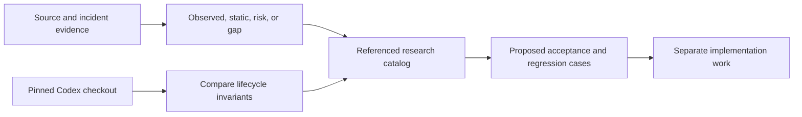

# Compaction bug research

Research date: **2026-10-17**. Documentation only; no fixes or reproductions run.
The repair direction retains the [research-backed DAG](../future-state/05-research-foundation.md)
and removes **all fallbacks**, including automatic transport/replay degradation.
CB-28 records this latest policy; descriptions of existing fallback behavior below
are evidence, not permission to keep it.

## Baselines and reading order

- fspec: `28d8e812ef4269d46b25f517574501902836902b`, inspected in this repository.
- Upstream Codex: `bb64b894fd67158be0f874872e6d7bfe717e7368`, inspected read-only
  in `/tmp/codex` (`/private/tmp/codex` on this machine), clean working tree.
- Upstream commit date: 2026-10-15; subject: “Retire worktree and voice feature
  flags (#54175)”. References are pinned to this revision, not upstream HEAD.

| Document | Scope |
| --- | --- |
| [Runtime and concurrency](01-runtime-and-concurrency.md) | Acknowledgement/application gap, locks, stale pins, watchdog, escalation |
| [Persistence and retrieval](02-persistence-and-retrieval.md) | Missing commit, resume filtering/replay, search, manifest risks |
| [Accounting and presentation](03-accounting-and-presentation.md) | Overlap, missing cache, mixed bases, stale headers, settlement |
| [Builders and convergence](04-builders-and-convergence.md) | Validation, coordinate systems, budgets, file awareness, thresholds |
| [Codex-specific findings](05-codex-specific-findings.md) | Usage, continuations, diagnostics, native lifecycle gaps, replay boundary |
| [Upstream Codex contract](06-upstream-codex-contract.md) | Actual local/remote-v2 implementation, installation, replay, transport |
| [Verification priorities](07-verification-priorities.md) | Proposed regression cases and repair dependencies |
| [No-fallback removal plan](08-no-fallback-removal-plan.md) | CB-28 inventory, typed failure requirements and negative regressions |

IDs below are **research-local labels**, not newly registered fspec work units.
Priority is triage judgment, not a measured incident frequency or CVSS rating.

## Evidence and priority

- **Observed + static:** incident logs show an outcome; current source explains
  a compatible sequence. Historical executable identity is not established.
- **Static defect:** executable source violates the stated lifecycle/data contract.
  A concurrency manifestation may still require a particular interleaving.
- **Conditional risk:** source establishes a hazardous boundary; runtime/provider
  conditions and actual impact remain unmeasured.
- **Capability gap:** missing functionality or stronger invariant, not necessarily
  a defect in a supported/default configuration.
- **P0:** session availability or active-context safety; **P1:** durable context,
  guards or convergence; **P2:** observability/configuration/secondary behavior.

## Catalog

| ID | Finding | Evidence | Triage | Detail |
| --- | --- | --- | --- | --- |
| CB-01 | Tool success precedes effective summary application | Observed + static | P0 | [Runtime](01-runtime-and-concurrency.md#cb-01-acknowledged-is-not-applied) |
| CB-02 | Terminal error recovery re-locks held mutex | Static defect | P0 | [Runtime](01-runtime-and-concurrency.md#cb-02-terminal-error-self-deadlock) |
| CB-03 | Terminal recovery builder already unregistered | Static defect | P1 | [Runtime](01-runtime-and-concurrency.md#cb-03-recovery-after-handler-cleanup) |
| CB-04 | Stale summaries destructively replace newer context | Conditional risk | P0 | [Runtime](01-runtime-and-concurrency.md#cb-04-no-generation-or-coverage-check-at-pin) |
| CB-05 | Mutual cross-target generation can deadlock | Conditional risk | P0 | [Runtime](01-runtime-and-concurrency.md#cb-05-cross-session-lock-cycle) |
| CB-06 | Watchdog attempts and completion contract diverge | Static defect | P1 | [Runtime](01-runtime-and-concurrency.md#cb-06-watchdog-is-not-a-timeout-or-commit-barrier) |
| CB-07 | Broader overflow escalates on its first round | Static defect | P2 | [Runtime](01-runtime-and-concurrency.md#cb-07-escalation-expression-is-evaluated-after-increment) |
| CB-08 | No explicit generic boundary commit in pin routes | Static wiring gap | P1 | [Persistence](02-persistence-and-retrieval.md#cb-08-active-pin-is-not-a-durable-generic-checkpoint) |
| CB-09 | Resume filter also removes wrapped DAG summary | Static defect | P1 | [Persistence](02-persistence-and-retrieval.md#cb-09-reminder-filter-matches-the-summary-itself) |
| CB-10 | Generic model replay is lossy and append-only | Static defect/risk | P1 | [Persistence](02-persistence-and-retrieval.md#cb-10-ui-replay-is-not-equivalent-model-replay) |
| CB-11 | Live token restoration ignores saved state | Static defect | P2 | [Persistence](02-persistence-and-retrieval.md#cb-11-token-restore-is-a-no-op) |
| CB-12 | Search cannot generally retrieve full tool payload | Static retrieval gap | P1 | [Persistence](02-persistence-and-retrieval.md#cb-12-original-retention-does-not-imply-searchable-payloads) |
| CB-13 | Whole-manifest writes lack cross-writer transaction | Conditional risk | P1 | [Persistence](02-persistence-and-retrieval.md#cb-13-manifest-write-and-cache-boundaries) |
| CB-14 | Shared additive usage overlaps provider subsets | Conditional risk | P1 | [Accounting](03-accounting-and-presentation.md#cb-14-overlapping-usage-fields-are-added-as-disjoint) |
| CB-15 | Claude terminal usage drops cache detail | Static defect | P1 | [Accounting](03-accounting-and-presentation.md#cb-15-claude-cache-detail-is-lost-before-the-finish-hook) |
| CB-16 | Context fill mixes segment/session/aggregate bases | Static mismatch | P2 | [Accounting](03-accounting-and-presentation.md#cb-16-context-fill-combines-different-time-bases) |
| CB-17 | Completion does not refresh header; coverage is zero | Static defect | P2 | [Accounting](03-accounting-and-presentation.md#cb-17-completion-is-not-a-token-refresh) |
| CB-18 | Done settlement and forwarding lose usage semantics | Conditional risk | P2 | [Accounting](03-accounting-and-presentation.md#cb-18-persistence-and-forwarding-are-not-request-settlement) |
| CB-19 | DAG metadata uses wrong bounds and weak validation | Observed + static | P1 | [Builders](04-builders-and-convergence.md#cb-19-coordinate-mismatch-and-weak-dag-acceptance) |
| CB-20 | Fallback does not prove fit or semantic convergence | Capability gap/risk | P1 | [Builders](04-builders-and-convergence.md#cb-20-a-bounded-builder-does-not-guarantee-a-fitting-context) |
| CB-21 | Reminder/file preservation differs across pin routes | Static asymmetry | P2 | [Builders](04-builders-and-convergence.md#cb-21-preservation-is-path-dependent) |
| CB-22 | Saved threshold override omitted at cached call sites | Static wiring gap | P2 | [Builders](04-builders-and-convergence.md#cb-22-saved-threshold-is-not-always-propagated) |
| CB-23 | Codex aggregate spend becomes hook context | Conditional risk | P1 | [Codex](05-codex-specific-findings.md#cb-23-internal-request-total-is-used-as-context) |
| CB-24 | Codex internal replay bypasses outer preflight | Conditional risk | P1 | [Codex](05-codex-specific-findings.md#cb-24-growing-continuations-have-no-fresh-outer-guard) |
| CB-25 | Streaming HTTP rejection discards backend diagnostic | Static loss/risk | P1 | [Codex](05-codex-specific-findings.md#cb-25-http-context-rejection-can-lose-its-classification) |
| CB-26 | Native opt-in is not a complete compaction lifecycle | Capability gap | P1 if enabled | [Codex](05-codex-specific-findings.md#cb-26-native-capability-is-not-an-upstream-equivalent-lifecycle) |
| CB-27 | Replay continuity checks only user ancestry | Conditional risk | P1 | [Codex](05-codex-specific-findings.md#cb-27-user-prefix-is-weaker-than-full-request-continuity) |
| CB-28 | Fallback routes conceal failure or change the selected contract | Static policy conflict | P1 | [Removal plan](08-no-fallback-removal-plan.md) |

## Incident attribution

The screenshot is **OpenAI-compatible Qwen**, not Codex. Matching log session is
`24b204fd-6252-4032-93c5-8519d52995e2`. The final retry error is observed at
05:48:20.083123Z and pending application at 05:48:20.087420Z on 2026-10-16:
4.297 ms between log observations. This supports CB-01's ordering, not proof
that every catalog item occurred in that run.

Primary local evidence: `/Users/rquast/.fspec/logs/fspec-combined.log.2026-10-16:8707`.
Full timeline and qualifications: [incident chapter](../current-state/12-incident-and-evidence.md).
CB-02 must not be retroactively called a reproduced cause of that historical run.

