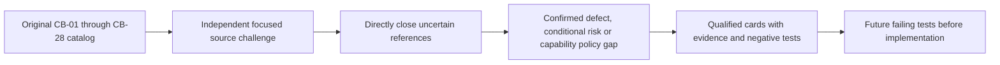

# Independent confirmation audit before card creation

Date: **2026-10-17**. Source: `28d8e812ef4269d46b25f517574501902836902b`.
Five focused DeepSearch reviews challenged the catalog against executable code;
follow-up direct reads closed missing references and corrected reviewer numbering.
**No runtime reproductions, Rust tests or production edits were performed.**
Each individual brief records its own decisive source locations and trigger.

## Confirmation matrix

| Finding | Disposition after second confirmation | Card |
| --- | --- | --- |
| CB-01 | Confirmed queued/committed boundary defect; historical error-before-apply observed | CMPCT-052 |
| CB-02 | Confirmed held-mutex self-relock on any terminal Err | CMPCT-053 |
| CB-03 | Confirmed dependency cleanup order; consequence masked by CB-02 | CMPCT-054 |
| CB-04 | Confirmed absent freshness check; destructive loss conditional on target advance | CMPCT-055 |
| CB-05 | Confirmed possible A→B/B→A lock cycle; not a reproduced permanent process hang | CMPCT-056 |
| CB-06 | Confirmed stale attempt reset and post-stream watchdog limits | CMPCT-057 |
| CB-07 | Confirmed expansion-order mismatch and classifier-dependent route selection | CMPCT-058 |
| CB-08 | Confirmed generic pin-to-manifest commit wiring gap | CMPCT-059 |
| CB-09 | Confirmed substring filter can remove durable summary/user envelope | CMPCT-060 |
| CB-10 | Confirmed generic structured replay loss; repeat-append consequence conditional | CMPCT-061 |
| CB-11 | Confirmed live restore ignores saved token state | CMPCT-062 |
| CB-12 | Confirmed full-envelope retrieval capability gap, not deletion | CMPCT-063, story |
| CB-13 | Confirmed nontransactional snapshot writes; lost update/crash damage conditional | CMPCT-064 |
| CB-14 | Confirmed cache-inclusive adapter values fed into disjoint additive counters | CMPCT-065 |
| CB-15 | Confirmed Anthropic terminal reconstruction removes earlier cache detail | CMPCT-066 |
| CB-16 | Confirmed request/display/session bases mixed in fill calculations | CMPCT-067 |
| CB-17 | Confirmed completion producer/consumer omit token refresh and report zero coverage | CMPCT-068 |
| CB-18 | Confirmed forwarding omission; duplicate/missed settlement remains conditional | CMPCT-069 |
| CB-19 | Confirmed active-versus-persisted bounds and incomplete candidate acceptance | CMPCT-070 |
| CB-20 | Confirmed whole-request fit admission gap, not guaranteed overflow | CMPCT-071, story |
| CB-21 | Confirmed route-dependent file/preservation handling and inaccessible-DAG fresh rebuild | CMPCT-072 |
| CB-22 | Confirmed saved override omitted at creation/switch, not all runtime guards | CMPCT-073 |
| CB-23 | Confirmed Codex aggregate final enters hook's per-request slot; early trigger conditional | CMPCT-074 |
| CB-24 | Confirmed internal continuations have no fresh outer admission; overflow conditional | CMPCT-075 |
| CB-25 | Confirmed streaming HTTP path discards rejection body | CMPCT-076 |
| CB-26 | Native lifecycle gap, disabled by default; enforce sole-DAG rather than implement native | CMPCT-077, story |
| CB-27 | Confirmed user-only ancestry check; stale saved non-user replay conditional | CMPCT-078 |
| CB-28 | Confirmed executable conflicts with latest no-fallback policy, not historical misconduct | CMPCT-079–082 |
| Cross-cutting | New acceptance coverage, not another independently observed bug | CMPCT-083, story |

## Corrections that prevent false bug claims

- CB-02 is not attributed to the historical Qwen screenshot. Historical binary
  identity is unknown; incident ordering supports CB-01, not all catalog entries.
- CB-03 cannot execute its missing-handler fallback until the prior self-lock
  obstruction is removed and overflow/compactable-turn gates admit recovery.
- CB-05 lock waits are outside builder timeout, but cancellation and a separate
  long stream stall deadline exist. Do not claim no deadline anywhere.
- CB-06 must not be fixed by emitting completion for fallback. Remove that path.
- CB-07 must not restore first-in-view-then-clean escalation. Remove strategy
  switching; a clean builder on a first attempt is not itself a semantic defect.
- CB-12 tail-window `show` and project-wide `search` are existing API semantics,
  not inherently bugs. Add explicit lossless retrieval; do not call retention loss.
- CB-14 addition is correct for disjoint usage. The bug is an unnormalized
  inclusive provider boundary, not every addition or every provider response.
- CB-19 metadata rejection does not delete the original candidate text. Intentional
  cross-depth hierarchy overlaps remain valid; incomplete candidates must fail whole.
- CB-20 requires fit-or-typed-failure, never a forced successful shrink guarantee.
- CB-26 is not a default-enabled native failure. No native implementation or
  comparison benchmark is required to keep the research-backed DAG.
- CB-28 WS downgrade is specifically 404/405/426/501 after configured WS upgrade.
  Baseline full-input behavior is a separate same-socket mode issue, not HTTP.

## Final reference closures

The fifth review accidentally used CB-17 for mixed fill and CB-18 for stale UI;
the matrix above keeps the original catalog numbering (CB-16 and CB-17).
Its unclosed Codex usage reference was then read directly:
`rust/patches/rig-core/src/providers/openai/responses_api/streaming.rs:81`
copies inclusive input/output plus cached/reasoning subsets into Usage.
Codex uses that Responses final usage type at
`rust/providers/src/codex/streaming.rs:7` and `:128`.

Direct reads also confirmed the broad chain-of-text overflow classifier in
`rust/cli/src/interactive/error_classifiers.rs:50`, guessed output reservation in
`rust/cli/src/compaction_threshold.rs:94`, provider limit defaults in
`rust/providers/src/codex/mod.rs:120` and guard poison fail-open behavior in
`rust/core/src/compaction_hook.rs:196`. CMPCT-082 owns their removal from admission.

## Overlap and historical acceptance

PROV-046 (original persistence), PROV-050 (pair-safe compaction) and RIG-011
(usage details) remain separate historical/open work. Related links identify
overlap without rewriting their scope or claiming they already solve these bugs.
CMPCT-016/020/047 fallback-success acceptance is superseded for the new repair;
CMPCT-083 requires its owning replacement specs/tests to enforce no fallback.

## Resolved design decisions

Source confirmation is complete for this planning scope. The human answered the
three Example Mapping questions through HITL on 2026-10-17. The decisions below
supersede choices in the original briefs; implementation still needs failing tests.

| Owner | Human decision |
| --- | --- |
| CMPCT-064, integrated by CMPCT-059 | One process owns each session; reject competing process writers explicitly. Specify crash-safe platform promotion and one authoritative generic/provider generation. Concurrent cross-process writers are excluded. |
| CMPCT-072, consumed by CMPCT-070 | Preserve authoritative durable D2 payloads and required reminder identities unchanged; assemble file metadata deterministically from authoritative state before validation. Equivalent rewrites are not permitted. |
| CMPCT-081, coordinated with CMPCT-078 | Full-current-DAG requests only. Remove delta mode rather than defining bootstrap or permitting downgrade. |

The human also required durable commits and lossless structured replay in the first
milestone, selected complete removal of Codex native compaction (CMPCT-077), and
authorized implementation to begin. These are requirements, not completed fixes.

The second item is a contract-definition prerequisite, not a dependency cycle:
CMPCT-070 can build structural validation first, while CMPCT-072's policy must be
agreed before preservation validation is finalized. The current dependency graph
orders implementation slices, not every specification discussion.

All CB-01–28 findings have owners, and the registered dependencies are acyclic.
No further concrete sole-DAG/no-fallback contradiction was found in this review.
These decisions do not reopen the selected architecture or authorize fallbacks.
Feature scenarios, failing tests and runtime reproduction remain future delivery
work; they are not claimed as completed source research.

