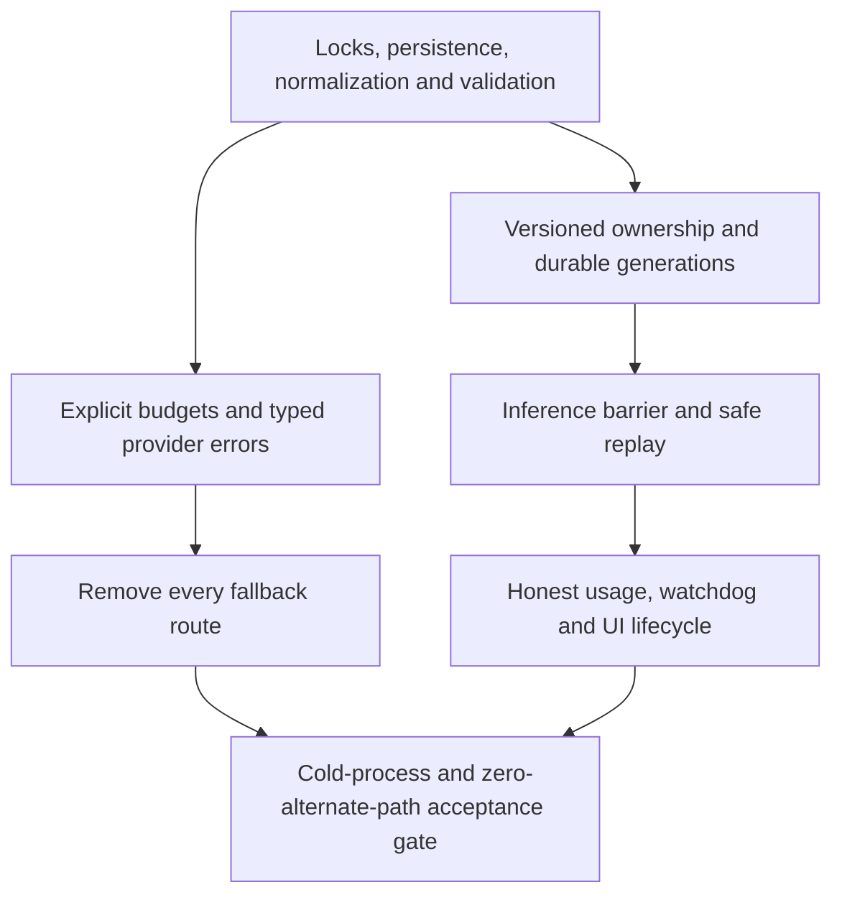

# Compaction repair cards and implementation order

Date: **2026-10-17**. Epic: **compaction-reliability-no-fallback**.
Research parent/reference: **CMPCT-051**. **32 cards: 28 bugs and four stories.**
Cards begin in specifying; consult work-unit status for implementation progress.
None was a completed fix when the research cards were created.
Source baseline: `28d8e812`.

Each card has a specific Markdown coding brief with a Mermaid diagram and the
mandatory `00-shared-contract.md` attachment. Card rules/examples duplicate the
brief's acceptance/regression requirements for discoverability in fspec. The
confirmation audit records the second source check and explicit limitations.

## Coverage and ownership

| Card | Finding | Priority | Owning implementation slice |
| --- | --- | --- | --- |
| CMPCT-052 | CB-01 | P0 | Inference barrier at accepted DAG handoff |
| CMPCT-053 | CB-02 | P0 | Terminal held-mutex self-relock |
| CMPCT-054 | CB-03 | P1 | Handler lifetime through terminal decision |
| CMPCT-055 | CB-04 | P0 | Generation, coverage and suffix-safe commit |
| CMPCT-056 | CB-05 | P0 | Cross-session lock ownership and status |
| CMPCT-057 | CB-06 | P1 | Operation deadlines and watchdog resets |
| CMPCT-058 | CB-07 | P2 | Remove classifier-dependent strategy escalation |
| CMPCT-059 | CB-08 | P1 | Durable generic/provider boundary |
| CMPCT-060 | CB-09 | P1 | Typed reminder/summary identity |
| CMPCT-061 | CB-10 | P1 | Structured, idempotent model replay |
| CMPCT-062 | CB-11 | P2 | Apply saved token state honestly |
| CMPCT-063 | CB-12 | P1 | Lossless original-envelope retrieval, story |
| CMPCT-064 | CB-13 | P1 | Manifest revision/write isolation |
| CMPCT-065 | CB-14 | P1 | Normalize inclusive usage and subsets |
| CMPCT-066 | CB-15 | P1 | Anthropic terminal cache retention |
| CMPCT-067 | CB-16 | P2 | Coherent request-generation fill basis |
| CMPCT-068 | CB-17 | P2 | Commit token/UI refresh and honest coverage |
| CMPCT-069 | CB-18 | P2 | Request settlement and forwarding fields |
| CMPCT-070 | CB-19 | P1 | Whole-DAG validation and stable coordinates |
| CMPCT-071 | CB-20 | P1 | Whole-request fit-or-failure admission, story |
| CMPCT-072 | CB-21 | P2 | Uniform durable-node/file preservation |
| CMPCT-073 | CB-22 | P2 | Saved threshold propagation |
| CMPCT-074 | CB-23 | P1 | Codex aggregate spend versus context |
| CMPCT-075 | CB-24 | P1 | Every Codex continuation guarded |
| CMPCT-076 | CB-25 | P1 | Preserve typed HTTP diagnostics |
| CMPCT-077 | CB-26 | P1 | Remove alternate native memory activation, story |
| CMPCT-078 | CB-27 | P1 | Full Codex checkpoint lineage |
| CMPCT-079 | CB-28/runtime | P1 | Remove salvage, generic DAG, forced pin/Continue |
| CMPCT-080 | CB-28/replay | P1 | Remove checkpoint masking and invented results |
| CMPCT-081 | CB-28/transport | P1 | Remove WS downgrade and delta mode |
| CMPCT-082 | CB-28/admission | P1 | Remove guessed limits/fail-open/broad classifiers |
| CMPCT-083 | CB-01–28 | P1 | Cold-resume/no-fallback end-to-end gate, story |

CB-12/20/26 are intentionally stories: accessible originals, whole-request admission
and unsupported native-policy enforcement are capability/policy work, not falsely
asserted default-enabled incident bugs. Conditional concurrency/accounting findings
remain bugs with qualified triggers, not claims of runtime reproduction.

## Suggested workstreams

1. **Foundations:** CMPCT-053, 064, 065, 070, 073, 076; retrieval 063,
   reminder identity 060 and alternate-memory rejection 077 can proceed separately.
2. **Ownership and durable state:** 054/056 → 055 → 078; 055/064/078 → 080.
   Integrate 055/064/070/071/072/078/080 in 059; then 052 establishes the barrier.
3. **Admission/no fallback:** 076 → 082 → 071; preserve content in 072;
   remove runtime fallback in 079, transport fallback in 081 and route escalation in 058.
4. **Accounting/replay/observers:** 064/065 → 069; 066/074 → 067/075; 060/080 → 061;
   065 → 062; barrier plus coherent state → 068; 052/079 → 057.
5. **Final gate:** 083 depends on all preceding repair slices. Every slice still
   writes its own feature and failing tests before implementation.

Dependencies are registered on the cards; numbers are not a strict execution order.
Related nonblocking links connect CMPCT-051 and relevant historical/open work.
Do not turn the final gate into permission to merge untested production changes.

## Planning readiness

The human answered the three card-specific questions through HITL: single process
ownership, exact durable identities and full-current-DAG-only Codex requests.
Native compaction must be removed entirely. Durable commits and structured replay
are both first-milestone requirements. Implementation is authorized; platform
promotion details still require concrete specifications and tests, not assumptions.
See [the decision record](00-confirmation-audit.md#resolved-design-decisions).

## Meaning of double confirmation

Read `00-confirmation-audit.md`: independent source reviews plus direct reference
closures confirmed executable mechanisms. No runtime tests were run for this
planning task. Each brief distinguishes static proof, conditional impact and gaps.
Implementation must reproduce each condition in a failing test before a fix.
No fallbacks means validated durable DAG commit **or typed blocked failure**, not
guaranteed successful shrinking. The DAG architecture is retained unconditionally.

