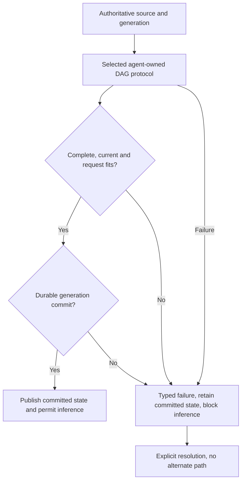

# Mandatory contract for every compaction repair card

Date: **2026-10-17**. These are implementation requirements, not completed fixes.
Applies to CMPCT-052–083. Read alongside each card's specific coding brief.

## Human decisions recorded on 2026-10-17

- Begin dependency-ordered implementation with feature-first, failing-test-first delivery.
- Require durable DAG commits and lossless structured replay in the first milestone;
  runtime-only repairs cannot be declared the completed compaction fix.
- Support one owning process per session. Reject competing process writers explicitly;
  define crash-safe platform promotion without claiming concurrent writer support.
- Preserve authoritative D2 payloads and required reminder identities unchanged.
  Assemble file metadata deterministically from authoritative state before validation.
- Remove Codex native compaction entirely, rather than retaining a rejection-only option.
- Support explicit full-current-DAG Codex requests only. Remove delta mode and its
  implicit bootstrap/downgrade paths; no alternate request representation on failure.

## Selected architecture

Retain fspec's hierarchical D0/D1/D2 DAG, immutable original envelopes, selective
retrieval, incremental condensation and agent-owned semantic selection. Preserve
the original same-agent/in-view design; repairing clean-builder ownership does not
authorize replacing that design with a separate flat/native/hybrid summarizer.
The evidence and original-card lineage are documented in
`compaction-research/future-state/05-research-foundation.md`.

## No fallback means no substitute success

- Use one selected DAG protocol and full-candidate validator, with a versioned
  commit owner. No generic recovery nodes, partial salvage, truncation, fragment
  extraction from errors, forced pins, native/flat substitution or model switch.
- Missing/inaccessible/incompatible state is not genuinely absent state. Do not
  silently rebuild checkpoints, replay raw archives, fabricate tool results,
  guess unknown limits, skip poisoned guards or rescue an unknown error through
  a broad secondary substring classifier.
- No automatic WS→HTTP downgrade or delta→full mode switch on incompatibility.
  Explicit full-current-DAG mode selected before sending is valid. A recorded,
  durable commit-time generation reset is valid; error-driven repair is not.
- A failed operation preserves immutable evidence and the last committed
  generation/checkpoint, publishes typed failure/cancellation and blocks unsafe
  ordinary inference. It never publishes CompactionComplete or a success result.
- Keep builder working views separate from committed memory, including preparation
  that clears a prompt. Cancellation cannot destroy the authoritative DAG/suffix.
- Durable promotion is irreversible for this operation: before promotion, rejection
  leaves the old commit unchanged; after promotion, notification/acknowledgement
  failure retains the new authoritative commit and reports its identity explicitly.
  Never roll it back, report the old generation as authoritative or create a second
  commit just because publication failed. Reconcile the outcome before inference.
- Clear busy/progress indicators without falsely claiming Ready. New user input
  may queue; it cannot trigger synthetic Continue or bypass explicit resolution.
- Bound capture, generation, validation, lock waits, persistence and publication.
  Promise bounded termination, not guaranteed successful shrinking. Explicit
  same-operation retry must use the same source contract, algorithm and validator.
- Declared bounded same-transport transient/OAuth refresh retry is allowed only
  without changing transport, model, memory representation or request lineage.

## Delivery and verification

1. Read existing feature scenarios, implementations and coverage before editing.
2. Write/update Gherkin first; replace current fallback-success expectations in
   the owning implementation slice. Do not rewrite historical completed cards.
3. Add a corresponding failing integration test for each scenario, then implement.
4. Use real temporary stores and shared `rust/test-helpers/` fixtures; barriers
   and harness deadlines for concurrency; scripted transports for actual wire data.
5. Test positive commits and negative failures. Pre-promotion failure must assert
   unchanged committed state, no alternate request/completion and blocked inference.
   Post-promotion notification failure must recover the new durable generation,
   expose its commit identity and block until reconciled; no rollback or duplicate commit.
6. Use `cargo test -p <crate> --test <target>`; scope check/clippy by package.
   Run `fspec format`, `fspec validate` and `fspec validate-tags` for feature edits.
7. Keep new files below 300 lines; obtain approval before major refactoring.

