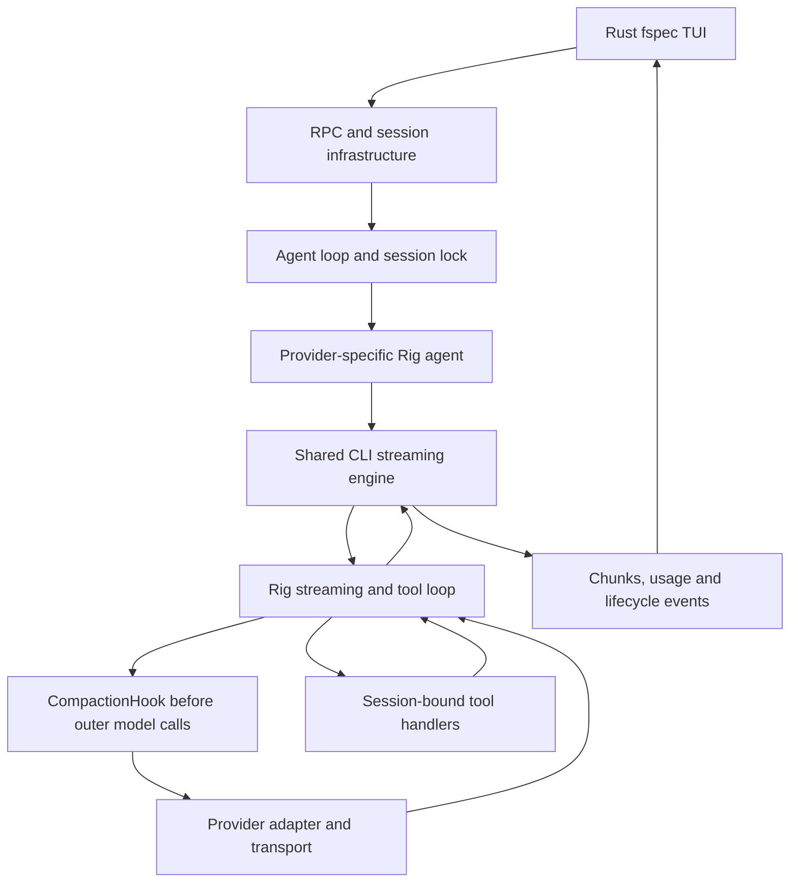
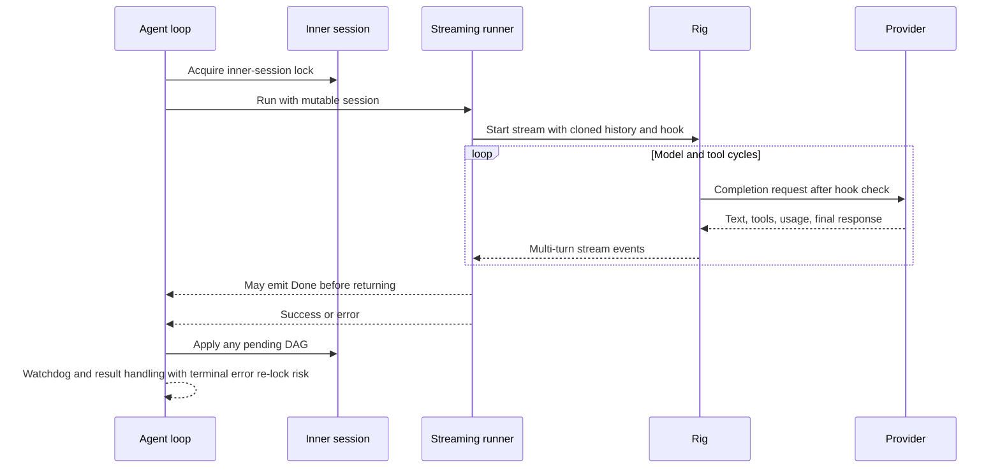

# Current state: architecture and state ownership

Status: code-confirmed unless explicitly qualified. Baseline: `28d8e812`.

## Live runtime topology

The live interactive frontend is the Rust TUI in the fspec binary. Default combined
mode uses an embedded in-process RPC backend and also exposes a WebSocket server;
standalone client mode uses WebSocket RPC. Both reach the session manager's
`FspecAgentHooks` and `codelet-agent-loop`. `codelet-cli` is a shared streaming
library. NAPI is not on these executable routes; legacy NAPI code is not the
authority for their behavior.

Provider-specific dispatch creates a Rig agent and runs the common streaming
engine. Tools use session-bound handlers. Generic compaction is shared orchestration
around provider inference; it is not a separate implementation for each API.

Sources: `rust/fspec/src/main.rs:2435`, `rust/fspec/src/combined.rs:39`,
`rust/fspec/src/client.rs:56`, `rust/fspec/src/common.rs:129`,
`rust/fspec-tui/src/transport/embedded.rs:59`,
`rust/agent-loop/src/dispatch.rs:68`,
`rust/agent-loop/src/agent_loop.rs:517`,
`rust/cli/src/interactive/stream_loop.rs:493`;
architecture notes on work unit CMPCT-044.

## State owners

| State | Owner | Meaning and lifetime |
| --- | --- | --- |
| `Session.messages` | Inner CLI session | Active application-level context, including reminders and current DAG |
| Rig history | Running streaming call | History cloned for a particular multi-turn stream; not a live view of `Session.messages` |
| `Session.turns` | Inner session | In-memory conversation-turn analysis; cleared by reminder reset |
| Token tracker | Inner session | Context/display and cumulative billing bookkeeping, with different field bases |
| `TokenState` | Shared mutex used by hook | Last response usage and `compaction_needed` signal for the current stream |
| Streaming display | Streaming engine | Current segment input/cache and accumulated output display state |
| `pending_dag_content` | Background session | Wrapped summary waiting for the outer loop to mutate inner context |
| `compaction_in_progress` | Background session atomic | Builder/lifecycle flag; not proof that context replacement committed |
| Retry counter | Streaming invocation | Bounds in-loop recovery restarts |
| Watchdog counter | Agent-loop lifecycle | Separate convergence budget for builders that do not inject |
| Message store and manifest | Persistence layer | Searchable original history and optional persisted compaction boundary |
| Provider extension | Provider session | Provider-specific continuation state; currently Codex is auto-registered |
| TUI view store | Frontend | Per-session token display, progress, reduction badge and notices |

## Ordinary request lifecycle

The agent loop holds the inner-session lock while dispatching the streaming runner.
The runner prepares history, seeds usage state, installs a `CompactionHook`, and
starts a Rig streaming prompt. Rig can run multiple model/tool cycles before the
runner returns. Stream handlers collect assistant text and tool results into
application history. At successful settlement the runner updates token tracking.

The outer agent loop then processes pending annotations and applies a pending DAG
on either success or error, before watchdog and result handling. The runner can
emit Done before this application; Done is not a compaction commit acknowledgement.
The terminal-error arm currently re-enters the held inner mutex and can block
before classification (see the recovery chapter). This is static source behavior,
not a claim that the historical incident ran this exact binary.

## History is not one thing

Replacing active session messages does not delete searchable disk history. Returning
success from a summary tool does not necessarily replace the running Rig history.
A provider checkpoint is not the generic manifest's compaction state. A UI reduction
event is not an acknowledgement that all these representations agree.

Generic compaction deliberately removes most active conversation messages while
retaining reminders and a searchable summary. Calling the whole mechanism
"lossless" needs qualification: stored records remain on disk, but an LLM-generated
summary can omit details. SessionSearch primarily searches stored text/previews and
blob references, not every structured metadata payload; original-record retention
does not guarantee full-payload search or retrieval.

Sources: `rust/agent-loop/src/background_output.rs:493`,
`rust/agent-loop/src/agent_loop.rs:1398`,
`rust/agent-loop/src/terminal_overflow_recovery.rs:37`,
`rust/agent-loop/src/session_search_handler.rs:479`.

## Provider extension boundary

`ProviderSession` registers a Codex extension automatically for provider `codex`.
It offers restore, writers, turn-start, reset, and status callbacks. Other built-in
providers do not gain a Codex-like checkpoint merely because they share the same
streaming engine. Custom extensions can be registered, so this is the default
registration policy, not a prohibition on extension.

Source: `rust/providers/src/session.rs:20` and
`rust/cli/src/session/provider.rs:7`.
