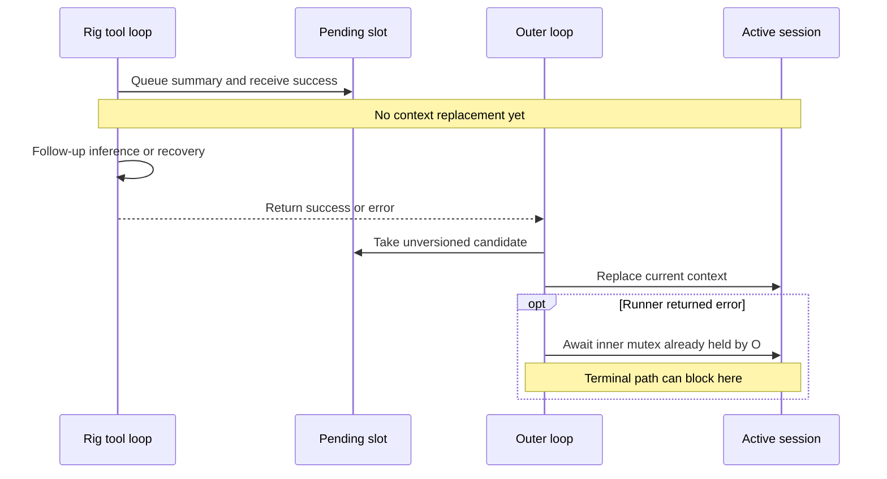

# Runtime and concurrency findings

Baseline/evidence classes: [catalog](00-bug-index.md). These are source findings,
not newly executed concurrency tests. Proposed fixes below are requirements, not patches.

## CB-01: acknowledged is not applied

**Observed ordering + static lifecycle defect; P0.** InjectSummary wraps and stores
a DAG in one `Option<String>`, clears the flag, and returns `injected_tokens` and
`remaining_budget`. It has not replaced active messages or Rig's streaming history
at that point ([R1]). Rig can run another completion after executing the tool
([R2]); its next preflight can cancel the still-large history. Recovery increments
the restart count and errors after three admitted rounds ([R3]). Only when the
runner returns does the outer loop apply pending content, on success or error ([R4]).

The incident records retry exhaustion before pending application; exact prior
submissions and historical build identity are unknown ([incident](../current-state/12-incident-and-evidence.md)).
The returned budget counts the wrapped DAG alone, not all surviving reminders or
wire overhead ([R1]); it is not an acknowledgement that the next request fits.

**Required invariant:** successful application must be an inference boundary. Either
stop the current tool loop and commit before resumption, or explicitly distinguish
“queued” from “committed” and prevent another inference on the obsolete generation.

## CB-02: terminal error self-deadlock

**Static defect; P0.** `inner_session` is acquired at outer-loop line 518 and stays
in scope through line 1679 ([R4]). The `Err` arm awaits
`try_terminal_overflow_recovery`, whose first block awaits that same mutex before
even classifying the error ([R5]). Thus every terminal `Err` reaching this arm,
including non-overflow errors, can block on the caller's own guard. An `Arc` clone
does not release it. The builder timeout is irrelevant to this earlier wait.

The idle drop guard has already been disarmed. Pending apply may already have
emitted completion/Idle, so an idle-looking UI does not prove released locks or
ability to process the next input ([R4]). This was not runtime-reproduced here.

**Required invariant:** error handling must have a single, explicit owner of the
session mutation boundary; no helper may await a lock already held by its caller.

## CB-03: recovery after handler cleanup

**Static lifecycle defect; P1.** The outer loop unregisters the compactor handler
at line 1587 before terminal recovery at line 1614 ([R4]). The shared compactor
round looks up that handler and uses fallback if absent ([R6]). Fixing CB-02 alone
therefore does not restore the intended clean-agent attempt: barring concurrent
re-registration, recovery sees its handler already removed.

**Required invariant:** clean up recovery dependencies after the terminal recovery
decision. If no builder can legitimately run, return typed failure and block;
remove deterministic fallback as required by [CB-28](08-no-fallback-removal-plan.md).

## CB-04: no generation or coverage check at pin

**Conditional active-context safety risk; P0.** Two related routes exist:

- Pending submissions overwrite a single unversioned slot. Consumption takes the
  string, parses metadata, resets the **then-current** context, and appends it.
  No coverage check preserves work produced between submission and apply ([R1]).
- Cross-target GenerateCompaction captures state under the target lock, releases
  it during generation, then reacquires it and resets the target without a
  generation/watermark check. Valid output and fallback both reach pinning ([R7]).

A builder can search more recent persisted turns while running, so its output is
not necessarily frozen at initial capture. The defect is that commit cannot prove
what suffix it covers. Last-writer-wins is not itself evidence of damage; the risk
is destructive replacement of uncovered work or a newer installed summary.
This concerns **active context**, not demonstrated deletion of stored originals.

**Required invariant:** tag candidates with stable coverage/generation; reject
stale replacement or splice the unrepresented suffix. Upstream has such prefix
validation and suffix retention ([Codex contract](06-upstream-codex-contract.md)).

## CB-05: cross-session lock cycle

**Conditional availability risk; P0.** While A's stream holds A's inner lock,
A→B GenerateCompaction awaits B's lock. If B simultaneously requests B→A under
its own stream lock, neither can progress ([R4], [R7]). The self-target `try_lock`
special case does not solve this cross-target cycle. “Different session” comments
are not proof of deadlock freedom. Initial capture and final pin waits are outside
the builder timeout ([R7]). External cancellation may break a cycle; it is not a
proven process-wide deadlock or an observed incident here.

**Required invariant:** do not retain caller locks while awaiting target locks;
bound capture/commit waits and validate versions when reacquiring mutation rights.
Cross-target success also unconditionally sets the target Running, rather than
restoring its prior state; cover an originally Idle target in status tests ([R7]).

## CB-06: watchdog is not a timeout or commit barrier

**Static control-flow/event defects; P1.** The watchdog runs after the stream,
not while a builder is stuck. First failure schedules synthetic Continue; second
forces a fallback. Successful injection clears the flag before this check, and
pending apply consumes the slot before inspection. Both conditions can be false
on success, bypassing the conditional reset of an earlier attempt count ([R1], [R4]).

The forced-fallback branch clears status/progress but emits no CompactionComplete,
despite its comment. It is not equivalent to the direct clean round, which emits
failure and completion on fallback ([R4], [R6]). These differences can leave stale
attempts or inconsistent observer lifecycle state; occurrence in the incident is unproved.

**Required invariant:** reset attempts on committed success; make timeout and
retry-limit failures explicit and consistent across producers. Remove synthetic
Continue/escalation and forced pins; failure must not emit completion (CB-28).

## CB-07: escalation expression is evaluated after increment

**Static implementation/comment mismatch; P2.** The broader overflow branch passes
`compaction_retry_count > 0` to a macro. The macro increments the counter **before**
evaluating that expression, so its first allowed round selects the clean compactor,
not first-in-view as the nearby comment claims ([R3]). The legacy prompt-too-long
branch still precedes it, so classification selects different policies.

This describes current behavior, not permission to retain automatic escalation.
Under CB-28, use the adapter's declared error parser and the same selected DAG
protocol for every admitted overflow. No classifier-driven strategy switch is
allowed. Test expanded behavior, not comments or macro argument text.

## Source references

[R1]: ../../rust/agent-loop/src/inject_summary_handler.rs#L49
[R2]: ../../rust/patches/rig-core/src/agent/prompt_request/streaming.rs#L791
[R3]: ../../rust/cli/src/interactive/stream_loop.rs#L659
[R4]: ../../rust/agent-loop/src/agent_loop.rs#L518
[R5]: ../../rust/agent-loop/src/terminal_overflow_recovery.rs#L30
[R6]: ../../rust/cli/src/compactor_sub_agent.rs#L107
[R7]: ../../rust/agent-loop/src/generate_compaction_handler.rs#L565

Navigation: [R1] pending store at 65, apply at 245; [R3] macro at 659,
broader overflow at 1846; [R4] apply at 1398, watchdog at 1465, cleanup at 1587,
error handling at 1604; [R7] capture at 623, generation at 683, direct pin at 773.
