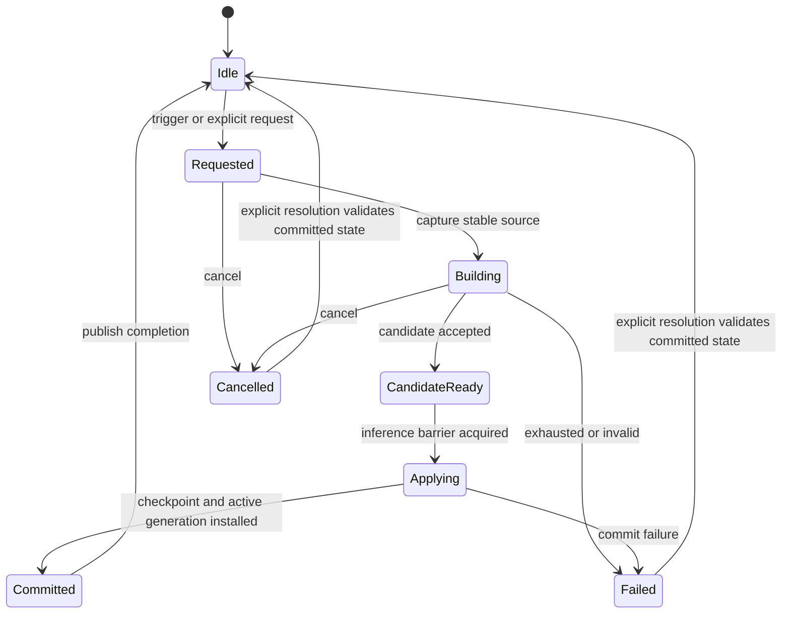
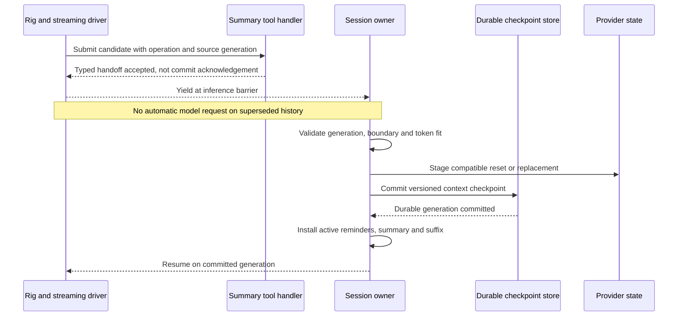
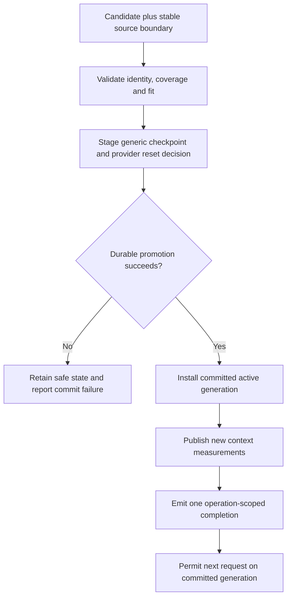

# Future state proposal: transactional compaction lifecycle

Status: **proposed, not implemented or approved as a final architecture**.
This chapter responds to the current-state sequencing and durability findings.
It is a design input for separate acceptance criteria, failing tests and code.
The selected architecture is the research-backed hierarchical DAG, with
**no fallbacks**. See [research foundation](05-research-foundation.md) and
[removal requirements](../compaction-bugs/08-no-fallback-removal-plan.md).

## Goals and non-goals

The critical guarantee is: after accepting a candidate for application, no ordinary
inference request may use the superseded active generation. A successful commit
must produce one coherent context, compatible provider state, durable resume
boundary and completion event.

Goals include bounded recovery, searchable original history, explicit failure
states, honest measurement and consistent self/cross-session semantics. Non-goals
include reconstructing facts the summarizer omitted, making every provider support
native compaction, treating a cost discount as context capacity, or deleting raw
conversation to make an active window smaller.
Searchable original history is an acceptance requirement, not an existing guarantee
for all structured payloads: current SessionSearch can see only tool previews even
when full metadata remains stored.

## Explicit operation and generation identities

Every request should carry a unique operation ID, target session, source generation,
stable covered-history boundary, captured provider/model and initiating reason.
The active session should have a monotonically advancing committed generation.
Repeated submissions of the same operation must be idempotent; a conflicting
submission must be rejected or explicitly supersede the earlier candidate.

Use stable persisted message IDs or a versioned boundary mapping, not active-vector
length as a substitute for persisted turn identity. Current range warnings show
why summary turn indices and rebuilt-message counts cannot be conflated.

| State | Meaning | Ordinary inference permitted? |
| --- | --- | --- |
| Idle | No active operation | Yes, on committed generation |
| Requested | Trigger captured and operation allocated | Only if explicitly safe before builder takeover |
| Building | Clean builder is researching original history | No ordinary target-task continuation |
| CandidateReady | Candidate accepted into validated handoff | No |
| Applying | Host owns replacement boundary | No |
| Committed | Durable checkpoint and active generation agree | Yes, on new generation |
| Failed | No successful commit; evidence and last committed context retained | No; explicit resolution must validate a usable generation |
| Cancelled | Operation cancelled before commit | No automatic continuation; explicit resolution required |

These are proposed lifecycle states, not a mapping of today's atomic flag.

## Safe stream handoff

Do not await the target's inner-session lock from a tool running while that lock
is held. Instead, tool submission should create a typed handoff outcome visible
to the streaming driver. The driver must stop automatic completion continuation
and return control to the owner before any next provider request.
The same prohibition must cover host recovery helpers: the current terminal-error
arm also re-enters its own mutex. Mutual cross-target calls need lock-order or
bounded acquisition policy; merely targeting a different session is not sufficient.

The exact mechanism requires an implementation spike: a typed stream outcome,
explicit control channel, or another tested boundary can work. Reusing an arbitrary
network/error string is not a sufficient protocol. This proposal does not prescribe
an unverified Rig API.

Tool success must distinguish `candidate queued` from `committed`. A self-targeted
tool cannot claim synchronous commit while the current lock design defers apply.
It can acknowledge handoff, then expose the committed operation through lifecycle
events or the next resumed turn. Cross-session tools must obey the same generation
and stale-source rules even when they can obtain the other target's lock directly.

## Candidate validation before commit

1. Verify target identity, source generation, coverage boundary and provider/model.
2. Parse representation and reject malformed or conflicting node ranges explicitly.
3. Preserve D2 commitments and file awareness according to an explicit policy;
   structural checks cannot prove semantic faithfulness, so retain original search.
4. Construct the exact proposed active messages including reminders and suffix.
5. Estimate full request overhead, tools, schemas and output reserve using provider
   contract capabilities. Mark estimates as estimates.
6. Reject the whole candidate if it does not fit; preserve committed state and
   report typed failure. No truncation, fragment salvage or alternate summarizer.

A candidate becoming stale while building must not silently discard newly arrived
turns. Capture an immutable source prefix, preserve a verified suffix, or reject
and regenerate within a bounded budget. New input can be queued while the target
is blocked; queue acceptance and replay order must be observable.
Flush/persist the source before capture and establish an immutable watermark. A
builder reading SessionSearch cannot summarize assistant/tool material not yet
persisted, and current tool-preview search is not a complete source snapshot.

## Durable checkpoint proposal

Store a versioned record containing operation ID, committed generation, summary,
stable original-history boundary, preserved suffix mapping, provider/model identity,
compatible provider-checkpoint generation, measurement basis and timestamp. Original
message storage remains independently searchable.

Crash consistency is a requirement, not something an ordinary manifest write
automatically provides. Stage a record and atomically promote the committed
generation using a storage mechanism appropriate to the repository. If provider
state must be reset, record that reset decision so resume cannot revive an older
checkpoint after a newer generic DAG.

Serialize or revision-check **all** whole-manifest writers, including message,
provider and token updates. Atomic file replacement alone cannot stop a stale
snapshot from overwriting a newer checkpoint. Route deferred injection, self/cross-
generation and automatic compactor submissions through the same commit contract.
Remove watchdog forced pins instead of bringing fallback success into that contract.

On a storage failure, do not publish completion or resume on an uncommitted
generation. If durable commit succeeds but in-memory activation is interrupted,
resume reconstructs from that committed record. This does not require a distributed
transaction with a provider backend: local replay state can be invalidated instead.

## Bounded termination and impossible-fit cases

Bound builder attempts, elapsed generation time, candidate size and total operation
time, including lock waits. Failure must be explicit and typed, with the last
committed DAG/checkpoint and original evidence intact. Do not synthesize replacement
nodes, salvage partial output, escalate to another strategy or schedule hidden Continue.
The existing clean builder already has depth/time bounds; the change extends bounds
to the entire capture/build/apply/persist/publication operation, not just inference.

Do not silently truncate durable decisions or mandatory reminders. If mandatory
context alone cannot fit, report an explicit `mandatory context exceeds budget`
failure and block unsafe inference. Same-algorithm retries, if explicitly allowed,
must use the same source contract and validator within a declared operation budget.
This is bounded termination, not guaranteed successful shrinking. LCM's deterministic
truncation guarantee is intentionally not adopted under the no-fallback requirement.

Reset recovery counters only at a verified generation transition. Separate reasons
for builder failure, overflow, stale candidate, commit failure and provider rejection;
a single count should not imply they are interchangeable attempts.

## Cancellation, targeting and completion

Cancellation before commit leaves no successful checkpoint. Cancellation after
commit must not roll back the durable generation or emit a contradictory failure.
Partial tool work must remain paired or explicitly cancelled before resume.

For another live target, capture identity under its lock, generate without holding
the lock, then validate generation at commit. Specify whether the builder uses the
caller's or target's provider; do not inherit that choice accidentally. Persisted
offline targets require a separate supported contract, not implicit live lookup.
Current GenerateCompaction captures the caller's route even for another target;
switching to target-provider semantics would be an intentional behavior change.

Publish completion only after commit and active installation. Include operation
and generation IDs, reduction basis, coverage counts or unknown values, and provider
reset decision. Publish failure/blocked status, not completion, for an uncommitted
operation. UI state and the next request can then refer
to the same generation rather than racing an unversioned success notice.

Exactly one semantic commit is distinct from exactly-once event delivery. Define
deduplication and a queryable durable result or outbox for commit-success followed
by crash-before-publication. Replayed completion must not create duplicate semantic
commits/notices. None of these delivery guarantees exists merely by ordering emit
after activation.
