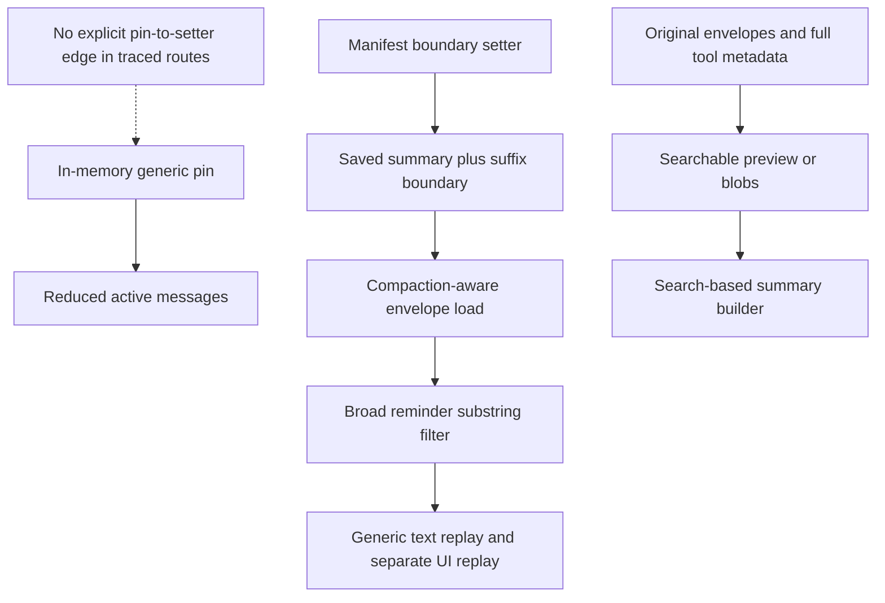

# Persistence and retrieval findings

Baseline/evidence classes: [catalog](00-bug-index.md). Original retention, active
context, provider continuation, and UI replay are separate guarantees.

## CB-08: active pin is not a durable generic checkpoint

**Static wiring gap; P1.** Deferred apply resets active messages and recalculates
tokens; self-target generation queues that route, while cross-target generation
pins directly ([P1], [P2]). None of these inspected pin routes explicitly calls
`set_compaction_state`. The manifest setter exists and stores summary, suffix
boundary and time; compaction-aware loading uses that state ([P3]). Ordinary
message/tool persistence and provider checkpoint envelopes are not that boundary
commit ([P4], [P5]). The outer apply site adds no explicit commit ([P6]).

**Impact:** restart can reconstruct a different, unreduced history rather than the
intended generic pinned generation. This is not a claim that original messages
were deleted, nor proof that every possible persistence caller is unwired.
Merely finding summary text in an ordinary tool result does not prove installation.

**Required invariant:** persist exact replacement/boundary and compatible provider
state under a documented commit/replay protocol. Upstream Codex records replacement
history, but even upstream's memory-before-append ordering is not atomic crash
durability ([upstream comparison](06-upstream-codex-contract.md#installation-and-durability-do-not-overclaim)).

## CB-09: reminder filter matches the summary itself

**Static defect when restoring marker-bearing content; P1.** Resume skips a
non-assistant envelope if its joined text contains both `<system-reminder>` and
`<!-- type:`. This is a substring test, not a typed reminder check ([P7]).
The synthetic manifest summary is a user message prefixed
`[Previous conversation summary]`; that prefix does not prevent a wrapped DAG
from matching the filter ([P3]). Even adding the missing setter in CB-08 would
not by itself repair this replay path.

The array branch skips the whole envelope, including buffered tool-result UI
chunks. Quoted marker examples or markers split across text blocks can also
match. Assistant envelopes use a different branch ([P7]). Cold creation initializes
reminders before replay; the restore/resume tail contains no fresh injection
after replay that restores a filtered DAG ([P7], [P8]).

**Required invariant:** distinguish replaceable runtime reminders from a durable
summary and ordinary user text by structured type/identity, not broad substrings.

## CB-10: UI replay is not equivalent model replay

**Static representational loss and idempotency risk; P1.** Restore produces UI
chunks for tool calls/results and thinking, but generic model messages are rebuilt
from joined text. Pure tool envelopes need not become equivalent structured model
history. Assistant string-content envelopes are skipped by the array-only branch.
Provider-extension restoration sees envelopes separately before generic filtering
([P7]); it may preserve provider-specific state, not repair every generic route.

Converted messages are appended to `inner.messages` without clearing it first.
Repeated restore into an already populated session therefore needs an idempotency
test; it is not proven to replace the existing context. An attractive scrollback
does not prove the next provider request contains the same structured conversation.

**Required invariant:** specify one model replay contract and test actual next-wire
input, including tool pairing and repeated/cached-session restore.

## CB-11: token restore is a no-op

**Static defect; P2.** Resume constructs saved token state and calls
`restore_session_token_state`; the live implementation names it `_state` and only
checks session existence ([P7], lines 233 and 763). That is not restoration of
context, spend or reasoning counters. Other creation/events can initialize some
state; this finding does not establish the exact final UI values on every route.

**Required invariant:** restore each supported counter with an explicit basis,
or explicitly recompute it and mark it estimated instead of accepting unused state.

## CB-12: original retention does not imply searchable payloads

**Static retrieval gap; P1 for search-based reconstruction.** Tool persistence
stores a short preview in `StoredMessage.content` and the full structured result
in metadata ([P4], lines 159–177). SessionSearch resolves content/blob references,
not generally the nested full tool result; ordinary storage begins with empty
blob references ([P9], [P10]). Search-mode trimming adds another reduction layer.

`show` truncates content, then takes `max_turns` **from the end** of the filtered
range ([P9], lines 398–418). Consequently `start_turn: 343, max_turns: 20` is not
forward pagination starting at 343. `search` surveys sessions using project/time
filters, rather than using `show`'s target-session selection ([P9], lines 175–231).
These are API semantics to account for, not proof that search itself is broken.

The bug is the stronger reconstruction assumption: builders directed to recover
everything through SessionSearch can miss content beyond previews and can sample
the wrong portion of the intended history. Keeping records on disk alone does not
establish an accessible lossless recovery path.

**Required invariant:** expose bounded, explicit full-envelope retrieval and stable
session-scoped pagination; report trimming honestly. Test a sentinel beyond the
preview, not merely that a tool-result record exists.

## CB-13: manifest write and cache boundaries

**Conditional persistence risk; P1.** Manifest save directly serializes/writes JSON.
`load_session` can clone an in-memory cache; independent writers load, modify and
save whole snapshots ([P3], lines 329, 357, 617, 891). Provider writers and token
writers use separate operations ([P5], [P4]). No transaction spanning generic pin,
provider checkpoint, messages and token state is established in these paths.

Concurrent stale snapshots can overwrite unrelated newer fields; interrupted writes
need explicit recovery behavior. Neither corruption nor a lost update was reproduced.
A same-process reload may only exercise the cache, so it cannot certify cold-disk
checkpoint survival.

**Required invariant:** serialize or revision-check writers and define durable write
promotion/recovery. Test a genuine fresh process plus controlled writer interleavings.

## Source references

[P1]: ../../rust/agent-loop/src/inject_summary_handler.rs#L245
[P2]: ../../rust/agent-loop/src/generate_compaction_handler.rs#L728
[P3]: ../../rust/core/src/persistence/manifest.rs#L93
[P4]: ../../rust/agent-loop/src/persist.rs#L142
[P5]: ../../rust/cli/src/session/provider.rs#L21
[P6]: ../../rust/agent-loop/src/agent_loop.rs#L1398
[P7]: ../../rust/sessions/src/handle_impl.rs#L537
[P8]: ../../rust/sessions/src/session_creation_helper.rs#L219
[P9]: ../../rust/agent-loop/src/session_search_handler.rs#L175
[P10]: ../../rust/core/src/persistence/messages.rs#L241

Navigation: [P3] compaction-aware load at 962, full load at 1033, setter at 1166;
[P7] assistant replay at 583, user replay/filter at 650–725, append at 739,
ignored token state at 763; [P9] match text at 248, show limit at 398,
content resolution at 479, conditional trimming at 729.
