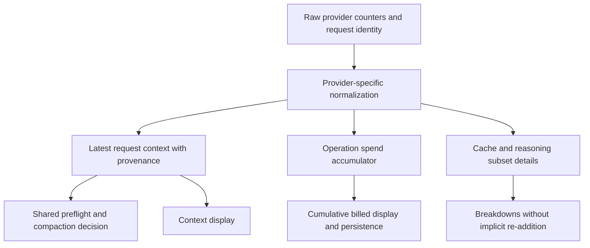
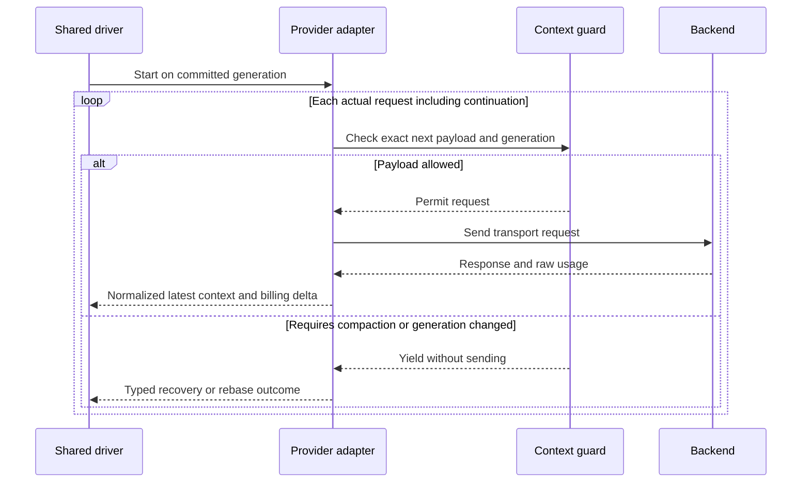

# Future state proposal: provider context and continuation contracts

Status: **proposed**. No adapters or native-compaction settings are changed here.
The aim is to make shared compaction safe without pretending every backend reports
usage or manages continuation identically.
The [selected DAG architecture](05-research-foundation.md) has **no fallbacks**;
the [removal inventory](../compaction-bugs/08-no-fallback-removal-plan.md) includes
transport and replay degradation, not just compactor helper names.

## Separate context measurement from spend

Define normalized usage with explicit provenance and scope, rather than one generic
input/output pair that sometimes describes a request and sometimes an operation.
The manifest already separates context and cumulative billed fields; this proposal
repairs normalization, settlement and propagation, rather than introducing the first
such distinction. Today Done-time persistence is not per-request settlement, and
the forwarding JSON projection drops reasoning/cumulative-billing fields.

| Proposed field | Contract |
| --- | --- |
| Request identity | Distinguish transport attempt, logical request and continuation chain |
| Context input total | Cache-inclusive input occupancy once, not raw fresh-plus-subset ambiguity |
| Output total | All generated output counted once under a declared provider policy |
| Cache read/write details | Subset or disjoint relationship explicitly declared |
| Reasoning detail | Relationship to output declared, not assumed additive |
| Latest request context | Eligible for next preflight, never cumulative overlapping input |
| Operation billing totals | Sum of billed requests, including continuations under declared retry policy |
| Quality/provenance | Backend-reported, normalized, estimated or unknown |
| Session generation | Prevent older response usage overwriting newly committed context |

Unknown values should remain unknown. Missing usage must not become a fabricated
zero-sized request. Keep raw fields for diagnostics with redaction; normalize once
at the provider boundary and use that normalized result consistently in live events,
final callbacks, hook state, settlement and UI.
Require parity through typed events, JSON forwarding, persistence and resume, not
only correct upstream counters. Settlement should be idempotent by request identity
and account explicitly for interrupted/error requests and duplicate Done delivery.

Avoid defining physical occupancy as input plus output plus reasoning universally.
Some providers include reasoning within output, and provider caches do not remove
prompt occupancy. The normalized contract must state which counts can be added.

## Every actual request needs a guard boundary

The outer hook cannot protect provider-internal continuation payloads it never
sees. An adapter that issues multiple requests must expose a preflight callback
or return continuation intent to the shared driver. The callback needs the actual
next input, tool/schema overhead, resolved model limits and committed generation.

Choose one owner for continuation scheduling; duplicated hidden loops should not
independently restart after compaction. Provider-specific replay remains allowed,
but it cannot bypass generation validation or context capacity policy.

Retries require distinct accounting too: a rejected request with no known usage is
not necessarily a zero-cost request, and replaying the same input does not make it
new physical history. Record uncertainty rather than inventing an exact bill.

## Adapter-by-adapter requirements

### Claude, API-key and OAuth

Preserve terminal cache read/creation details or emit a normalized cache-inclusive
input total with declared subset details. Live and terminal usage must describe
the same request. Test both authentication modes because headers/preamble formatting
can differ even though the shared compaction lifecycle should not.

Keep tool call/result pairing keyed to the correct provider identifier. Distinguish
thinking-budget errors, output exhaustion, auth refresh and context rejection.
Do not enable server-side compaction based solely on beta documentation.

### OpenAI-compatible, Z.AI, local servers and profiles

Normalize cached prompt detail as a subset when the backend defines it that way.
Normalize reasoning as a subset of completion output when applicable. Accept
usage-only terminal chunks and missing optional details. Store profile-resolved
window/output limits, not just the vendor/model catalog's advertised capacity.

Compatibility is not uniformity: capability/configuration metadata should declare
usage semantics for a backend or mark them unknown. Error classification must use
the adapter's declared status/body contract, including documented native text fields.
An unrecognized response stays unknown/unsupported; no broad substring classifier
may rescue it by choosing another recovery strategy. Session-affinity headers are
routing, not context memory.

### Gemini

Align live and terminal formulas: cached input must not appear as generated
output. Declare whether thought tokens are included in a generated-output total.
Retain usage-only final metadata even without candidate content when valid.

The dedicated empty-response continuation must share the same per-request guard,
generation checks and normalized usage contract. Preserve required thought
signatures across ordinary replay; reset/rebuild them under a tested compaction
policy rather than stripping them blindly.

### Codex Responses, SSE and WebSocket

Keep latest-request context distinct from internal-continuation billing sums.
Guard every additional continuation, not just the first outer model stream.
Preserve text-only replay restrictions and surface unsupported incomplete reasons.

Model the typed history checkpoint, WebSocket suffix baseline and previous-response
identity as generation-bound replay state. Generic replacement must invalidate or
rebase all affected state, not just one response ID. SSE full replay and WebSocket
suffix optimization was considered, but the human selected full-current-DAG requests
only through HITL. Remove delta mode and its implicit baseline downgrade. Configured
WebSocket upgrade failure must not trigger HTTP downgrade; assert zero HTTP attempts.
Missing tool results must produce a replay error, not fabricated cancellation text.

Native compaction must be removed entirely for this repair: it is not a backup memory
algorithm. Current enablement is a programmatic capability, not an established
CLI/profile option or backend advertisement. Documenting its implementation gaps
does not authorize enabling it. Unexpected opaque items must fail explicitly,
not substitute for a generic DAG commit or evidence of preserved semantic detail.

### Copilot

Normalize according to the concrete OpenAI chat-completion adapter currently
constructed, not the endpoint selector or a model's marketing family. Test its
Copilot middleware and cache-marker behavior with chat-shaped counters. If future
wiring enables Responses or another delegated adapter, add explicit branch-specific
fixtures before claiming support. Retain model limit and routing provenance so a
branded provider name cannot hide which parser or context window was used.
Separately test refresh and rebinding: current middleware injects the construction-
time token rather than refreshing it. Do not treat its name as a refresh guarantee.

### Custom Rhai providers and stub

Require a script-facing schema declaring usage scope, cache/reasoning relationships,
limits and continuation ownership. Validate script output at the Rust boundary.
Where no usage exists, use explicitly estimated context and unknown billing.

Keep deterministic stub behavior useful for shared lifecycle tests, but do not
treat its successful compaction as evidence of a real vendor's wire behavior.
Third-party script upgrades must not silently change the shared usage meaning.
Document the current snapshot merge rule: nonnegative supplied fields replace,
omitted fields retain, and explicit zero clears. Incremental deltas require explicit
conversion. Propagate generation limits deliberately; the present request bridge
does not automatically carry the configured output limit.

## Provider reset and resume contract

Every extension should declare whether it owns replay state and implement versioned
capture, restore, reset and commit compatibility. Absence of a checkpoint is valid
for stateless adapters; it must not inherit Codex semantics implicitly.

On restore, reject incompatible provider/model/generation metadata explicitly;
do not silently rebuild from raw history or pretend inaccessible state is absent.
An intentional generation-bound reset recorded at DAG commit is part of the selected
protocol, not an error-driven repair. Preserve original searchable history independently.
Restore tests should cover older schemas, declared reset decisions, model switches,
checkpoint-only metadata and rejection of unsupported native state.
Ensure committed DAG summaries are not discarded by the current blanket reminder
substring filter. Define fresh-reminder versus committed-summary handling and make
token-state restoration actually apply the saved normalized counters. Repeated
resume into a live session must have explicit replace/append/idempotency semantics.
Restore structured model messages as well as UI scrollback: current generic replay
can emit tool/thinking UI chunks without equivalent structured active history.

## Capability and limit reporting

Report resolved context window, maximum output, reserve, trigger threshold,
post-compaction target and estimation uncertainty as distinct values. Capability
discovery and credential refresh must not silently widen a session window beyond
configured policy. Dynamic changes should advance an observable configuration
revision and revalidate pending candidates before commit.
Resolution failure must not guess a model window or switch model/provider. Surface
unknown/unsupported limits and block requests lacking a valid capacity contract.

The shared guard should return a typed decision: allowed, compaction required,
mandatory input cannot fit, unsupported estimate, or stale generation. These are
operationally different from network retry and provider authentication failure.
