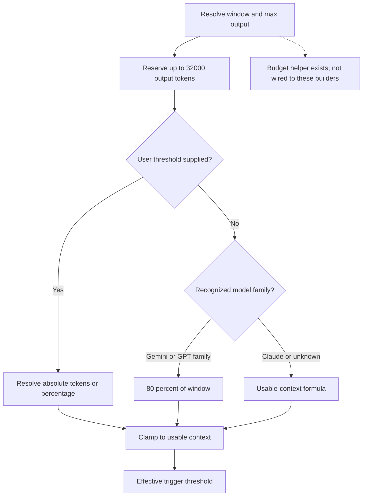
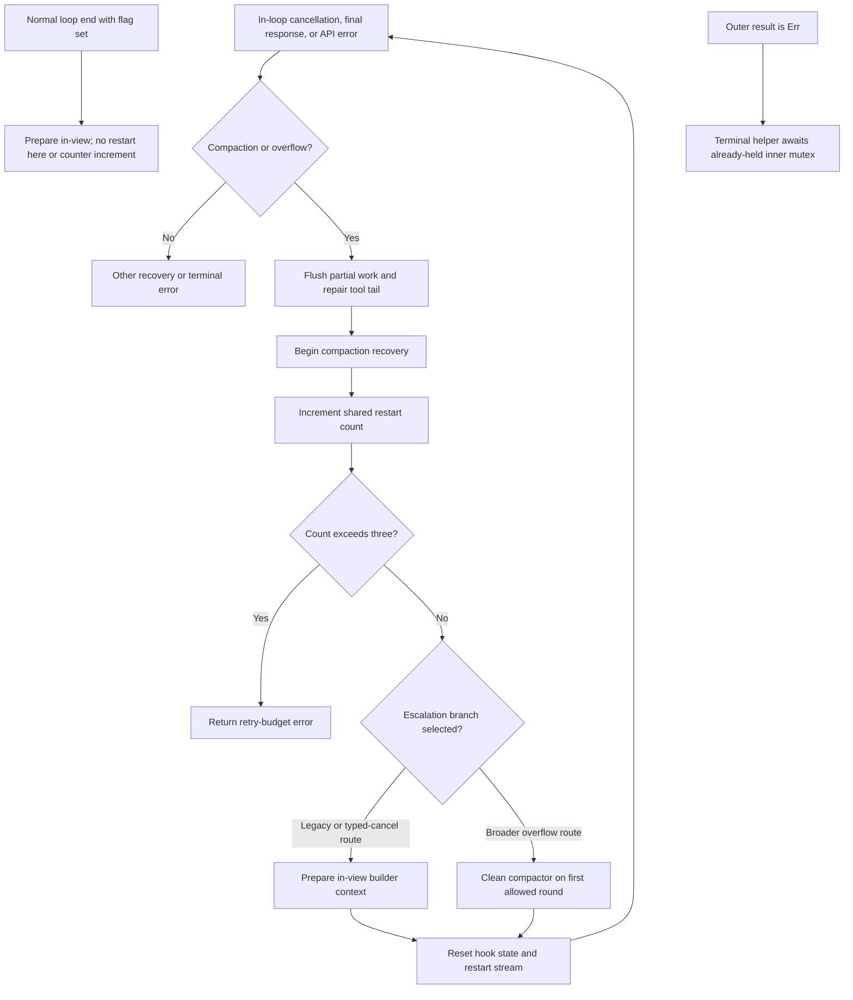

# Current state: triggers, thresholds and recovery

## Context-window and threshold resolution

Model limits resolve explicit overrides before registry data, clamping those
values to declared hard ceilings; provider defaults are returned directly. The provider's advertised
maximum, the resolved session window, the trigger threshold, and the desired
post-compaction budget are distinct values.

The shared threshold calculations are:

1. `reservation = min(model_max_output, 32_000)`; if zero, use `32_000`.
2. `usable = context_window.saturating_sub(reservation)`.
3. Choose a user threshold, otherwise a model-family default, otherwise `usable`.
4. Clamp the chosen threshold to `usable`.

Recognized Gemini and GPT/o-series prefixes receive an 80% family default. Claude
prefixes and unknown names fall through to the usable-context formula. This is
model-name matching, not universal behavior based only on a provider label.

A summarization-budget helper computes `window - 50_000` for larger windows, or
80% for windows at most 50,000. No production consumer was found in the inspected
live paths; in-view and clean builders do not enforce this helper's target.

Resolver support is not configuration propagation. Initial-session and model-switch
cached threshold calculations pass `None` for the threshold override even though
profiles save `compactionThreshold`. The shared streaming runner has additional
resolution paths; do not infer that every header/guard honors the saved override.

Sources: `rust/sessions/src/session_creation_helper.rs:300`,
`rust/sessions/src/handle_impl.rs:1493`,
`rust/sessions/src/profile_persistence.rs:211`.

Sources: `rust/providers/src/model_limits.rs:1`,
`rust/providers/src/manager.rs:1027`,
`rust/cli/src/compaction_threshold.rs:63`, `:102`, `:166`, `:215`.

## Hook behavior

`CompactionHook::on_stream_completion_response_finish` stores the response's usage:
input, cache-read, cache-creation, and output. The next `on_completion_call` estimates
the supplied prompt/history and compares:

`effective_total = max(last_known_usage_total, estimated_payload_tokens)`

If `effective_total > threshold`, it sets `compaction_needed` and cancels the call.
This is a pre-call guard, not token-by-token interruption of every provider's
internal requests. Its accuracy depends on the usage object's semantics and the
completeness of the estimate; it is not an authoritative tokenizer for every wire
payload including all tool/schema/provider overhead.

Source: `rust/core/src/compaction_hook.rs:212`, `:231`, `:254`.

## Entry paths

| Path | Trigger | Recovery shape |
| --- | --- | --- |
| A | Pre-prompt threshold exceeded and compactable pair exists | Prepare in-view context; on failure continue ordinary inference |
| B | Legacy API prompt-too-long error and compactable pair exists | Preserve/repair state, in-view recovery, restart stream |
| C | Typed PromptCancelled, including boxed errors | Recover even if the compaction flag was missing; flag alone is insufficient |
| D | Gemini continuation encounters compaction | Return recovery policy to primary stream loop, then restart |
| Clean final settlement | Hook flag remains set at FinalResponse | Explicit check routes through recovery rather than silently exiting |
| Post-loop safety net | Flag set after normal loop break, not interrupted | Prepare in-view context without another stream or retry-counter increment |
| Broader overflow classifier | Recognized overflow wording and compactable pair exists | Currently selects clean compactor on first allowed round |
| Terminal agent-loop error | Runner returns Err | Attempts recovery but re-locks the held inner mutex before classification |
| Explicit request | Manual compact or GenerateCompaction | Builder/pin path; success semantics depend on target and lock state |

The common helper conditionally removes a trailing User message only if it has no
ToolResult, saves partial assistant text, flushes display accounting, repairs orphan
calls, captures the basis and emits start/progress. Only primary typed-cancellation
handling additionally reconciles Rig cancellation history and drains the local
tool-call buffer. Retry policy distinguishes preserved work from generic continuation.
Tool calls/results must remain paired (CMPCT-029 and CMPCT-050).

Path A uses tracker input + output + estimated prompt, strict `>`, and a nonempty
adjacent User/Assistant-pair conversion. That conversion does not exclude reminders.
Preparation failure emits failure but proceeds with ordinary inference. The post-loop
safety net instead logs preparation failure; its recalculated tracker can then be
overwritten by normal settlement from the old streaming display.

Sources: `rust/cli/src/interactive/recovery_compaction.rs:1`,
`rust/cli/src/interactive/stream_loop.rs:621`, `:1460`, `:1806`, `:1846`, `:1931`;
`spec/features/orphan-tool-call-defeats-execute-compaction-trailing-user-pop-removes-a-toolresult-after-the-cmpct-029-cleanup-ran.feature`.

## Retry budgets are not interchangeable

The in-loop budget is three recovery rounds. Its counter increments before recovery;
an attempted fourth round errors immediately. Successful deferred tool storage does
not inherently reset this counter or replace the active history.

The watchdog runs only after the stream returns; it is not a running-builder timeout.
Its first observed failure adds escalation instructions and schedules synthetic
Continue; the next forces fallback. That fallback clears progress/status but emits
no CompactionComplete, despite a comment saying otherwise. Successful deferred
injection normally clears the flag and consumes pending content before inspection,
bypassing the conditional attempt reset; an old count can survive a later episode.
It is not a pre-inference application barrier.

Sources: `rust/cli/src/interactive/recovery_compaction.rs:60`,
`rust/cli/src/interactive/stream_loop.rs:659`,
`rust/agent-loop/src/agent_loop.rs:1465`.

## Overflow versus unrelated errors

The broader classifier recognizes variants such as maximum context length,
context length exceeded, and input too long, including wrapped errors. It excludes
thinking-budget configuration errors containing `budget_tokens`. Its recovery
branch precedes transient-network retry so a rejected oversized payload is not
blindly treated as a disconnect.

The older prompt-too-long branch still precedes the broader branch. Therefore
adding a robust classifier or sub-agent path does not imply that every overflow
automatically reaches that escalation path.

The broader branch passes `compaction_retry_count > 0` into a macro that increments
the counter before evaluating that expression. It therefore selects the clean
compactor on its first permitted round, contrary to the nearby first-in-view comment.

Terminal recovery has a separate source-confirmed lock defect: the outer loop's
guard acquired at line 518 remains in scope through line 1679, while the helper
awaits the same mutex at entry. This blocks any Err reaching that arm, not just
overflow. Cleanup also unregisters the compactor before the call; fixing only the
lock would leave missing-handler fallback, absent concurrent re-registration.
Neither finding is a runtime reproduction of the historical incident.

Additional sources: `rust/cli/src/interactive/stream_loop.rs:306`, `:1721`,
`:1744`, `:2326`, `:2393`; `rust/cli/src/interactive/error_classifiers.rs:320`;
`rust/agent-loop/src/agent_loop.rs:518`, `:1484`, `:1535`, `:1548`, `:1587`, `:1614`;
`rust/agent-loop/src/terminal_overflow_recovery.rs:37`.

Sources: `rust/cli/src/interactive/error_classifiers.rs:1`,
`rust/cli/src/interactive/stream_loop.rs:1846` and `:1931`.
