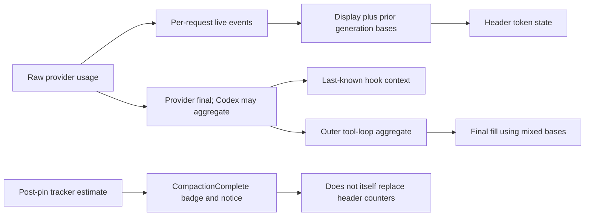

# Accounting and presentation findings

Baseline/evidence classes: [catalog](00-bug-index.md). None of these findings alone
quantifies the backend-specific excess in the October 16 Qwen incident.

## CB-14: overlapping usage fields are added as disjoint

**Conditional guard/display risk; P1.** Shared `ApiTokenUsage` adds input, cache-read
and cache-creation; context adds output and reasoning. The hook adds input/cache/
output, but not separate reasoning ([A1], [A2]). That works only with a compatible
disjoint-category contract.

OpenAI streaming copies `prompt_tokens` and its cached subset separately, and
output as `total_tokens - prompt_tokens` alongside reasoning detail. It does not
subtract the subsets ([A3]). Codex conversion has the same overlap boundary
([A4]). For backends whose input already includes cache and output already includes
reasoning, shared addition overstates occupancy. This can cause early compaction
or inflated fill even without repeated requests. Raw response fields are required
to attribute a specific incident numerically.

**Required invariant:** normalize once into explicitly inclusive context counters
and separately categorized usage/cost detail. Cached tokens still occupy context;
a cost discount is not a context discount ([A5]).

## CB-15: Claude cache detail is lost before the finish hook

**Static adapter defect; P1.** Anthropic MessageStart carries input plus cache
read/creation, while MessageDelta usage omits cache detail. The terminal collector
constructs usage with both cache fields absent ([A6]). `CompactionHook` consumes
the successful provider-final callback, not the earlier live cache detail ([A2]).
Cached context can therefore be underrepresented in last-known usage. The separate
payload estimate is a guard, not proof of exact compensation. Missing terminal
metadata can also leave default-zero usage.

Non-streaming conversions differ; do not describe this as every Anthropic API
response losing cache ([provider chapter](../current-state/05-claude.md)).
**Required invariant:** preserve compatible terminal cache detail and verify live,
final and hook bases against a cached-input fixture.

## CB-16: context fill combines different time bases

**Static accounting mismatch; P2.** Backend live fill uses current-segment usage;
the streaming display retains prior output/reasoning bases; TokenUpdate publishes
those accumulated counters; TUI-derived fill can add them to input ([A7], [A8],
[A9]). Final fill instead combines display input/cache with Rig outer-final output
and reasoning ([A7], lines 1140–1178). Rig sums provider finals across a tool loop;
Codex can already sum internal requests inside one such final ([A10], [A4]).

Thus “latest input + session/loop generation” need not be one request's context.
Preference for live input protects some display updates but not final output-based
fill or hook usage. Gemini also has distinct live versus final usage and reseed
contracts; that is a provider boundary to test, not independently proof of a new
Gemini compaction defect ([A11]).

**Required invariant:** label request, loop, session-spend and current-context bases;
compute fill from a single coherent context snapshot/generation.

## CB-17: completion is not a token refresh

**Static event-contract defect; P2.** Deferred apply recalculates inner tracker
input and clears output, then emits CompactionComplete ([A12]). The TUI handler
clears progress and shows a badge/notice; it does not assign ordinary counters or
fill ([A13]). Cached background counters and normal TokenUpdate/ContextFillUpdate
are not explicitly refreshed by this producer ([A12], [A14]). A new reduction
notice can therefore coexist with an old full-looking header.

The producer hard-codes both turn-coverage fields to zero ([A12], line 123).
“0 turns summarised” is not measured coverage. Before/after counts also mix a
cached/tracker basis with an estimated rebuilt context; they are not two calls to
the backend's authoritative tokenizer.

Fill is relative to the compaction threshold, not necessarily the absolute model
window. Header rendering rounds that threshold to integer thousands ([A15]).
105% of a trigger is not proof of exceeding backend capacity.

**Required invariant:** publish committed context/token/fill together and represent
unknown coverage as unknown, rather than measured zero. Keep original-history
coverage separate from post-pin active-message count.

## CB-18: persistence and forwarding are not request settlement

**Conditional accounting/observability risk; P2.** On Done, BackgroundOutput persists
cached counts; the helper adds input/output into billed totals, passes zero cache
details and stores reasoning separately ([A14], [A16]). This is not an idempotent,
per-physical-request billing ledger. Retries, duplicate Done, intermediate requests,
already accumulated display output and post-pin cached values need explicit tests.
Actual overbilling/underbilling was not reproduced.

Typed TokenUpdate contains reasoning and cumulative billing fields, but its JSON
projection omits them ([A17]). That projection is used for bridge/subordinate
forwarding; it is not established as the screenshot's primary TUI route.

The manifest already has separate context/spend fields ([A18]); the problem is
producer/update semantics, not the complete absence of a schema distinction.
**Required invariant:** settle usage by stable request identity; preserve supported
fields across all forwarding projections and specify unknown/missing usage.

## Source references

[A1]: ../../rust/core/src/token_usage.rs#L64
[A2]: ../../rust/core/src/compaction_hook.rs#L212
[A3]: ../../rust/patches/rig-core/src/providers/openai/completion/streaming.rs#L83
[A4]: ../../rust/providers/src/codex/streaming.rs#L128
[A5]: ../../rust/core/src/compaction/model.rs#L90
[A6]: ../../rust/patches/rig-core/src/providers/anthropic/streaming.rs#L331
[A7]: ../../rust/cli/src/interactive/stream_loop.rs#L1099
[A8]: ../../rust/core/src/streaming_display/output_token_tracker.rs#L49
[A9]: ../../rust/fspec-tui/src/store/agent_view/token_state.rs#L64
[A10]: ../../rust/patches/rig-core/src/agent/prompt_request/streaming.rs#L756
[A11]: ../../rust/cli/src/interactive/gemini_continuation.rs#L161
[A12]: ../../rust/agent-loop/src/inject_summary_handler.rs#L103
[A13]: ../../rust/fspec-tui/src/app/dispatch_compaction_complete.rs#L45
[A14]: ../../rust/agent-loop/src/background_output.rs#L441
[A15]: ../../rust/fspec-tui/src/views/agent/header_build.rs#L153
[A16]: ../../rust/agent-loop/src/persist.rs#L202
[A17]: ../../rust/agent-loop/src/stream_chunk_json.rs#L96
[A18]: ../../rust/core/src/persistence/manifest.rs#L177
