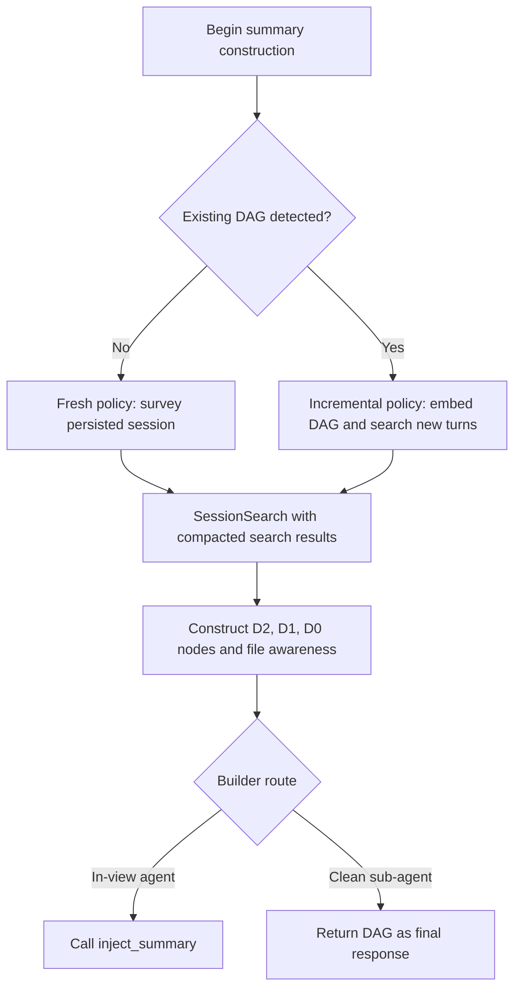
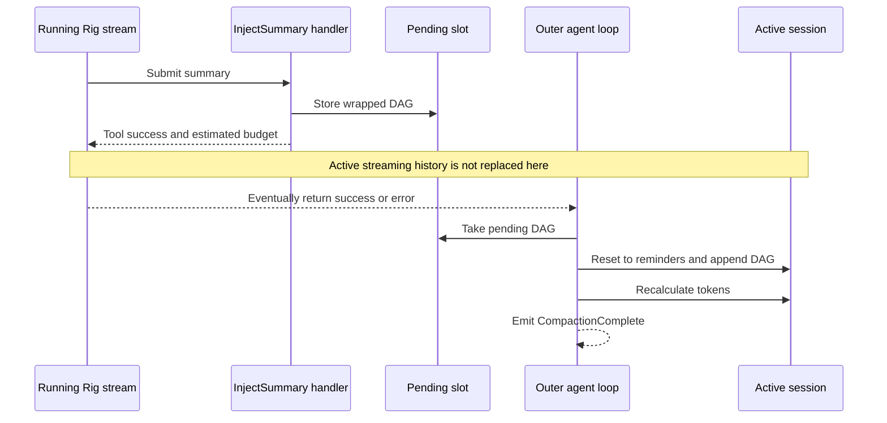
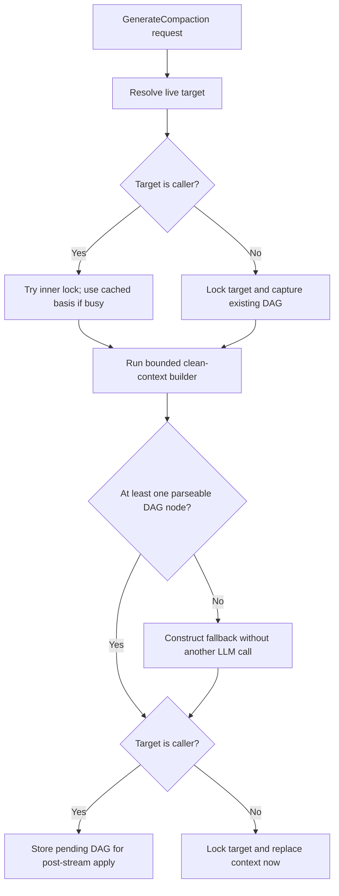

# Current state: DAG construction and application

## Representation and discovery

A summary is wrapped in a `<system-reminder>` carrying
`<!-- type:compaction-dag -->`. Its `<dag-node>` blocks have depth, inclusive turn
range, and label attributes. D2 means durable decisions; D1 means a work arc; D0
means recent detail. Search references point back to original persisted turns.
`<dag-files>` preserves touched-file awareness and may be synthesized from structural
annotations if the injected summary omits it.

`detect_existing_dag` scans user messages and examines the first content item. It
returns the first matching marker and maximum parsed `turn_end`, not a separately
versioned authoritative checkpoint. Range validation can discard metadata nodes
when supplied bounds do not match the indices in the summary; this does not prove
their text was removed from the injected reminder.

The parser matches opening tags with a specific attribute order, rejects inverted
ranges, optionally rejects/clamps to a message count, and removes same-depth
overlaps. Cross-depth overlap is allowed. A parseable node does not require a
closing tag, body, coverage completeness or semantic validity. Deferred apply uses
active-message count even though search ranges can refer to persisted message
indices; detection and clean-builder acceptance use no count bound.

Sources: `rust/core/src/compaction/model.rs:459`, `:478`, `:541`;
`rust/agent-loop/src/session_search_handler.rs:219`.

Sources: `rust/cli/src/compaction_dag.rs:138`,
`rust/core/src/compaction/model.rs:1`,
`rust/agent-loop/src/inject_summary_handler.rs:264`.

## Fresh and incremental builder policies

Fresh instructions ask the agent to search strategically: recent turns, errors and
fixes, decisions and architecture, open questions and blockers. They request a
hierarchical DAG plus file awareness, then injection.

Incremental instructions embed the previous DAG, preserve durable D2 nodes, promote
older detail, and search new turns starting at `max_turn_end + 1`. These are prompt
policies: there is no general proof here of complete coverage, non-overlap,
faithfulness, or mandatory preservation of every durable fact.

Layer-0 trimming reduces bulky search results such as encoded content/metadata;
original persisted history remains the recovery source. Structural trimming and
semantic summarization are different operations.

Sources: `rust/cli/src/compaction_dag.rs:26`, `:85`, `:322`;
`rust/core/src/compaction/trimmer.rs:1`.

## In-view compaction

`execute_compaction` prepares reduced builder context: recognized reminders and
fresh/incremental instructions, embedding the previous DAG where detected.
History is expected to be searchable on disk. This preparation is not the completed
summary. The resumed agent must construct and submit the DAG.

The reset retains only the latest message of each recognized reminder type, clears
turn analysis, and resets provider-session state. `compaction-dag` is not a recognized
type: partitioning drops its old message, rather than selectively stripping its
text. Arbitrary reminder types are not preserved. Stored structural annotations
are not rendered into this builder context. Recalculation updates tracker context.

Sources: `rust/cli/src/interactive_helpers.rs:205`, `:274`, `:587`.
Reminder partition: `rust/cli/src/session/system_reminders.rs:55`, `:216`.

## Deferred InjectSummary application

The handler cannot acquire `session.inner` because streaming holds it. It wraps
the submitted text, stores it in a single pending slot, clears the active flag,
and returns estimated summary size and budget. A later submission can replace the
pending slot; it is not a queue of versioned compaction transactions.

Only after the stream returns does `apply_pending_dag` take the content, append
missing file awareness where possible, reset active history to reminders, append
the summary, and recalculate token tracking. Completion is emitted after that
recalculation. It reports zero turns summarized/kept because those fields are
hard-coded here.

Application runs on success or error with no generation check. Resetting the then-
current history can discard non-reminder work accumulated after submission. A later
in-loop preparation/direct pin does not invalidate the pending slot, which can
subsequently supersede it. The runner can emit Done before this apply point.

Sources: `rust/agent-loop/src/inject_summary_handler.rs:49`, `:103`, `:245`, `:323`;
`rust/agent-loop/src/agent_loop.rs:1398`.

## Clean-context overflow compactor

An ephemeral builder inherits the recovery target's provider/model and reads the
parent through SessionSearch. Its tool surface is the read-only research set,
including Bash; permission enforcement is a separate concern. It does not call
InjectSummary. Depth and wall-clock bounds limit its run.

The host parses its final DAG and pins directly while owning the parent session
mutation boundary. Missing handlers, failure, timeout, or unparseable output take
the deterministic fallback route. Completion follows direct reset/recalculation.
This describes the in-stream shared round; the outer terminal-error caller has a
separate held-lock defect and has already unregistered its builder (chapter 02).

Sources: `rust/cli/src/compactor_sub_agent.rs:107`, `:164`,
`rust/agent-loop/src/generate_compaction_handler.rs:47`.

## GenerateCompaction: caller versus another live session

| Concern | Caller target | Other live target |
| --- | --- | --- |
| Capture lock | `try_lock`, never await own held lock | Await target inner lock |
| Existing DAG under contention | Not read; fresh policy selected | Captured under target lock |
| Basis under contention | Cached token/turn counters | Message/token snapshot under lock |
| Pin | Deferred pending slot | Reacquire target lock and apply immediately |
| Tool success | Summary queued, not yet applied | Context replacement performed before return |
| Concurrency | Caller stream can continue before apply | Target may change while generation runs |

The tool resolves live sessions, not arbitrary persisted UUIDs. Its generation
provider/model are captured from the caller, including cross-session targeting.
Lock waits sit outside the sub-agent timeout, so that timeout is not a universal
bound on the whole operation.

Mutual cross-session calls can form a lock cycle because each caller holds its own
inner lock while awaiting the other target. Self-target pending-slot mutex poisoning
returns an error without queuing or pinning. Successful cross-target pin sets the
target Running rather than restoring its previous status. These are source-visible
behaviors/risks, not live concurrency reproductions.

Sources: `rust/agent-loop/src/generate_compaction_handler.rs:454`, `:528`, `:565`,
`:728`, `:773`.
Failure/status details: `rust/agent-loop/src/generate_compaction_handler.rs:735`, `:790`.

## Fallback guarantee is limited

The fallback extracts complete node blocks from available output/error text; if
none exist, it creates a coarse D1 recovery node. "Free" means no additional LLM
call for fallback construction, not that the failed builder incurred zero cost.

The current helpers do not prove semantic completeness or strict fit within a
target token budget. Large surviving reminders alone can exceed a small window.
Pin paths also differ in explicit billing/cache reset bookkeeping. These limits
must remain visible when describing convergence.

Only deferred application synthesizes missing `<dag-files>`, and only when that
literal opening string is absent; direct automatic/cross-target pins do not repair
it. An existing empty or malformed block bypasses repair. Automatic clean fallback
emits CompactionFailed then CompactionComplete; GenerateCompaction instead notes
fallback in its result. Watchdog fallback emits no CompactionComplete at all.

Sources: `rust/cli/src/compaction_dag.rs:222`, `:281`,
`rust/cli/src/compactor_sub_agent.rs:107`.
