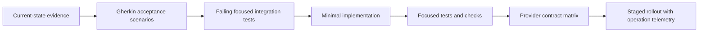
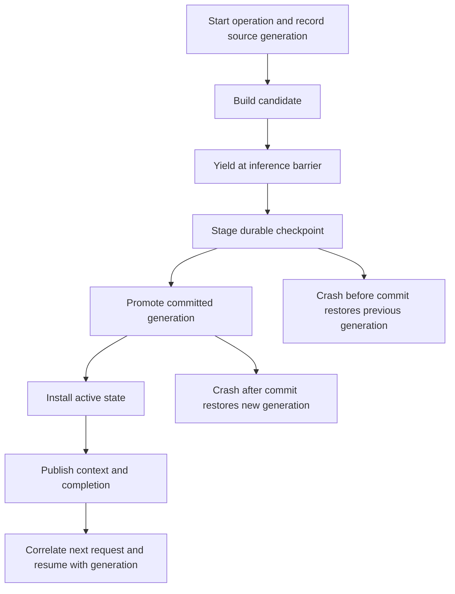

# Future state proposal: verification, observability and rollout

Status: **proposed acceptance and test plan**, not an implementation or claim of
passing runtime tests. Current research changed documentation only.
The selected direction is [research-backed DAG retention](05-research-foundation.md)
with **no fallbacks**. The [removal plan](../compaction-bugs/08-no-fallback-removal-plan.md)
supersedes historical success-oriented fallback criteria; do not silently retain
them in implementation tests.

## Development order

Follow repository ACDD for each implementation slice: feature scenarios first,
corresponding failing tests second, minimal implementation last. Register tags
through fspec and keep scenario/test mapping explicit. The candidates below must
be translated into actual feature files before production changes.

Do not solve the central sequencing failure only with a UI patch or a larger retry
budget. Begin with the next-wire-request invariant, then extend it to durable
resume, provider usage and presentation.

## Candidate scenario matrix

Each row is a proposed individual scenario with one corresponding integration test.
Split further if a row needs distinct observable outcomes.

| Candidate | Given / when | Required observable outcome |
| --- | --- | --- |
| Live self-injection barrier | Agent submits summary while the streaming lock is held | No next ordinary request uses superseded builder history |
| Deferred acknowledgement | Self-tool accepts a candidate | Response says queued/handoff, not durable commit |
| One commit event | Candidate applied successfully | Exactly one operation-scoped completion follows activation |
| Boundary durability | Session restarts after successful commit | Summary and verified suffix restore on committed generation |
| Original search | Compaction commits and session resumes | Covered original messages remain searchable |
| Wrapped summary replay | Committed summary contains the DAG reminder markers | Resume retains the committed DAG instead of filtering it as stale |
| Token-state replay | Manifest contains saved normalized counters | Resume applies counters rather than only checking session existence |
| Repeated live resume | Target already contains restored messages | Declared idempotent/replace behavior prevents accidental duplication |
| Stale cross-target candidate | New input arrives while another caller builds | New turns preserved or candidate explicitly rejected |
| Conflicting injection | Different candidate arrives for same source operation | Deterministic rejection or explicit supersession |
| Idempotent repeat | Same operation/candidate submitted again | No duplicate commit, counter reset or completion |
| Cancellation before commit | User cancels builder | No false success or new committed generation |
| Cancellation after commit | Cancellation races successful promotion | Durable commit retained and reported consistently |
| Builder exhaustion | Builder times out or repeatedly fails | Bounded typed failure, unchanged committed generation, blocked inference; no replacement or completion |
| Mandatory oversize | Required reminders exceed budget | Unsafe inference blocked with actionable reason |
| Tool-pair preservation | Compaction interrupts a tool cycle | Next provider request has valid call/result pairing |
| Bad metadata ranges | Candidate covers invalid history indices | Explicit validation failure, not silent coverage success |
| Latest context usage | Codex completes multiple internal requests | Hook receives latest context, billing receives operation sum |
| Internal continuation guard | Growing continuation would exceed capacity | Request is not sent before compaction/recovery decision |
| Cache subsets | Prompt input already includes cached detail | Context counts cached tokens exactly once |
| Reasoning subsets | Output already includes reasoning detail | Context counts generated tokens exactly once |
| Missing usage | Backend emits no usage | Estimated context and unknown spend are distinguishable |
| Usage-only terminal chunk | Backend ends without content | Valid final usage survives settlement |
| UI commit refresh | Commit replaces old large context | Header and reduction notice identify same new generation |
| Unknown coverage | Summary coverage cannot be measured | UI reports unknown, not misleading zero summarized turns |
| Terminal recovery lock | A streamed turn returns Err while owner holds inner lock | Bounded result/status, no re-entrant wait; builder registration remains valid |
| Mutual cross-target calls | Two callers compact each other concurrently | Explicit conflict or bounded completion, no lock cycle |
| First overflow | Adapter's declared error parser admits compaction | Same selected DAG protocol, no classifier-driven strategy switch or escalation |
| Watchdog reset | One failure is explicitly resolved, then a new episode starts | Independent episode budget; no synthetic Continue, forced pin or failure-as-completion |
| Missing builder | Handler is absent or registry cannot be accessed | Typed dependency failure, no generic recovery DAG |
| Invalid candidate | Valid-looking fragment accompanies malformed or incomplete nodes | Whole candidate rejected; no salvage or metadata clamping into success |
| WebSocket unavailable | Configured upgrade returns 404/405/426/501 | Explicit transport failure, zero HTTP requests |
| Removed delta mode | Legacy configuration requests delta encoding | Explicit unsupported outcome with no send; full-current-DAG is the only supported mode |
| Replay unavailable | Tool result or compatible checkpoint cannot be recovered | Typed replay failure, no fabricated result or raw-history reconstruction |
| Full tool retrieval | Unique sentinel is beyond persisted tool preview | Search/retrieval recovers the retained structured payload after resume |
| Settlement identity | Multiple requests, repeated Done, or error/interruption occur | No duplicate settlement; unknown/unreported costs remain distinguishable |
| Forwarding parity | Typed tokens traverse bridge/subordinate JSON | Reasoning and billed fields retain normalized meaning |
| Concurrent manifest writers | Checkpoint interleaves with message/provider/token save | No newer state lost to stale whole-manifest snapshot |

## Integration harness design

Use real temporary stores and repository `rust/test-helpers` rather than duplicating
filesystem setup. A local scripted HTTP/SSE/WebSocket fixture is appropriate for
observing wire payloads without credentials; it redirects requests instead of
mocking away the control flow under test.

For the principal regression, exercise live agent-loop dispatch, Rig tools and the
pending application boundary. Capture the next outbound request and assert its
content and generation, not only final `session.messages.len()`. Make the fixture
fail if an unexpected old-history request arrives after candidate acceptance.

For resume, use a fresh process or explicitly reset/reinitialize persistence
singletons and reload from disk. `load_session` clones a cached manifest; merely
tearing down active objects can accidentally validate cache rather than durability.
Assert summary plus suffix, provider reset/checkpoint compatibility, stable coverage
identity, token provenance and original-history search. Mutating process-global
stores requires `serial_test`. No live provider credentials belong in fixtures.
Include structured tool results beyond preview length and assert model-history
blocks, not only UI scrollback. Test corrupt/truncated manifests separately; these
controlled failure tests do not prove power-loss durability.

Use property tests for parser/serialization/range normalization and subset-accounting
invariants. Use YAML snapshots for complex normalized events and request payloads
after redacting nondeterministic IDs. A snapshot cannot replace the no-stale-request
assertion or prove semantic completeness of the summary.

## Provider-specific fixture coverage

| Route | Minimum transport/usage cases |
| --- | --- |
| Claude API/OAuth | Cache start/delta/final consistency, auth-mode preambles, call IDs, thinking versus context errors |
| OpenAI-compatible/Z.AI | SSE and OpenAI non-streaming adaptation, usage-only chunks, inconsistent live/final counts, cache/reasoning subsets, overflow |
| Gemini | Empty versus omitted candidates, signed-invalid counters, thought/cache fields, separate continuation hook states, signature retention |
| Codex SSE | Logical versus transport retries, interrupted terminal versus EOF, continuation usage, checkpoint reset, HTTP diagnostic-body loss |
| Codex WebSocket | Full-current-DAG only, generation binding, removed delta selection, upgrade failure with zero HTTP attempts |
| Codex native removal | Activation surfaces removed; unexpected opaque items fail without alternate-memory activation |
| Copilot | Concrete chat route, construction-time token versus refresh/rebinding, cache markers; new branches only when wired |
| Custom provider | Snapshot replace/retain/zero merge, malformed/unknown usage, output-limit propagation and unsupported continuation |
| Stub | Deterministic common lifecycle without claiming vendor equivalence |

Provider-independent scenarios should be parameterized where that preserves clear
scenario mapping. Transport-specific behavior needs explicit scenarios, not an
assertion that one stub stands in for every vendor.

## Crash and race matrix

Inject controlled failures at durable transition boundaries. These are candidates
for filesystem/store fixture tests, not requests to use unsafe code or kill a
developer's running session.

| Interruption point | Expected restored state |
| --- | --- |
| Before candidate accepted | Previous committed generation |
| After candidate accepted, before durable promotion | Previous generation plus pending/failure status under declared policy |
| During staging write | Previous valid checkpoint, no partial record treated as committed |
| After promotion, before active installation | New committed generation reconstructed on restart |
| After activation, before UI event | New generation, no duplicate semantic commit |
| Provider metadata older than generic generation | Apply only a recorded commit-time reset decision; otherwise explicit incompatible-state failure |
| Input arrives during builder | Verified suffix preserved or source conflict surfaced |
| Two compaction initiators race | One serialized commit or explicit generation conflict |
| Message/token/provider save races checkpoint | Revision-safe merge/serialization preserves both updates |
| Commit succeeds but completion publication fails | Durable result discoverable; delivery deduplicated independently of semantic commit |

## Observability contract

Emit structured tracing with operation ID, target session, source/committed
generation, trigger reason, builder route, attempt count, measured/estimated token
bases, coverage boundary, provider reset decision and elapsed stage times.

Separate `candidate_queued`, `apply_started`, `checkpoint_committed`, `activated`,
`completion_published` and `next_request_sent`. An observer should be able to answer
whether a post-injection request used old history without reading a private prompt.
Avoid logging credentials, raw tool results or complete conversation text.

Metrics should count stale-generation requests, rejected candidates, blocked
operations, commit failures, unknown-usage frequency, next-request overflow and restored
generation mismatch. A good compression percentage alone is not success.
Any fallback activation during regression fixtures is a test failure, not a
successful recovery metric.

## Rollout sequence

1. Add end-to-end regression fixtures and operation-level telemetry without changing
   meaning of existing public success fields silently.
2. Introduce typed handoff and generation validation behind a controlled migration
   path; prove no old-history inference after acceptance.
3. Add durable checkpoint schema, explicit legacy migration and crash tests.
4. Normalize provider usage one adapter at a time with raw-to-normalized fixtures.
5. Update UI/RPC contracts for committed context and unknown coverage.
6. Enable by default only after targeted transport and resume suites pass.

Legacy sessions without versioned compaction records need an explicit, user-visible
migration before ordinary inference: preserve originals and validate its result.
Unsupported migration fails; it must not quietly rebuild as resume fallback.
Do not invent a generation relationship for old Codex metadata. Rollback should
remain able to access original history even if it cannot reuse newer checkpoints.

## Validation commands and scope

Run actual affected package/target names after creating their tests, for example
`cargo test -p codelet-cli --test compaction_recovery_unification_test` from `rust/`.
Add corresponding package-scoped `cargo check`, `cargo clippy` and formatting for
changed implementation crates. Confirm package names in Cargo manifests rather
than assuming a directory name is the package name.

Never run unscoped `cargo test` or `cargo test --workspace`; repository guidance
documents excessive linking/resource cost. Feature validation and tag validation
are additional checks, not replacements for next-request and crash/resume tests.
Mermaid attachment validation for this research is recorded in `../VALIDATION.md`.
