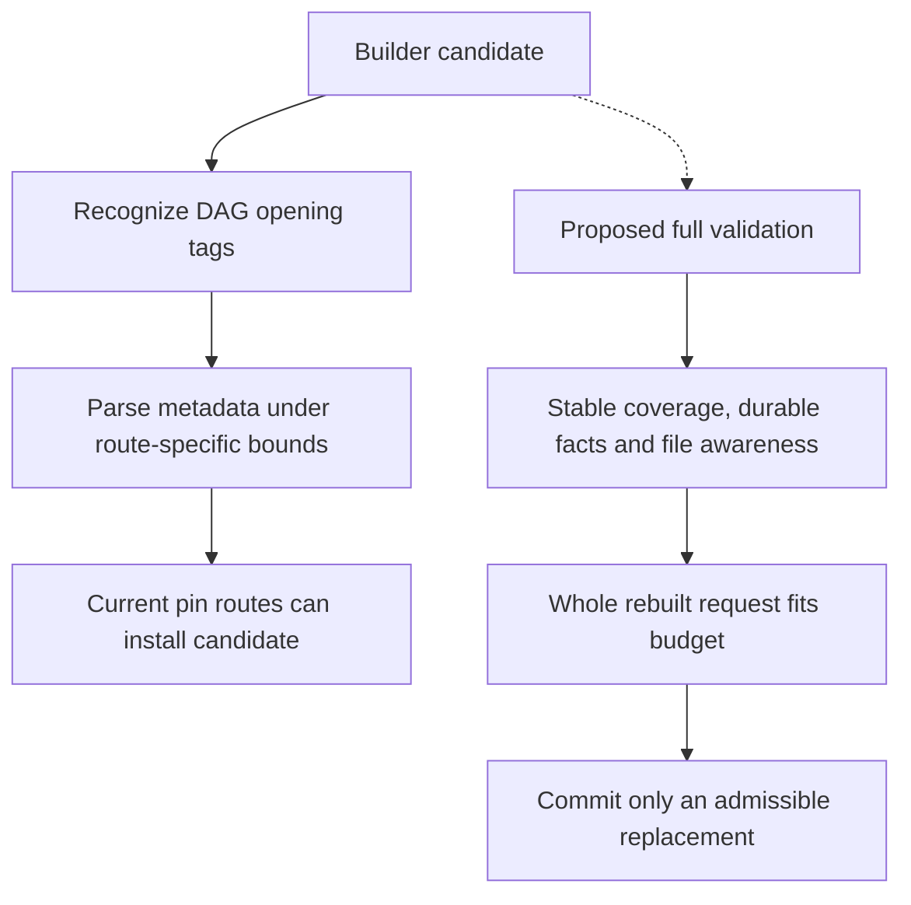

# Builder validation and convergence findings

Baseline/evidence classes: [catalog](00-bug-index.md). A syntactically parseable
summary, a smaller estimated context, and a successful next inference are different
claims. This chapter does not certify summary fidelity.

## CB-19: coordinate mismatch and weak DAG acceptance

**Observed warnings + static validation defect; P1.** SessionSearch turn indices
enumerate persisted records ([B1]); deferred apply instead calls
`parse_dag_nodes(..., Some(session.messages.len()))` on the current active history
([B2]). After earlier compactions these are not the same coordinate space. The
incident logs warn that starts 101 and 156 exceed active count 37
([incident](../current-state/12-incident-and-evidence.md)).

The parser rejects out-of-bounds starts, clamps ends and removes same-depth overlap
from **metadata** ([B3]). Deferred apply still injects the wrapped text even when
the parsed list is empty ([B2]). Therefore metadata rejection alone does not show
loss of the actual summary text, but it can break metadata-based coverage tracking.
Existing-DAG detection and clean-builder acceptance parse without those active
count bounds ([B4], [B5]).

Opening-tag recognition requires a particular attribute order and does not require
a closing tag, body, complete coverage, or preservation of D2 text ([B3]). At least
one parseable metadata node is not semantic or structural validation of the whole
candidate. Incremental preservation instructions remain a prompt policy ([B4]).

**Required invariant:** use stable persisted identities/watermarks, validate a
complete candidate before replacement, and keep metadata/text agreement explicit.
Do not indiscriminately ban cross-depth overlap: the hierarchy intentionally permits it.

## CB-20: a bounded builder does not guarantee a fitting context

**Capability gap and conditional convergence risk; P1.** The clean builder has
depth/time limits and deterministic fallback; neither implies that retained
reminders plus fallback plus tool/schema overhead fit the provider window ([B5],
[B6]). The summarization-budget helper is defined, but no consumer was found in
the inspected production builder routes ([B7]). No host-side final fit veto is
present at the inspected pending/direct pin sites ([B2], [B5], [B8]).

Large reminders can dominate even a tiny fallback. Extracted partial nodes can
also be large. The generic recovery node preserves a recovery pointer, not the
meaning of every discarded turn ([B6]). “Free fallback” means no additional LLM
call for fallback construction, not zero cost for the failed attempt.

**Required invariant:** validate the **whole** rebuilt request against a meaningful
budget before declaring successful compaction. If fixed instructions alone cannot
fit, fail explicitly and block. Remove fallback generation and partial salvage
under [CB-28](08-no-fallback-removal-plan.md); promise bounded termination, not
guaranteed successful shrinking.
The watchdog is post-stream, not an executing-builder timeout (CB-06).

## CB-21: preservation is path-dependent

**Static asymmetry; P2.** Reset keeps the latest message of each recognized reminder
type. The DAG marker is not one of those types: the old message is dropped, and
builder instructions must explicitly carry its contents where applicable ([B4],
[B9]). Arbitrary reminder types and structural annotations are not all rendered
back into builder context. This is narrower than “preserve every system reminder.”

Only deferred apply synthesizes a missing `<dag-files>` block, and only if the
literal opening string is absent. An empty/malformed block bypasses synthesis.
Direct automatic/cross-target pins do not perform that repair ([B2], [B5], [B8]).
Self-target GenerateCompaction under its normal held-lock contention cannot read
the active DAG and selects fresh instructions instead of incremental preservation
([B8]). That is a deliberate deadlock accommodation, not proof of equivalent D2
or file-awareness retention through a fresh rebuild.

**Required invariant:** define required durable content and file-awareness metadata
once, then validate it across every supported commit route; remove fallback routes.
Not every arbitrary reminder
must be retained forever; acceptance criteria must decide which are authoritative.

## CB-22: saved threshold is not always propagated

**Static wiring gap; P2.** Profile persistence stores `compactionThreshold`, and the
resolver accepts explicit threshold configuration ([B10], [B7]). Initial-session
and model-switch cached threshold calculations pass `None` for that override
([B11], [B12]). Resolver unit tests cannot prove end-to-end propagation.

The streaming runner has other resolution paths ([B13]); this is not a claim that
every guard ignores configuration. Header/cached thresholds and active recovery
policy can diverge unless they share the resolved value and provenance.

**Required invariant:** trace profile → session creation/switch → hook/recovery/UI
with an override that differs from the default, and assert the same effective
threshold where the contract requires it.

## Source references

[B1]: ../../rust/agent-loop/src/session_search_handler.rs#L231
[B2]: ../../rust/agent-loop/src/inject_summary_handler.rs#L262
[B3]: ../../rust/core/src/compaction/model.rs#L454
[B4]: ../../rust/cli/src/compaction_dag.rs#L85
[B5]: ../../rust/cli/src/compactor_sub_agent.rs#L119
[B6]: ../../rust/cli/src/compaction_dag.rs#L222
[B7]: ../../rust/cli/src/compaction_threshold.rs#L102
[B8]: ../../rust/agent-loop/src/generate_compaction_handler.rs#L565
[B9]: ../../rust/cli/src/session/system_reminders.rs#L55
[B10]: ../../rust/sessions/src/profile_persistence.rs#L211
[B11]: ../../rust/sessions/src/session_creation_helper.rs#L300
[B12]: ../../rust/sessions/src/handle_impl.rs#L1493
[B13]: ../../rust/cli/src/interactive/stream_loop.rs#L306

Navigation: [B3] regex at 459, bounds at 508, overlap at 535; [B4] detection at
138, fallback helpers at 222/281; [B8] acceptance/generation at 683–725, pin at
773. Reset implementation: [interactive helpers](../../rust/cli/src/interactive_helpers.rs#L274).
