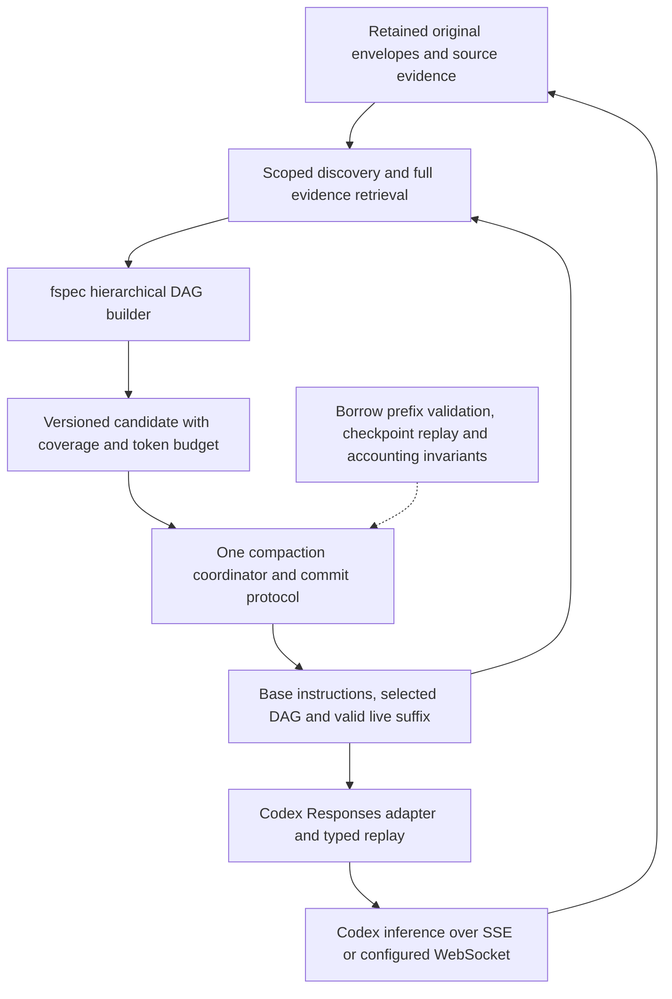
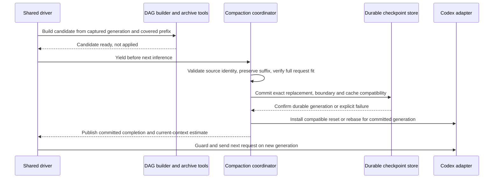
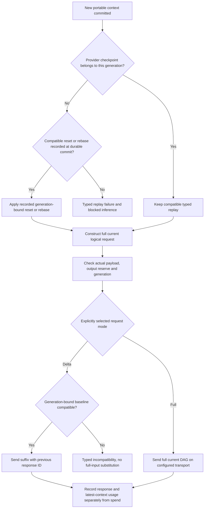
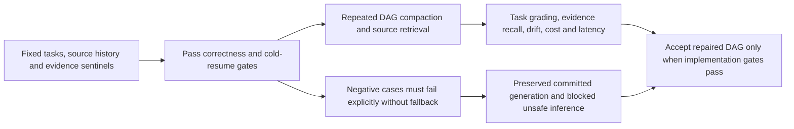

# Reusing fspec DAG compaction with Codex

Date: **2026-10-17**. Tracking card: **CMPCT-051**. Documentation only.
fspec baseline: `28d8e812ef4269d46b25f517574501902836902b`.
Upstream inspected in `/tmp/codex`: `bb64b894fd67158be0f874872e6d7bfe717e7368`.
**Selected architecture: retain the research-backed DAG, repair it, no fallbacks.**
The repairs below are proposed, not implemented.

## Answer and recommendation

**Yes: keep fspec's repaired DAG summarization and conversation retrieval as the
sole application-owned memory system for this repair, including Codex inference.**
Borrow upstream Codex's explicit history-replacement, concurrency, replay and
transport contracts. Do not replace our memory architecture merely to use OAuth,
Responses, or Codex models. These are separable concerns ([F1], [F2], [F3]).

The original CMPCT-005/016 cards and attachments establish the research lineage.
LCM's published evaluation demonstrates long-context superiority over Claude Code:
74.8 versus 70.3 average score, winning at every tested length from 32K to 1M.
See the [primary-paper review](05-research-foundation.md) for methods, limitations
and CMV support. This is empirical support for the selected architecture, not a
benchmark of this fspec build against upstream remote V2 or an isolated DAG ablation.
Retrieval can recover an omission; it does not put every fact into active context.

Prefer **fspec memory + selected Codex lifecycle ideas + existing Codex transport**.
Remove native opaque compaction entirely. Do not gate DAG retention on a new native
comparison, add a hybrid accelerator, or substitute another memory algorithm on failure.

## What “Codex compaction architecture” means

There are two integration targets, not one:

1. **fspec using its existing Codex provider:** reuse the current OAuth/Responses
   adapter and repair shared compaction. No upstream compactor must be embedded.
   Normal construction leaves native compaction off; explicit native opt-in appends
   `compaction_trigger` ([F1], [F2]). This is the recommended target.
2. **Changing the upstream Codex client itself:** a DAG builder could conceptually
   replace its textual summary generation and feed its replacement-history layer.
   This needs a new history/retrieval adapter, not just a different summary prompt.
   Upstream local compaction already installs readable summaries as contextual user
   content ([U1]). That is architectural precedent, not a ready-made fspec plugin.

Upstream remote V2 instead requests a native opaque item through ordinary Responses
streaming and constructs retained history around it ([U2]). A text DAG is **not**
valid `encrypted_content`; it cannot be substituted inside that item. Remote V2
in this revision is not a `/responses/compact` call. Detailed wire-contract research
is [separate](../compaction-bugs/06-upstream-codex-contract.md).

## Research-backed choice and current implementation gaps

| Dimension | Repaired fspec DAG and retrieval | Upstream native opaque compaction |
| --- | --- | --- |
| Human inspection | Readable decisions, coverage and evidence references | Client cannot inspect encrypted summary semantics |
| Historical recall | Can fetch retained source evidence on demand | Native item alone is not a cross-session retrieval index |
| Provider portability | Summary text can be re-encoded for other providers | Opaque state is not established as portable across providers/models |
| Continuation fidelity | Depends on summaries, retained suffix and retrieval quality | May preserve useful model-specific state; comparative quality unknown |
| Cost and latency | Search, summarization and later retrieval incur work | Native generation/replay also incurs work; relative cost unknown |
| Durability | Requires repaired checkpoint and retrieval contracts | Upstream records replacement state; append is not atomic crash durability |

**Retrieval is not exclusive to DAGs.** A native-compaction client can also call
SessionSearch or another archive tool. The LCM result evaluates a system including
both summary DAGs and engine-managed task partitioning. It is not evidence that
archive access is exclusive to DAGs. Preserve the selected architecture and test
fspec's implementation obligations rather than making retention conditional again.

Today fspec parses `DagNodeMeta { depth, turn_start, turn_end, label }`, not explicit
globally identified nodes/edges ([F4]). D0/D1/D2 express a hierarchical policy, not
proof of a persisted cross-session graph, acyclicity or complete source coverage.
Cross-session search exists separately; default search is project-scoped, while
`show` addresses a session UUID ([F5]). Tool persistence retains full envelopes in
metadata but stores a short content preview; the search resolver does not generally
recover that nested full payload. `show` also truncates and takes its limit from
the end of the selected range ([F6], [F7]).

Therefore say **“recoverable evidence across retained, accessible sessions”**, not
“all knowledge across all time.” Deletion, scope, unavailable blobs and permissions
must be explicit. An arbitrarily large archive is compatible with a bounded prompt;
an arbitrarily large pinned DAG is not. Durable nodes also need budgeted selection.

## Reuse map

| Component | Recommendation | Boundary or repair required |
| --- | --- | --- |
| Original conversation/envelope store | Keep as evidence archive | Full structured retrieval; stable addresses; retention controls ([F6], [F8]) |
| SessionSearch | Keep discovery and cross-session navigation | Separate previews from full evidence; stable forward pagination ([F5], [F7]) |
| D0/D1/D2 and incremental builder | Keep summary policy | Coverage, provenance, semantic evaluation and hard fit checks ([F4], [F9]) |
| Trimming, annotations, file awareness | Keep bounded builder views | Lossy navigation aids, not archival truth or immutable file contents ([F14], [F10]) |
| Clean-context compactor | Keep isolated generation concept | Generation-bound candidate; no destructive stale pin ([F15]) |
| Pending InjectSummary handoff | Keep tool-facing submission intent | Replace success-before-apply with typed yield/commit lifecycle ([F10]) |
| Codex OAuth and Responses adapter | Keep inference front door | Authentication does not choose the memory algorithm ([F1], [F3]) |
| Typed Codex replay/checkpoint | Keep same-generation continuation | Explicit reset/rebase on DAG replacement; preserve tool pairing ([F11]) |
| WebSocket request mode | Full-current-DAG only; remove delta mode | WS setup failure is an error, not HTTP downgrade ([F12], [U6]) |
| Upstream captured-prefix installation | Borrow invariant/design | Validate generation, ownership and covered prefix; retain live suffix ([U3]) |
| Upstream checkpoint/recompute | Borrow reconstruction/accounting ideas | Define fspec's own durable commit; separate context from spend ([U4], [U5]) |
| Native opaque compaction | Remove entirely; not a repair alternative | Not DAG output and not a fallback replacement owner ([F2], [U2]) |

Reuse means retaining concepts and working helpers, **not preserving today's unsafe
application sequence**. See the [bug catalog](../compaction-bugs/00-bug-index.md)
and [transactional proposal](01-transactional-lifecycle.md) for required repairs.

## Proposed composition: one owner, three separate artifacts

1. **Evidence archive:** append original structured envelopes independently of active
   window size. Give references project/session/envelope/block identities and a
   source revision or integrity hash. Define unavailable/deleted evidence outcomes.
2. **Portable committed context:** exact selected DAG text, validated provenance,
   required instructions and structured suffix. Cross-session nodes need explicit
   source identities; local turn ranges alone are ambiguous. If a true DAG is
   promised, persist typed edges and validate resolution/acyclicity. Keep historical
   quoted instructions as evidence, not newly authoritative system instructions.
3. **Provider continuation cache:** model/account/configuration/generation-compatible
   Codex typed items and optional transport baseline. This can preserve ordinary
   reasoning/tool continuity within a generation, but cannot secretly override a
   new portable context. Do not copy opaque reasoning into DAG prose or assume it
   survives a cross-model reset. The human selected full-current-DAG requests only:
   remove delta mode and its baseline, without permitting raw-history replay.

The current DAG wrapper is injected as a user message ([F10]); its textual
`system-reminder` name does not itself change its protocol role. Keep actual base
instructions in their supported instruction channel and verify the serialized wire
request. All-role/tool payload acceptance remains an integration-test obligation.

### Safe generation and installation

Capture the source prefix and generation, build from archive/snapshot without holding
the target's streaming mutex, then yield at an inference boundary. Under the owner
lock, reject replacement/rollback/auth/model incompatibility. Ordinary appends may
remain a valid suffix if the captured prefix is unchanged, following [U3].
Recheck **base instructions + selected DAG + suffix + tools/schema + output reserve**,
not summary length alone. Reject oversized candidates; any explicitly permitted
same-algorithm retry uses the same source contract and validator within its budget.
Cancellation/failure retains committed state and blocks ordinary inference until
explicit resolution. Never turn fragments, generic nodes or error text into success.

This diagram is a **proposed logical contract**, not an existing transaction or a
claim that separate memory/disk writes become atomic. Implementation must fence
requests during install and recover deterministically if a process stops between
durable promotion and in-memory/cache install. Resume should load the committed
replacement plus subsequent accepted suffix, not replay every original message.
Upstream provides useful replacement/reconstruction patterns ([U4], [U7]); its
memory-before-append and logged append failure do **not** certify crash atomicity.

### Codex-specific boundary work still needed

Current `CodexHistory::prepare` primarily compares substantive user ancestry and
model. A DAG marker is not an unconditional reset; assistant/tool-only edits can
retain a user prefix ([F11]). Prefer explicit generation fencing over inference
from message contents. Persist generic context and compatible provider state under
one recovery contract; fail safely if a checkpoint reset cannot be persisted.

Guard every actual request, including Codex's internal continuations. Track latest
request context separately from overlapping continuation billing totals; otherwise
compaction decisions can remain wrong even with a good DAG ([F13]). Authentication
refresh/transport retries are not compaction and must not reset memory arbitrarily.

## No alternate compactor or transport fallback

Do not enable native compaction as a secondary accelerator or failure rescue.
Today's capability boolean adds a trigger to prepared requests and native commit
changes provider history independently of generic DAG history ([F2], [F11]); it
does not repair the shared lifecycle. Borrow ownership/installation invariants,
not upstream's alternate compaction algorithms or failure-driven transport changes.

Use one coordinator, one DAG algorithm, one complete-candidate validator and one
generation-aware commit. Configured WS failure must not send HTTP, and removed
delta-mode configuration must not send a request. Missing checkpoint/results must
not become fabricated replay or an archive rebuild. An intentional commit-time
reset is a declared protocol step, not a hidden error-driven repair. The complete
[CB-28 inventory](../compaction-bugs/08-no-fallback-removal-plan.md) covers these paths.

## Verify the selected architecture, not permission to retain it

After correctness repairs, test repeated DAG cycles with known evidence sentinels,
stable source references and held-out continuation tasks. Account for every builder,
search and continuation request, not just the next answer. The published result
supports DAG retention; these checks establish whether fspec faithfully implements
the selected design. They do not require a native/hybrid selection experiment.

Required gates: no inference after handoff on superseded history; stale candidate
rejection with suffix preservation; valid tool-call/result structure; token-fit
bounded success-or-failure termination; and fresh-process restoration verified
against the **next wire request**.
Retrieve a tool-result sentinel beyond the stored preview, plus a historical
cross-session decision. Test model/account changes, cancellation, failed writes,
repeated compaction, repeated resume and archive deletion/scope denial.

Measure task success, wrong/stale-fact rate, evidence-backed recall, repeated-summary
drift, actual active occupancy, total billed/unknown usage, cache behavior, latency
and restart success. Predeclare thresholds on held-out tasks. Report paper results
as paper results and fspec measurements as fspec measurements. **No runtime repair
or comparative benchmark was executed for this documentation task.**

## Source references and related research

Local anchors describe inspected behavior, not completed repairs. Upstream links
pin the revision above; upstream code/tests and live APIs were not executed.

[F1]: ../../rust/providers/src/codex/constructors.rs#L125
[F2]: ../../rust/providers/src/codex/native.rs#L5
[F3]: ../../rust/providers/src/codex/model.rs#L73
[F4]: ../../rust/core/src/compaction/model.rs#L390
[F5]: ../../rust/agent-loop/src/session_search_handler.rs#L168
[F6]: ../../rust/agent-loop/src/persist.rs#L152
[F7]: ../../rust/agent-loop/src/session_search_handler.rs#L398
[F8]: ../../rust/core/src/persistence/manifest.rs#L1166
[F9]: ../../rust/cli/src/compaction_dag.rs#L26
[F10]: ../../rust/agent-loop/src/inject_summary_handler.rs#L245
[F11]: ../../rust/providers/src/codex/history.rs#L76
[F12]: ../../rust/providers/src/codex/websocket_baseline.rs#L30
[F13]: ../compaction-bugs/05-codex-specific-findings.md
[F14]: ../../rust/core/src/compaction/trimmer.rs#L155
[F15]: ../../rust/cli/src/compactor_sub_agent.rs#L107
[U1]: https://github.com/openai/codex/blob/bb64b894fd67158be0f874872e6d7bfe717e7368/codex-rs/core/src/compact.rs#L391
[U2]: https://github.com/openai/codex/blob/bb64b894fd67158be0f874872e6d7bfe717e7368/codex-rs/core/src/compact_remote_v2.rs#L295
[U3]: https://github.com/openai/codex/blob/bb64b894fd67158be0f874872e6d7bfe717e7368/codex-rs/core/src/session/mod.rs#L4238
[U4]: https://github.com/openai/codex/blob/bb64b894fd67158be0f874872e6d7bfe717e7368/codex-rs/core/src/session/mod.rs#L4301
[U5]: https://github.com/openai/codex/blob/bb64b894fd67158be0f874872e6d7bfe717e7368/codex-rs/core/src/session/mod.rs#L5144
[U6]: https://github.com/openai/codex/blob/bb64b894fd67158be0f874872e6d7bfe717e7368/codex-rs/core/src/client.rs#L1496
[U7]: https://github.com/openai/codex/blob/bb64b894fd67158be0f874872e6d7bfe717e7368/codex-rs/core/src/session/rollout_reconstruction.rs#L60

See also: [provider contracts](02-provider-contracts.md),
[persistence/retrieval findings](../compaction-bugs/02-persistence-and-retrieval.md),
and [verification priorities](../compaction-bugs/07-verification-priorities.md).
