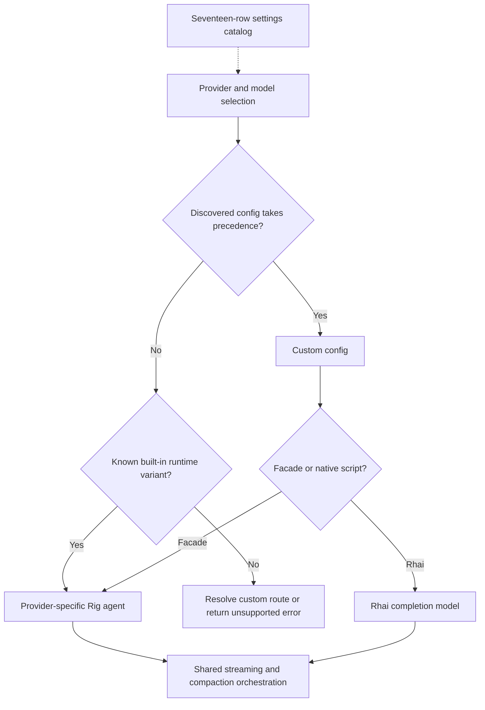

# Current state: complete provider routing inventory

## What counts as a provider

There are six built-in runtime variants, dynamically discovered custom variants,
and a feature-gated test stub. The settings catalog contains seventeen canonical
rows; that is not seventeen independently implemented live compaction transports.
A model family, tool facade, profile, catalog slug, and runtime provider are
different identities.

Sources: `rust/providers/src/manager.rs:20`,
`rust/providers/src/catalog.rs:49`, `rust/agent-loop/src/dispatch.rs:142`.

| Runtime variant | Provider-name input | Registry ID | Transport or dispatch |
| --- | --- | --- | --- |
| Claude | `claude` | `anthropic` | Rig Anthropic, API key or OAuth |
| OpenAI | `openai` | `openai` | Rig OpenAI chat completions, optional custom base URL |
| Codex | `codex` | `codex` | Custom Codex Responses adapter over refreshing transport |
| Gemini | `gemini` | `google` | Rig Gemini |
| Z.AI | `zai` | `zai`, `z-ai` | Rig OpenAI chat completions at selected Z.AI endpoint |
| Copilot | `github-copilot`, `copilot` | Same aliases | Rig OpenAI chat model through Copilot middleware |
| Custom | Discovered config name | Discovered slug | Explicit facade, API-style facade, or Rhai model |
| Stub | `stub`, test-support only | Custom test registration | Deterministic Rig-compatible adapter; not a separate enum variant |

Provider-name parsing lowercases input. The registry mapping is a separate match;
for example `anthropic` is not a built-in `ProviderType::from_str` alias for
`claude`, and registry `google` is not the same input namespace as `gemini`.
Custom configurations can shadow built-ins unless
`FSPEC_DISABLE_SCRIPT_SHADOWING=1` disables that precedence.

## All seventeen catalog entries

| Catalog slug | What the catalog establishes | Compaction interpretation |
| --- | --- | --- |
| `openai` | OpenAI API configuration metadata | Explicit built-in runtime path |
| `anthropic` | Anthropic configuration metadata | Built-in Claude path through registry mapping |
| `cohere` | Cohere settings and default endpoint | No explicit live dispatch arm by this name |
| `gemini` | Gemini configuration metadata | Runtime Gemini exists; registry mapping separately uses `google` |
| `mistral` | Mistral settings and default endpoint | No explicit live dispatch arm by this name |
| `xai` | xAI settings and default endpoint | No explicit live dispatch arm by this name |
| `together` | Together settings and default endpoint | No explicit live dispatch arm by this name |
| `huggingface` | Hugging Face settings and default endpoint | No explicit live dispatch arm by this name |
| `openrouter` | OpenRouter settings and default endpoint | No explicit live dispatch arm by this name |
| `groq` | Groq settings and default endpoint | No explicit live dispatch arm by this name |
| `deepseek` | DeepSeek settings and default endpoint | No explicit live dispatch arm by this name |
| `moonshot` | Moonshot settings and default endpoint | No explicit live dispatch arm by this name |
| `galadriel` | Galadriel settings and default endpoint | No explicit live dispatch arm by this name |
| `azure` | Azure settings; deployment-dependent endpoint | No explicit live dispatch arm by this name |
| `zai` | Z.AI settings | Explicit built-in runtime path |
| `codex` | ChatGPT/Codex OAuth settings | Explicit built-in runtime path |
| `github-copilot` | Copilot OAuth settings | Explicit built-in runtime path |

For catalog-only names, actual execution must be established through the selected
profile/facade/custom route. Rig's vendored support for a vendor does not prove
that fspec's live dispatcher selects it. This research does not infer vendor-native
compaction, context limits, or continuation state from a settings row.

## Limit defaults, not guarantees about a selected model

| Runtime family | Fallback context | Fallback output | Manager hard ceiling |
| --- | --- | --- | --- |
| Claude | 200,000 | 8,192 | Claude constants |
| OpenAI | 128,000 | 4,096 | None; environment can alter defaults |
| Gemini | 1,000,000 | 8,192 | None |
| Codex | 272,000 | 4,096 | None |
| Z.AI | 128,000 | 8,192 | None |
| Copilot | 200,000 | 4,096 | None |
| Custom manager fallback | 128,000 | 4,096 | None |
| Custom JSON model default | 200,000 | 4,096 | Separate custom configuration layer |

Resolution uses overrides/registry/defaults and clamps against declared ceilings.
Rhai can provide positive model limits and a threshold override. Constants in an
agent builder and resolved session limits are separate surfaces; do not assume
all configured values are propagated identically without checking that call path.

Sources: `rust/providers/src/manager.rs:1027`,
`rust/providers/src/claude.rs:42`, `rust/providers/src/openai.rs:24`,
`rust/providers/src/gemini.rs:20`, `rust/providers/src/codex/mod.rs:54`,
`rust/providers/src/zai.rs:30`, `rust/providers/src/copilot/mod.rs:59`,
`rust/providers/src/custom/config.rs:38`.

## Automatic selection and inheritance

With no explicit provider, resolution accepts exactly one built-in with a detected
availability flag; none errors and multiple require disambiguation. Some flags test
environment-variable presence, not nonempty/usable credentials, so selection can
still fail later authentication validation. It does not enumerate
all discovered custom providers as implicit candidates. The old priority-chain
comment in `manager.rs` must not override the actual resolver implementation.

A profile-qualified model identity preserves provider/profile separately from
the bare API model ID, which may contain slashes. Overflow builders inherit the
parent route; GenerateCompaction captures the caller's generation route even when
targeting a different session. These distinctions affect credentials, practical
window size, and which usage normalization applies.

Sources: `rust/providers/src/provider_resolution.rs:19`,
`rust/providers/src/credentials.rs:103`,
`rust/providers/src/manager.rs:635`,
`rust/agent-loop/src/generate_compaction_handler.rs:454`.

## Common usage layers

Live Usage events, provider terminal responses, and Rig's outer multi-turn
FinalResponse are different surfaces. Rig forwards live events without adding them
to its aggregate; each provider terminal response is added to that aggregate and
passed individually to the finish hook. Outer FinalResponse sums all model calls
in that tool loop. Codex additionally aggregates its internal continuations inside
one provider response. Chapters below use these distinctions, not one ambiguous
"final usage" contract.

Sources: `rust/patches/rig-core/src/agent/prompt_request/streaming.rs:752`, `:756`,
`:837`; `rust/patches/rig-core/src/completion/request.rs:349`.
