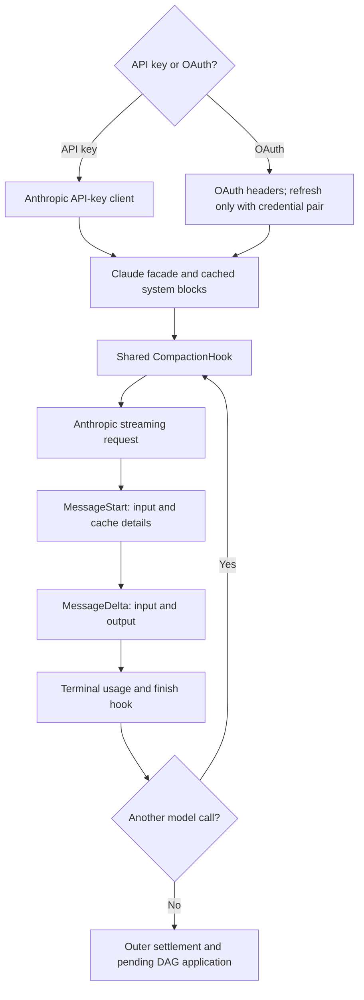

# Current state: Claude and Anthropic

## Routing, authentication and context

The built-in `claude` provider uses Rig's Anthropic adapter. API-key and OAuth modes
share the generic agent/compaction engine. The manager prefers a usable persisted
OAuth access/refresh pair and requests immediate refresh. A static environment token
with an OAuth prefix uses OAuth headers/prompt formatting but a pass-through client:
without a refresh token, it is not the refreshing-pair path. Neither changes the
summary algorithm.

The fallback context is 200,000 and output is 8,192. The manager declares corresponding
hard ceilings. Claude-prefixed model names do not receive the generic 80% override:
the base trigger reserves output capacity instead. Model-aware beta headers and
comments mentioning larger windows must not be mistaken for an enabled 1M context
policy. Inspect actual header construction and resolved limits.

Sources: `rust/providers/src/manager.rs:787`, `:1027`,
`rust/providers/src/claude.rs:42`, `:81`, `:506`, `:694`.
Authentication details: `rust/providers/src/claude.rs:222`, `:272`.

## Prompt caching is not history compaction

The system-prompt facade inserts cache-control metadata. OAuth formatting includes
a Claude Code prefix separately from the cached preamble. Reminder replacement
normally appends superseding information to preserve a reusable prefix; compaction
cleans older reminder versions. Cached input still occupies context even when its
billing rate differs. Authentication refresh does not itself shrink context.

Sources: `rust/providers/src/claude.rs:477`, `:565`,
`rust/cli/src/session/system_reminders.rs:1`.

## Actual patched-Rig streaming usage

The live usage and final usage must be distinguished:

| Surface | Input | Output | Cache detail |
| --- | --- | --- | --- |
| MessageStart | Start input count | Zero | Read/creation counters copied |
| MessageDelta | Captured start input | Delta's output count | Not copied into this usage event |
| Provider streaming terminal | Captured input | Stopping delta output | Constructed with both cache fields `None` |

The generic streaming converters can preserve cache fields when supplied, but the
terminal collector discards them. Its `total_tokens` is input plus output. The
shared hook reads this final usage, not the earlier live cache details. Therefore
the hook's last-known usage can underrepresent cached context; its payload estimate
provides a separate guard, not proof of exact compensation.
Missing retained stop metadata can also yield default-zero terminal usage. Rig's
outer FinalResponse is a separate sum over the tool loop, not this single callback.

Sources: `rust/patches/rig-core/src/providers/anthropic/streaming.rs:90`, `:124`,
`:331`, `:372`, `:454`.

There is also a different non-streaming conversion: Anthropic `Usage::token_usage`
adds cache creation/read to input and does not expose them as separate detail
fields. Ordinary `TryFrom<CompletionResponse>` does not use that helper: it keeps
raw input and separate cache fields. Neither formula describes the streaming
collector's terminal cache loss.

Sources: `rust/patches/rig-core/src/providers/anthropic/completion.rs:116`, `:155`.

## Tool pairing and continuation

Rig executes tool calls and automatically continues with their results. Anthropic
tool pairing can use `call_id` rather than `id`; the cleanup key is
`call_id.unwrap_or(id)`. Recovery must not drop a result while retaining its call.
The compaction preparer defensively rejects orphan tool calls, and repair paths
can inject synthetic cancelled results before preparing builder context.

Sources: `rust/cli/src/interactive_helpers.rs:288`, `:587`,
`rust/patches/rig-core/src/agent/prompt_request/streaming.rs:605`, `:791`.

## Compaction and failure boundaries

Claude uses the common pre-call hook, prompt-too-long recovery, in-view DAG builder,
deferred InjectSummary application, and clean-context overflow fallback. There is
no code-confirmed automatic Anthropic server-side compaction in this inspected
provider setup. A backlog feature or beta documentation is not enablement.

The generic deferred-application hazard applies: tool acknowledgement does not
install the DAG into active Rig history. Thinking-budget errors must remain outside
context-overflow recovery; `budget_tokens` exclusion prevents a configuration
failure from becoming a compaction loop.

## Verification priorities

- Preserve cache details consistently in hook-facing terminal usage.
- Exercise API-key and OAuth modes through the same active compaction lifecycle.
- Verify call/result pairing after cancellation, trailing-user cleanup, and retry.
- Distinguish thinking exhaustion, output truncation, context overflow, and auth errors.
- Reproduce injection followed by automatic continuation using real streaming fixtures.

These are research/test recommendations, not changes made by this documentation.
