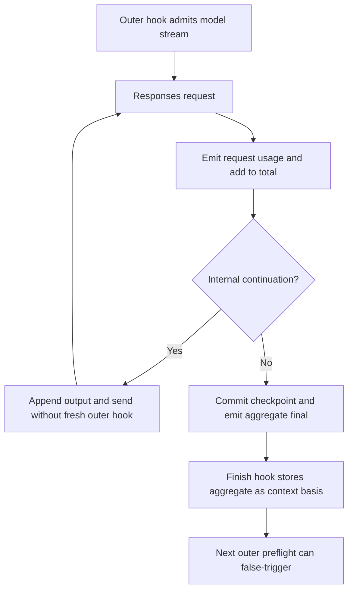

# Codex-specific compaction findings

Baselines: [catalog](00-bug-index.md). Upstream code was inspected in `/tmp/codex`,
not inferred from an API name or older Codex architecture. Read the
[upstream contract](06-upstream-codex-contract.md) alongside this chapter.
The October 16 screenshot is Qwen; none of these is a reproduced Codex incident.

## CB-23: internal request total is used as context

**Conditional false-trigger risk; P1.** fspec emits per-request usage, adds it into
`total_usage`, and emits that sum in the provider FinalResponse ([C1]). The finish
hook stores this final usage; the next outer preflight compares the greater of
last-known total and payload estimate against the threshold ([C2]). The presentation
wrapper does not normalize the final callback ([C3]).

Example, excluding overlap: two internal requests use 90k and 95k input, while the
threshold is 150k. Latest occupancy can fit, but the 185k aggregate can cancel the
next outer call. This is an illustrative fixture, not a measured run. A successful
final and another preflight are required; the finish callback itself only stores
state. Aggregating request usage is reasonable for spend—the defect is assigning
that aggregate the meaning of current context.

Upstream keeps `total_token_usage` distinct from `last_token_usage` and, after
replacement, recomputes last context while preserving totals ([U-accounting]).
Its server-reasoning/context scope rules are richer than “use raw latest input”;
copy the separation invariant, not one counter mechanically.

**Proposed regression:** latest request below threshold, operation total above;
assert correct context guard and separate accumulated spend. Also test cached/
reasoning subsets (CB-14) and missing-usage error paths.

## CB-24: growing continuations have no fresh outer guard

**Conditional overflow/recovery risk; P1.** One fspec model stream permits an
initial request and three internal continuations. Replayed assistant output is
appended to request input, then the provider sends again without returning through
the outer `on_completion_call` ([C1], [C4]). Transport retries are additional;
this is not a physical-send bound. The metadata guard is not a context preflight.

This bypass does **not** suppress every error: SSE and terminal failures still
propagate. It means the guard that approved the first request cannot independently
check each growing replay payload. Generic compaction still operates at outer
boundaries. Upstream's turn loop has explicit continuation/compaction boundaries,
but is not an exact counterpart of this adapter's interrupted-response mechanism
([upstream scheduling](06-upstream-codex-contract.md#scheduling-is-separate-from-the-trigger-item)).

**Proposed regression:** a first request fits and the next replay exceeds budget;
assert send counts, guard decisions and preserved output. Exercise terminal and
HTTP/SSE context rejection separately, rather than assuming automatic continuation
and WebSocket response-ID optimization are the same mechanism.

## CB-25: HTTP context rejection can lose its classification

**Static diagnostic loss with conditional recovery impact; P1.** After bounded
setup retries, streaming HTTP non-success returns status plus fixed text,
`Codex request rejected; automatic setup recovery stopped`, without retaining the
body ([C5]). An HTTP 400/413 context-length diagnostic can therefore disappear
before the generic text-based overflow classifier sees it ([C6]). Not every
400 is overflow; status alone cannot recover that distinction safely.

Successful SSE connections have separate backend error-event diagnostics; ordinary
non-streaming completion reads the body ([C1], [C7]). The defect is not universal
loss of every Codex error. No live backend overflow was reproduced.

**Required invariant:** preserve structured error category/code and bounded,
sanitized diagnostic text through the streaming boundary. Do not solve this by
classifying every rejected request as context overflow.

## CB-26: native capability is not an upstream-equivalent lifecycle

**Repair scope:** keep native disabled. This gap is not a recommendation to add an
alternate compactor; the selected DAG and [CB-28 no-fallback contract](08-no-fallback-removal-plan.md)
govern the repair. The hypothetical support obligations below describe why the
existing capability must not be mistaken for a complete lifecycle.

**Capability gap, not a default-enabled bug.** `NativeCapabilities` defaults off;
its programmatic setter enables unconditional trigger insertion during each wire
request build. No production caller enabling it was found in the audited provider
route ([C7], [C8]). Generic DAG compaction remains active independently.

The important upstream comparison is precise:

| Concern | fspec at baseline | Upstream Codex at pinned revision |
| --- | --- | --- |
| Wire trigger | Appends `{"type":"compaction_trigger"}` when enabled | Same empty input control, in a dedicated remote-v2 attempt |
| Endpoint | Normal `/responses` stream | Normal Responses streaming machinery, not a compact-specific call in this path |
| Cadence | Capability flag, no native threshold/phase scheduler here | Capability-based local/remote selection; explicit pre/mid/post-turn policy |
| Result validation | Streaming checks negotiated family and nonempty encrypted content; non-streaming bypasses that validator | Remote-v2 requires Completed and exactly one `Compaction` item |
| Replacement | Clears provider replay items on any accepted compaction family; stores output and user ancestry | Builds retained context + opaque item; speculative adoption validates captured prefix and retains live suffix |
| Generic application | No rewrite of generic messages/DAG by native history commit | Installs actual active replacement history through session primitive |
| Restart | Provider extension checkpoint separate from generic boundary | Records replacement envelopes and replays post-checkpoint suffix |

Evidence: fspec [C1], [C7], [C8], [C9]; upstream
[request/output/installation trace](06-upstream-codex-contract.md).
Thus `compaction_trigger` itself is **not** shown to be the wrong API. Enabling
the flag alone is not a repair for deferred injection, accounting, commit or resume.

Further compatibility boundaries: fspec's streaming validator accepts `compaction`,
`compaction_summary` and `context_compaction`, requiring nonempty encrypted content.
Non-streaming completion commits output directly; its history parser requires a
string but does not reject empty encrypted content ([C7], [C11]). Upstream models
`compaction_summary` as an alias of `Compaction`, but `ContextCompaction` has
optional encrypted content ([U-types]). The upstream remote-v2 collector still
specifically requires `Compaction`. Do not treat every protocol enum variant as
valid for that operation, or call fspec's stricter policy a demonstrated default
failure. Define the supported mode and test malformed/multiple/missing native
results before exposing native compaction as production functionality.

## CB-27: user prefix is weaker than full request continuity

**Conditional replay risk; P1.** fspec compares the model and non-reminder **user**
ancestry. With that prefix intact, saved typed assistant/tool items can remain even
if incoming assistant history changed ([C9]). The DAG special case only applies
when prior non-reminder user ancestry is empty; it is not “reset on any DAG.”
Generic reset explicitly resets provider state, so normal generic compaction is
not proved to resurrect old checkpoint items ([C10]). A relevant failing fixture
must change non-user ancestry without that explicit reset.

Upstream WebSocket reuse requires compatible request settings and the complete
previous request input plus previous output as prefix; replacement normally forces
full current input ([U-transport]). This is a **transport** continuity check, while
fspec's history reconciliation intentionally bridges a lossy generic representation.
They have different jobs. The comparison identifies a validation gap, not proof
that copying WebSocket equality wholesale would be a correct fspec fix.

**Proposed regression:** same user prefix, changed assistant/tool lineage; assert
no stale tool work reappears. Also test DAG-only history, explicit provider reset,
native replacement, model switch, and resumed checkpoint/generic history agreement.

## Source references

[C1]: ../../rust/providers/src/codex/streaming.rs#L71
[C2]: ../../rust/core/src/compaction_hook.rs#L212
[C3]: ../../rust/providers/src/codex/presentation.rs#L66
[C4]: ../../rust/providers/src/codex/lifecycle.rs#L99
[C5]: ../../rust/providers/src/codex/recovery.rs#L137
[C6]: ../../rust/cli/src/interactive/error_classifiers.rs#L320
[C7]: ../../rust/providers/src/codex/model.rs#L104
[C8]: ../../rust/providers/src/codex/native.rs#L5
[C9]: ../../rust/providers/src/codex/history.rs#L76
[C10]: ../../rust/cli/src/interactive_helpers.rs#L274
[C11]: ../../rust/providers/src/codex/history_items.rs#L53
[U-accounting]: https://github.com/openai/codex/blob/bb64b894fd67158be0f874872e6d7bfe717e7368/codex-rs/core/src/session/mod.rs#L5099
[U-types]: https://github.com/openai/codex/blob/bb64b894fd67158be0f874872e6d7bfe717e7368/codex-rs/protocol/src/models.rs#L1278
[U-transport]: https://github.com/openai/codex/blob/bb64b894fd67158be0f874872e6d7bfe717e7368/codex-rs/core/src/client.rs#L1496

Navigation: [C1] per-request accumulation at 128, replay at 140, final at 152;
[C7] setter at 49, default at 73, prepare/apply at 129, non-stream body at 184;
[C8] trigger at 21, output validation at 134; [C9] continuity at 99, native commit
at 141, trigger exclusion at 191. [U-accounting] recomputation at 5144.
