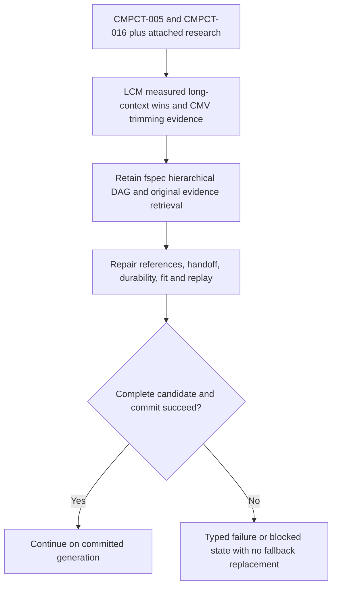

# Research foundation: retain and repair the DAG architecture

Date: **2026-10-17**. Tracking card: **CMPCT-051**. Documentation only.
This corrects the earlier reuse chapter's omission of the original research.
**The DAG architecture has published empirical support; it is not a new,
unsupported proposal awaiting permission to replace it with native compaction.**
The decision is to repair fspec's DAG implementation, with **no fallbacks**.

## Original cards and attached research read

The original parent is **CMPCT-005**, “Hierarchical Lossless Context Compaction
with Agent-Controlled Compression.” Its description and architecture note specify:

- Layer 0: deterministic trimming of builder views, with originals retained.
- Layer 1: agent-written hierarchical D0/D1/D2 summaries using SessionSearch and
  InjectSummary, replacing separate batch anchor/narrative summarization.
- Layer 2: a capacity trigger invoking the same DAG construction flow.

Its [design attachment][D1] synthesizes the architecture; the [seven-paper research
review][D2] explicitly cites LCM's superiority to Claude Code on long-context OOLONG,
not merely a hypothetical advantage of hierarchical memory. The parent AST inventory was also read;
its historical coverage claims are not current runtime verification.

The original construction flow is deliberately **same-agent and in-view**:
clear the active view, retrieve selectively from persisted history, let the agent
write D0/D1/D2, then install through InjectSummary. Layer 0 transforms builder
retrieval views, not stored originals. Dropped builder turns remain persisted and
recoverable; dropping them from the active prompt is not deleting evidence.
This replaces separate batch summarizers, rather than adopting all of LCM's
engine-managed/asynchronous construction. The later clean-builder implementation
is a subsequent mechanism; repairing its lifecycle must not erase the original
agent-owned semantic selection and incremental preservation requirements.

CMPCT-005 initially expressed the DAG as structured Markdown with prose breadcrumbs.
It did not already supply LCM's transactional, engine-enforced provenance graph.
CMPCT-016 identifies those enforcement gaps. Distinguish original intent, later
implementation and outstanding repair obligations rather than asserting parity.

**CMPCT-016**, “LCM-Aligned DAG Compaction,” follows up with engine-resolvable
references, incremental condensation, bounded operations, scoped search and file
awareness. Its [gap analysis][D3], [post-review fixes][D4] and
[implementation inventory][D5] were read alongside the card's rules and decisions.
CMPCT-011 details the in-view integration; CMPCT-047 later unifies fallback shape.
These explain the design lineage, not permission to retain fallback behavior now.

## Primary paper: LCM

Clint Ehrlich and **Theodore Blackman**, *LCM: Lossless Context Management*,
Voltropy PBC, paper dated February 14, 2026. Original card URL: [Voltropy][P1].
The accessible [versioned arXiv text][P2] supplies sections and results below.
The old research attachment says “Andrew Blackman”; the primary paper says Theodore.
Historical attachments are left intact; this chapter records the correction.

### What the evaluation demonstrates

Sections 4.1–4.3 evaluate OOLONG's `trec_coarse` split, from 8K to 1M tokens.
Both Volt and Claude Code v2.1.4 use **Opus 4.6**, with **Haiku 4.5** available
for lightweight subtasks. Reported results:

| Observation | Paper result |
| --- | --- |
| Average absolute score | Volt **74.8**, Claude Code **70.3**: **+4.5 points** |
| 32K through 1M | Volt wins at **every tested context length** |
| 256K | **+10.0 points** over Claude Code |
| 512K | **+12.6 points** over Claude Code |
| 1M | **+4.3 points** over Claude Code |
| 8K and 16K | Comparable performance; Claude Code has a slight edge |

That is demonstrated superiority of the evaluated **LCM-equipped system** over
the stated production-agent baseline in the long-context regime. The earlier
blanket framing that the approach was only “promising” omitted this evidence.

Be precise about attribution without discarding the result: the evaluated system
combines a hierarchical summary DAG and immutable retrieval with engine-managed
task partitioning. Section 4.3 particularly credits `LLM-Map` for aggregation.
The reported comparison is not an isolated DAG-versus-flat-summary ablation, nor
a test of this fspec build against upstream Codex remote V2. Section 5 discusses
benchmark contamination, excluded memorized tasks, and limitations of the raw-model
baseline's decontamination. Do not relabel those results as an fspec benchmark.

### What fspec should preserve from the architecture

Sections 2–2.4 describe a dual-state design: immutable originals are the source
of truth; active summary nodes are derived materialized views. The DAG is a
multi-resolution navigation map, not merely a flat transcript plus grep. Its
losslessness means **verbatim originals remain reachable**, not that the summary
retains every fact or the agent always retrieves the right evidence.

| LCM property | fspec design lineage | Repair obligation |
| --- | --- | --- |
| Transactional DAG with enforced source links | Structured turn references, CMPCT-016/017 | Stable identities and validated complete coverage, not parseable prose alone |
| Incremental leaf/condensed summaries | D0/D1/D2, CMPCT-019 | Preserve durable nodes, summarize fresh work, validate suffix ownership |
| Original-message expansion | SessionSearch, CMPCT-018 | Recover full structured payloads, not previews masquerading as originals |
| File IDs survive condensation | `<dag-files>`, CMPCT-021 | Validate/propagate awareness on every supported commit path |
| Context swap between turns | InjectSummary integration, CMPCT-011 | Explicit inference barrier and durable generation commit |
| Bounded active context | Threshold/budget policies | Guard the entire serialized request, not DAG length alone |

The paper's zero-cost continuity concerns **below-threshold** operation, without
compaction/retrieval overhead. The card's “zero marginal LLM cost” means no separate
batch summarizer in the intended in-view design. Retrieval, summary output and
builder turns still consume tokens; neither phrase proves free compaction.

## Supporting primary paper: CMV

Cosmo Santoni, Imperial College London, *Contextual Memory Virtualisation:
DAG-Based State Management and Structurally Lossless Trimming for LLM Agents*,
February 2026, [arXiv:2602.22402v1][P3]. Its DAG models snapshot/branch lineage,
not LCM's summary-node provenance graph. It supports Layer 0 and reusable state,
and must not be confused with an isolated proof of D0/D1/D2 summary superiority.

Its single-user case study covers **76 coding sessions**: mean **20%** trimming,
up to **86%**, and **39%** average reduction for mixed tool-use sessions, with
break-even within **10 turns** for that category. “Structurally lossless” preserves
user/assistant text while removing mechanical overhead; it does not mean every
tool output remains verbatim in the active view. Retained immutable evidence and
protocol-correct tool structure are separate obligations.

The original review also covers Focus, ACON, HiAgent, SimpleMem and H-MEM. Their
reported findings are supporting background, not newly replicated here. LCM and
CMV are the primary papers directly checked for this correction.

## Explicit divergence: no fallback, even though LCM contains one

LCM Figure 3 and section 2.3 escalate from normal to aggressive summarization to
`DeterministicTruncate(X, 512)`. CMPCT-016 adopted that reasoning, and CMPCT-020/047
implemented/shared forced fallback DAGs. **The latest user instruction supersedes
that historical acceptance policy.** Preserve the research-backed DAG and retrieval
architecture; do not copy its deterministic fallback or promise its successful
convergence guarantee after removing that mechanism.

The replacement guarantee is **bounded termination with either a validated,
durably committed DAG or an explicit typed failure/blocked state**. A timeout,
missing builder, invalid summary or impossible budget must not install fragments,
fabricate a generic recovery node, switch to native/flat memory or claim success.
Repeated attempts, if explicitly permitted, use the same algorithm and validator.
No automatic transport downgrade or silent checkpoint reconstruction is authorized.

## Consequences for the bug-fix plan

Do not gate DAG retention on a new native/hybrid comparison. Use fspec tests to
verify that the implementation honors the selected design, closes the known gaps,
preserves recall across repeated cycles and fails honestly without degradation.
Borrow Codex's useful ownership/installation/replay invariants, not its alternate
memory algorithms or transport fallbacks. The [reuse decision][R1] and
[no-fallback removal plan][R2] make those boundaries explicit.

This research adds no production fixes, feature scenarios or executed benchmarks.
Implementation still requires feature → failing scenario-mapped test → code.

[D1]: ../../spec/attachments/CMPCT-005/hierarchical-lossless-compaction-design.md
[D2]: ../../spec/attachments/CMPCT-005/research-papers.md
[D3]: ../../spec/attachments/CMPCT-016/lcm-gap-analysis.md
[D4]: ../../spec/attachments/CMPCT-016/post-review-fixes.md
[D5]: ../../spec/attachments/CMPCT-016/ast-research-compaction-implementation.md
[P1]: https://papers.voltropy.com/LCM
[P2]: https://arxiv.org/html/2605.04050v1
[P3]: https://arxiv.org/html/2602.22402v1
[R1]: 04-dag-codex-reuse.md
[R2]: ../compaction-bugs/08-no-fallback-removal-plan.md
