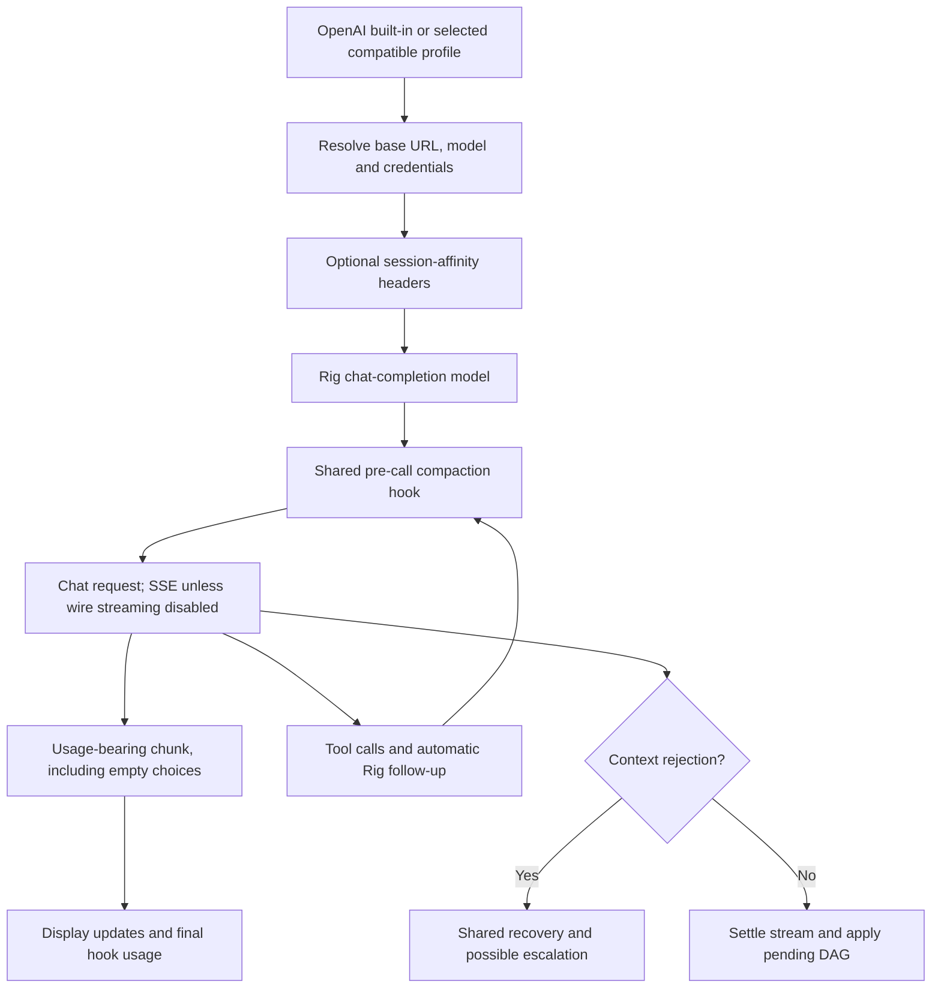
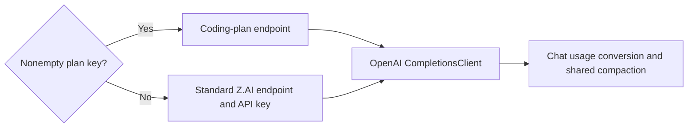

# Current state: OpenAI, compatible endpoints and Z.AI

## OpenAI runtime route

The built-in OpenAI provider constructs Rig's `CompletionsClient` and chat-completion
model, not the Codex adapter. `OPENAI_BASE_URL` permits compatible/local endpoints;
the URL is normalized before construction. Optional session-affinity headers help
cache routing for custom endpoints. They do not establish server-side conversation
memory or native compaction.

`OPENAI_STREAMING=false` selects a non-streaming wire request adapted into the same
Rig stream abstraction, emitting content/tools, usage and a terminal response.
Tool continuations still operate. The built-in agent accepts but ignores its
thinking-configuration argument on this path.

Sources: `rust/providers/src/openai.rs:209`, `:424`, `:444`;
`rust/patches/rig-core/src/providers/openai/completion/nonstreaming.rs:95`.

Fallback limits are 128,000 context and 4,096 output, with environment overrides for
defaults and manager resolution from model/profile settings. GPT/o-series prefixes
receive the 80% threshold family rule; an arbitrary model served through OpenAI
compatibility, such as Qwen, is not automatically a GPT-prefix model.

Sources: `rust/providers/src/openai.rs:24`, `:44`, `:167`, `:192`, `:216`,
`rust/cli/src/compaction_threshold.rs:166`.

## Actual usage events, not stale comments

When wire streaming is enabled, Rig requests `stream_options.include_usage`.
Every decoded chunk containing
usage emits `RawStreamingChoice::Usage` before checking whether choices are empty.
Thus a usage-only terminal chunk is supported. Comments in the CLI that say all
OpenAI-compatible providers report usage only through FinalResponse are not a
complete account of current patched behavior.

Backends may omit usage despite the request. The CLI falls back to FinalResponse
only when it has no authoritative output and nonzero final input usage.

Sources: `rust/patches/rig-core/src/providers/openai/completion/streaming.rs:132`,
`:219`, `rust/cli/src/interactive/stream_loop.rs:1140`.

## Cache and reasoning semantics

The streaming final adapter copies:

- Input: `prompt_tokens`.
- Output: `total_tokens - prompt_tokens`.
- Cache-read detail: `prompt_tokens_details.cached_tokens`, when present.
- Reasoning detail: `completion_tokens_details.reasoning_tokens`, when present.

No cache subtraction from input or reasoning subtraction from final output occurs
in that adapter. The live usage event also copies prompt and detail counts, while
its output prefers supplied `completion_tokens`, falling back to
`total_tokens - prompt_tokens`. Terminal output always uses the subtraction;
inconsistent backend fields therefore produce different live/terminal counts.

The shared formula adds input + cache-read + cache-creation + output + reasoning.
The CLI uses this additive formula for live/final fill; the hook omits the separate
reasoning field. Therefore, for
backends whose prompt count already includes cached tokens, these representations
overlap and can overstate context. This is a code-confirmed accounting mismatch
conditional on the backend field semantics, not proof that the Qwen incident's
entire excess came from caching. Raw payloads are needed to quantify a given run.

Sources: `rust/patches/rig-core/src/providers/openai/completion/streaming.rs:83`,
`:222`, `rust/core/src/token_usage.rs:64`,
`rust/core/src/compaction_hook.rs:254`,
`rust/patches/rig-core/src/providers/openai/completion/mod.rs:1062`.

Reasoning detail is likewise not automatically extra physical context: whether
to add it depends on whether output already includes it. The application retains
separate reasoning/display state, so provider normalization needs an explicit
contract rather than repeated additive assumptions.
Provider terminal usage reaches the finish hook individually. The CLI's final fill
uses output/reasoning from Rig's outer aggregate across the tool loop, even if its
display input came from live usage.

## Z.AI

Z.AI uses the same OpenAI chat-completion implementation with a selected normal or
coding-plan endpoint. The manager prefers a nonempty `ZAI_PLAN_API_KEY`, otherwise
`ZAI_API_KEY`. Fallback limits are 128,000 context and 8,192 output. Its cache details
use the same OpenAI-shaped fields and therefore share the normalization concerns.

Sources: `rust/providers/src/zai.rs:30`, `:144`, `:151`, `:371`,
`rust/providers/src/manager.rs:1228`.

## Profiles, local servers and catalog-only vendors

An OpenAI-compatible endpoint may front a local server, proxy, hosted vendor, or
profile-qualified model. The client protocol does not guarantee identical usage,
window enforcement, error text, or thinking support. Resolved profile/model limits
are important when registry metadata differs from actual deployment capacity.

Catalog names such as OpenRouter, Groq, DeepSeek, Azure, and others need their actual
selected route checked. Neither catalog presence nor vendored Rig modules prove
a direct live fspec dispatch arm. For Rhai-native routes see the custom-provider
document; script parsing can change all usage semantics.

## Recovery behavior

These routes use the shared in-view preparation, deferred injection, retries, and
broader overflow escalation. Overflow checks precede network retries so API 400s
wrapped as interrupted SSE errors need not be retried as transient disconnects.
Output truncation and malformed tool JSON use separate recovery paths.

The October 16 incident was `openai:Strada/qwen3.8-flash-next-iq3_s`, not Codex.
Its retry-exhaustion/application ordering is established; backend-specific causes
of its usage count are not fully established by the available log excerpt.
