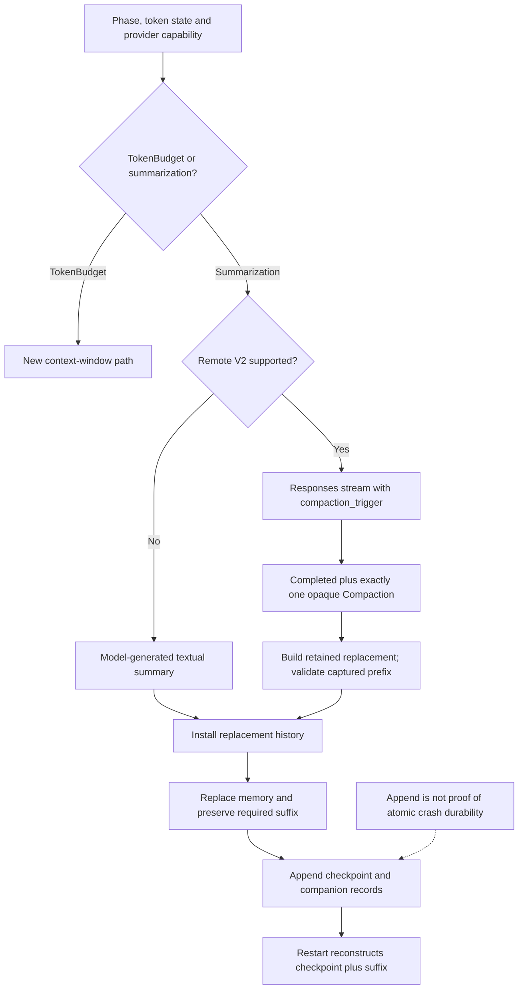

# What the upstream Codex implementation actually does

Inspected read-only in **`/tmp/codex`**, resolved to `/private/tmp/codex` on macOS.
Commit **`bb64b894fd67158be0f874872e6d7bfe717e7368`**, dated 2026-10-15.
All upstream links below pin that commit; the same paths can be read under the
local checkout. No upstream code was changed, built or tested for this research.

This checkout has `compact_remote_v2.rs` and `session/turn.rs`, **not** the older
`compact_remote.rs` / `codex.rs` layout. Describing the old endpoint design without
checking this source would be misleading. This is a reference implementation at
one revision, not a universal guarantee about every Codex backend deployment.

## Three different mechanisms

| Mechanism | Actual role | Evidence |
| --- | --- | --- |
| Local textual compaction | Ordinary model inference creates prose; client assembles retained user text + summary | [U1] |
| Remote V2 compaction | Dedicated compaction-marked Responses stream returns an opaque item; client installs retained replacement | [U2], [U3], [U4] |
| TokenBudget rollover | Separate feature branch starts a new context window instead of the normal summarizing dispatch | [U5], line 1534 |

“Local” means client-owned summary assembly, not offline/no-cost inference.
Opaque native compaction is not fspec's searchable textual DAG. WebSocket
`previous_response_id` optimization is transport reuse, not any of these algorithms.

## Remote V2 request and output contract

1. Capture/clone annotated history and prepare model-compatible input. Eligible
   trailing tool output can be trimmed on the snapshot to make the request fit
   ([U3], [U6]). This is request-size repair, not the summary itself.
2. Append `ResponseItem::CompactionTrigger {}` as the last input item. Serde's
   tagged snake-case enum serializes it as `{"type":"compaction_trigger"}`
   ([U3], line 167; [U7], lines 1035 and 1293).
3. Send via ordinary Responses machinery: foreground uses
   `ModelClientSession::stream`; background explicitly uses
   `ResponsesHttpExecutor::stream_responses_http` and separately captured routing
   and auth-owner state ([U2], lines 295–353). The HTTP Responses endpoint posts
   to `/responses` ([U8]). **No `/responses/compact` call occurs in this traced V2
   path.** Foreground transport selection remains the regular client's concern.
4. Buffer output and require terminal Completed plus **exactly one**
   `ResponseItem::Compaction`. Other output families do not become the replacement
   compaction result; zero/multiple `Compaction` items or missing terminal completion error
   ([U2], lines 375–477).
5. Remove the request-only trigger from saved input; build replacement from selected
   retained original context plus the opaque compaction item ([U3], line 216;
   [U2], line 480). The trigger is not durable conversation history.

`Compaction` requires `encrypted_content`; `compaction_summary` is its alias.
`ContextCompaction` is a separate enum variant with optional encrypted content,
not the item accepted by this particular remote-v2 collector ([U7]). Neither the
collector nor installation extracts an assistant prose summary from the blob.
Remote installation's metadata `message` is empty ([U4], line 238).

Retention is selective: recognized user/hook input, feature-gated client developer
messages/tool outputs, and eligible agent messages. Agent final/progress or overly
large messages can be excluded. The retained-context budget is approximately 64k,
with a 10k per-agent-message exclusion and separate image accounting ([U2], lines
87 and 480–702). These are retention rules, **not automatic-trigger thresholds**.

## Scheduling is separate from the trigger item

Thread policy can disable ordinary automatic pre-/mid-/post-turn installation.
It does not gate every speculative launch: the async launch sites and eligibility
checks can still admit background requests, so disabled automatic installation
does not guarantee zero speculative spend ([U5], lines 174–193, 418–433, 607–620
and 778–784; [U9], lines 40–99). TokenBudget changes the dispatch and disables the
ordinary async/post-turn summarization branches ([U5], line 1534; [U9], line 40).

- **Pre-turn:** handle previous-model compatibility/downshift, then act on reached
  token limit or ready speculative candidate. This is before recording incoming
  user/context updates; the source explicitly leaves prospective additions as
  future work ([U5], lines 189 and 1372–1496).
- **Mid-turn:** after sampling/tool work, continuation or pending input must require
  another iteration; reached limit, requested rollover or a ready candidate can
  cause compaction before that iteration ([U5], lines 575–715).
- **Post-turn:** positive configured threshold, no pending input and no cancellation;
  reached post-turn threshold or a ready candidate admits summarization. Ordinary
  failure preserves the completed answer; interruption/turn abortion propagates
  ([U5], lines 718–825).
- **Async:** feature-gated and remote-v2-only; launch uses a context-window percentage
  before normal compaction is due. Pre-turn launch requires a routing token, letting
  foreground establish backend model pinning first ([U9], lines 40–80).

Context-limit calculation separates total versus body-after-prefix scope, model
auto limit, effective hard context window, fallback buffer and post-turn percentage.
Normal trigger is buffered auto-scope exhaustion **or** full hard-window exhaustion;
reported remaining tokens use unbuffered limits ([U10], lines 58–117). No single
“Codex always compacts at X tokens/percent” rule accurately describes this revision.
Do not copy the local 20k or remote 64k retention budgets as fspec trigger values.

## Speculation validates coverage and preserves the live suffix

Background capture records history version, prefix length and auth-owner generation,
alongside model/compaction hash and routing state ([U3], line 235; [U9], line 83).
Installation checks model/hash and, under the actual state lock, checks generation,
minimum length and auth-owner generation immediately before slicing/replacement
([U4], line 85; [U11], line 4254).

It replaces the captured prefix while preserving the **unchanged live suffix**,
including associated world-state baseline handling ([U11], lines 4262–4283).
History replacement invalidation is not synonymous with every append: the explicit
prefix length and suffix splice are essential to understanding this contract.
After successful adoption, it rechecks budget; an oversized live suffix causes
one fresh foreground attempt. A rejected candidate can be skipped when compaction
is not actually required ([U4], lines 29–69; [U5], line 1556).

That is the concrete contrast with fspec's unversioned pending/direct reset
(CB-04), not a vague recommendation to “use a sub-agent.”

## Installation and durability: do not overclaim

`Session::replace_compacted_history` assigns missing item IDs before cloning the
exact replacement envelopes for the checkpoint. It installs live annotated history,
sets context/world-state metadata and then awaits persistence of, in order:
Compacted, full WorldState, TurnContext and ThreadSettingsApplied ([U11], lines
4301–4374). Complete replacement also preserves accepted concurrent goal edits
not already represented; prefix replacement preserves its suffix separately.

**Memory replacement precedes checkpoint append.** Append failure is logged by
`persist_rollout_items`; the installation returns true without rolling memory back
([U11], lines 4374–4385 and 4747–4756). It does not invoke the separate
`flush_rollout` barrier at line 1517. Therefore this research does **not** certify
atomic crash-durable installation, nor does upstream eliminate the need to define
fspec's own commit protocol. The concrete storage writer's durability semantics
are not established by that append call alone.

Checkpoint payload includes replacement history, window metadata, latest usage
record and resume metadata ([U12]). Serialization keeps raw response items and
aligned harness-metadata sidecars; decoding validates their lengths ([U13], lines
274–351). A summary string or compaction response ID alone is not equivalent.

## Resume uses replacement history plus later rollout items

Resume enters rollout reconstruction through the session path ([U11], line 1676).
For the bounded current contract, only the newest eligible compaction establishes
the input boundary; required fields include replacement history/window number and,
except paginated mode, resume metadata. An incomplete newest checkpoint does not
fall back to an older input boundary ([U14], lines 60–90).

Reconstruction installs the selected replacement envelopes, then replays only
the relevant suffix, with rollback-aware selection and legacy handling when needed
([U14], lines 124–161 and 492–548). World-state reconstruction separately handles
checkpoint/baseline/patch ordering ([U14], line 572). This is substantially stronger
than replaying every original message and hoping a summary tool result is enough.

Token handling is separate: successful usage accounting retains both total and
last usage. Post-replacement recomputation estimates the current history, preserves
cumulative totals and replaces last usage with an estimate. Resume restores recorded
token events/usage records; it does not invariably freshly tokenize the checkpoint
([U11], lines 1712, 1933, 5099 and 5144).

## Transport continuity is not compaction persistence

WebSocket delta reuse needs compatible request settings and the full previous
request input **plus previous response output** as a prefix. With a usable response
ID it sends only the suffix; otherwise it sends full **current** input ([U15],
lines 389–475, 1496–1560 and 2091–2163). Replaced history normally breaks that prefix.
“Full” does not mean resurrect the original uncompressed transcript.

The ordinary HTTP request has `input` and no `previous_response_id` field ([U16]).
Opaque reasoning/compaction items retain encrypted content in client formatting
([U15], line 1013). A persisted compaction response ID is not by itself sufficient
to restore a valid transport baseline.

## Local textual path and existing upstream tests

Local compaction clones history and sends an ordinary summary prompt. On context
overflow it can remove the oldest input item and retry; it retains newest user text
under approximately 20k and appends a prefixed summary as user-context content
([U1], lines 275–387 and 702–816). This is intentionally lossy retention, not a
guarantee of complete transcript semantics. It calls replacement and recomputation
before completion ([U1], lines 413–441).

Inspected test sources, **not executed**:

- `reconstruct_history_uses_replacement_history_verbatim`: synthetic envelope/window
  equality, not a disk crash test ([U17], line 2437).
- `start_new_context_window_persists_checkpoint_state`: assigned IDs, explicit
  flush/read and persisted/live replacement comparison ([U17], line 4055).
- `compaction_persists_resume_metadata_and_companion_records`: preserved goal edit,
  flush/read, record order and exact replacement comparison ([U17], line 6208).
- Remote installation tests reject stale generation/auth state, preserve history
  on optional rejection and make one foreground request when required ([U18], line 99).

These support component contracts, not a claimed executed compaction → crash →
fresh-process equality proof. fspec-specific regression recommendations are
[separate](07-verification-priorities.md).

## Pinned upstream source references

[U1]: https://github.com/openai/codex/blob/bb64b894fd67158be0f874872e6d7bfe717e7368/codex-rs/core/src/compact.rs#L118
[U2]: https://github.com/openai/codex/blob/bb64b894fd67158be0f874872e6d7bfe717e7368/codex-rs/core/src/compact_remote_v2.rs#L295
[U3]: https://github.com/openai/codex/blob/bb64b894fd67158be0f874872e6d7bfe717e7368/codex-rs/core/src/compact_remote_v2_attempt.rs#L167
[U4]: https://github.com/openai/codex/blob/bb64b894fd67158be0f874872e6d7bfe717e7368/codex-rs/core/src/compact_remote_v2_installation.rs#L29
[U5]: https://github.com/openai/codex/blob/bb64b894fd67158be0f874872e6d7bfe717e7368/codex-rs/core/src/session/turn.rs#L174
[U6]: https://github.com/openai/codex/blob/bb64b894fd67158be0f874872e6d7bfe717e7368/codex-rs/core/src/compact_remote_history.rs#L41
[U7]: https://github.com/openai/codex/blob/bb64b894fd67158be0f874872e6d7bfe717e7368/codex-rs/protocol/src/models.rs#L1035
[U8]: https://github.com/openai/codex/blob/bb64b894fd67158be0f874872e6d7bfe717e7368/codex-rs/codex-api/src/endpoint/responses.rs#L135
[U9]: https://github.com/openai/codex/blob/bb64b894fd67158be0f874872e6d7bfe717e7368/codex-rs/core/src/session/async_compaction.rs#L40
[U10]: https://github.com/openai/codex/blob/bb64b894fd67158be0f874872e6d7bfe717e7368/codex-rs/core/src/session/context_window.rs#L58
[U11]: https://github.com/openai/codex/blob/bb64b894fd67158be0f874872e6d7bfe717e7368/codex-rs/core/src/session/mod.rs#L4202
[U12]: https://github.com/openai/codex/blob/bb64b894fd67158be0f874872e6d7bfe717e7368/codex-rs/history/src/lib.rs#L289
[U13]: https://github.com/openai/codex/blob/bb64b894fd67158be0f874872e6d7bfe717e7368/codex-rs/history/src/rollout_payload.rs#L274
[U14]: https://github.com/openai/codex/blob/bb64b894fd67158be0f874872e6d7bfe717e7368/codex-rs/core/src/session/rollout_reconstruction.rs#L60
[U15]: https://github.com/openai/codex/blob/bb64b894fd67158be0f874872e6d7bfe717e7368/codex-rs/core/src/client.rs#L389
[U16]: https://github.com/openai/codex/blob/bb64b894fd67158be0f874872e6d7bfe717e7368/codex-rs/codex-api/src/common.rs#L278
[U17]: https://github.com/openai/codex/blob/bb64b894fd67158be0f874872e6d7bfe717e7368/codex-rs/core/src/session/tests.rs#L2437
[U18]: https://github.com/openai/codex/blob/bb64b894fd67158be0f874872e6d7bfe717e7368/codex-rs/core/src/compact_remote_v2_installation_tests.rs#L99
