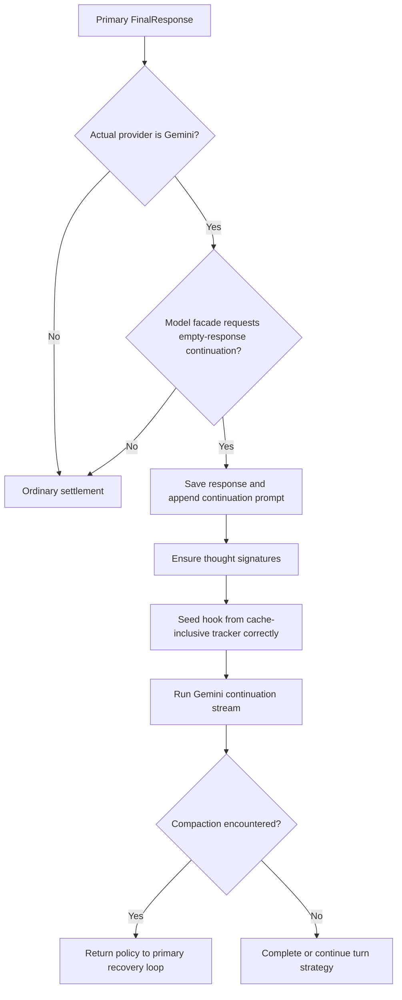
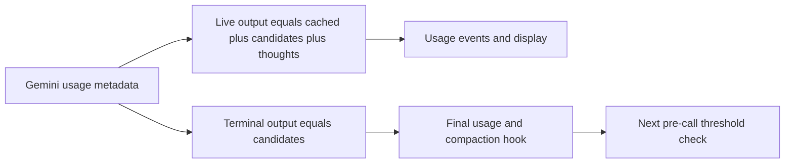

# Current state: Gemini

## Provider and model setup

The Gemini provider uses Rig's Google Generative AI client and Gemini-specific
tool/system-prompt facades. Its fallback limits are 1,000,000 context and 8,192
output; manager resolution trusts configured/registry limits without a provider
hard ceiling. Recognized Gemini model prefixes get an 80% threshold, clamped to
usable context.

Generation parameters include temperature, top-P, top-K, and optional thinking
configuration. Gemini 3 has model-specific thinking defaults. These settings affect
generation, not the generic summary application transaction.

Sources: `rust/providers/src/gemini.rs:20`, `:139`,
`rust/cli/src/compaction_threshold.rs:166`.

## Two continuation mechanisms

Ordinary tool use continues inside Rig, as with other providers. Separately, the
CLI has a Gemini turn-completion helper for an empty response after tools. It
checks the actual provider name and model-specific completion facade, appends a
continuation prompt, ensures thought signatures, and starts another streaming loop.

The helper can return `NoContinuation`, `Completed`, or `CompactionNeeded(policy)`.
The last case hands control back to the primary recovery loop rather than hiding
compaction in an unrelated error branch.

Continuation hooks use newly allocated token states, but the helper's error/None
classification inspects the primary state's flag. Typed cancellation repairs a
missing flag. An ordinary error returns without the primary overflow classifier;
None with the parent flag set returns policy without common start/progress handling.
A completed continuation FinalResponse returns Completed without the primary
FinalResponse compaction check. Nested continuation replaces the stream without a
dedicated count bound in this helper.

Sources: `rust/cli/src/interactive/gemini_continuation.rs:138`, `:323`, `:384`,
`:401`, `:445`; `rust/cli/src/interactive/stream_loop.rs:1246`.

Sources: `rust/cli/src/interactive/gemini_continuation.rs:45`, `:81`, `:107`, `:152`.

## Corrected seed boundaries

The tracker stores cache-inclusive input after display updates. The continuation
hook therefore uses `TokenState::from_cache_inclusive_total`, which zeroes separate
cache fields. Feeding the inclusive total plus cache fields would count cache twice.

The display snapshot, in contrast, uses raw input with separate cache fields, so
its reseed uses the ordinary display constructor. CMPCT-041 and CMPCT-042 explicitly
pin this distinction. These fixes do not establish that all provider usage parsing
before those constructors is correct.

Sources: `rust/cli/src/interactive/gemini_continuation.rs:120`, `:144`, `:183`;
`rust/cli/tests/cmpct041_seed_cache_double_count_test.rs:1`,
`rust/cli/tests/cmpct042_gemini_continuation_token_state_test.rs:1`.

## Patched-Rig usage formulas differ by surface

Let P be prompt tokens, C cached-content tokens, A candidate tokens, H thought
tokens, and T the provider's reported total.

| Surface | Input | Output | Total | Dedicated cache/reasoning fields |
| --- | --- | --- | --- | --- |
| Live `PartialUsage` | P | C + A + H | P + C + A + H | Not populated |
| Streaming terminal | P | A | T | Not populated |
| `UsageMetadata::token_usage` | P | C + A + H | P + C + A + H | Not populated |
| Ordinary completion response conversion | P | A | T | Not populated |

This is the current code, not a recommended accounting model. Cached input is
added to live output, thoughts are not a distinct reasoning field, and terminal
output drops those additions while retaining the provider total. The final usage
and live display can therefore disagree without any context replacement occurring.

Sources: `rust/patches/rig-core/src/providers/gemini/streaming.rs:17`, `:59`,
`rust/patches/rig-core/src/providers/gemini/completion.rs:401`, `:1090`.

## Usage timing and retention

Live usage is emitted for successfully decoded SSE messages with metadata, before
candidate/content handling. `candidates` is a required field: an empty array can
carry usage, but an omitted field fails decoding and is skipped. Prompt/total
counts are also required signed integers. Terminal retention occurs later in a
content-bearing finish path; content-less metadata can update live display without
becoming terminal usage. Missing retained metadata yields default-zero final usage.

Sources: `rust/patches/rig-core/src/providers/gemini/streaming.rs:17`, `:42`,
`:151`, `:209`, `:246`.

Signed counters are cast to unsigned without rejection, and the live output sum is
calculated in `i32`. Negative/malformed counts can distort accounting or overflow
arithmetic. This is a parser risk, not evidence Gemini supplied such values.
Provider terminal usage feeds the hook; Rig's outer final is a separate tool-loop
aggregate (chapter 04).

## Compaction implications and test needs

Gemini shares generic DAG construction and deferred application; its special
continuation loop adds another place where hook state, signatures, history,
display basis, and recovery policy must agree. Cache-inclusive seed fixes should
not mask the separate live/final parser discrepancy.

Required validation should cover usage-only final chunks, missing optional counts,
thought/cache subsets, signed invalid counters, repeated empty responses after
tools, and compaction during the dedicated continuation loop. No live Gemini
reproduction was run as part of this documentation.
