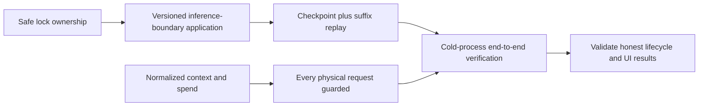

# Verification and repair priorities

This is a **proposed** regression plan derived from the referenced
[catalog](00-bug-index.md), not implemented feature scenarios or executed tests.
Each CB ID links through the catalog to source evidence and qualifications.
**No fallbacks:** retain the [research-backed hierarchical DAG](../future-state/05-research-foundation.md).
[CB-28](08-no-fallback-removal-plan.md) supplies the mandatory removal inventory
and negative assertions, superseding historical fallback-success expectations.

## Repair dependencies

1. Resolve session-lock ownership and cross-target lock ordering (CB-02/05).
   Keep the builder registered until recovery decisions finish (CB-03).
2. Make candidate application a versioned inference boundary (CB-01/04), preserving
   uncovered suffixes and cancelling/superseding stale pending work explicitly.
3. Define generic/provider commit and restore together (CB-08/09/10/13), not a
   setter-only patch. Fix token restoration separately (CB-11).
4. Normalize context versus spend at provider boundaries (CB-14/15/23); inspect
   every Codex continuation request (CB-24) and preserve typed failures (CB-25).
5. Validate complete candidates and whole-request fit (CB-19/20/21), then align
   watchdog, events, UI, settlement and thresholds (CB-06/07/16/17/18/22).
6. Remove fallback paths and success-oriented fallback tests/specs (CB-28), including
   replay/transport degradation. Keep native disabled (CB-26); test generation
   compatibility and explicit rejection, not another compaction algorithm (CB-27).

Ordering is a recommendation: several can be developed independently, but a green
component test must not hide the end-to-end dependencies.

## Proposed acceptance matrix

| Case | Exercise | Required assertion | Findings |
| --- | --- | --- | --- |
| Inject then follow-up | Real tool dispatch queues summary before Rig continues | No next inference on superseded context; clear queued/committed semantics | CB-01 |
| Terminal errors | Actual outer Err arm with overflow and ordinary error | Bounded typed result, lock released, explicit resolution possible; no unsafe continuation | CB-02/03/28 |
| Candidate staleness | Pause generation; append target work or install newer DAG | Preserve suffix or reject/rebuild; never silently overwrite uncovered work | CB-04 |
| Competing producers | Pending InjectSummary and self/cross GenerateCompaction in both orders | One owned generation and explicit supersession; no forced fallback producer | CB-04/06/28 |
| Mutual target requests | Barrier-synchronized A→B and B→A | No lock cycle; cancellation restores status/progress | CB-05 |
| Watchdog episodes | Failure, explicit resolution, success, later failure | Attempts reset on commit; exhaustion blocks, no synthetic Continue or forced pin | CB-06/28 |
| Overflow routes | Execute legacy and broader overflow branches | Same selected DAG protocol; no automatic strategy escalation | CB-07/28 |
| Cold resume | Pin, commit, terminate process, resume, send | Same intended compacted generation and compatible provider input | CB-08/13 |
| Marker matrix | Wrapped DAG, quoted markers, split blocks, mixed tool envelope | Correct summary/user retention; only intended reminder policy applied | CB-09 |
| Structured replay | Tool-only, thinking, assistant string, repeated resume | Correct next model history/tool pairing; no duplicate append | CB-10 |
| Counter restoration | Saved context/spend/reasoning values | Restored or explicitly re-estimated according to contract | CB-11 |
| Deep retrieval | Sentinel after preview/trimming threshold | Explicit retrieval finds original payload, with stable session/turn scope | CB-12 |
| Concurrent writers | Barrier message/provider/token/checkpoint writers | No stale-field overwrite; interruption recovery defined | CB-13 |
| Provider accounting | Anthropic cached input, OpenAI cached/reasoning subsets | Context counts once; details/spend preserved separately | CB-14/15 |
| Fill lifecycle | Multi-tool stream, Gemini continuation, Codex aggregate final | All fill views use declared coherent basis/generation | CB-16/23 |
| Pin while header full | Observe completion and ordinary token/fill events | Header refreshes from committed state; unknown coverage not zero | CB-17 |
| Settlement/projection | Duplicate Done, retry, failed final, forwarded events | Idempotent request settlement and supported fields retained | CB-18 |
| DAG validity | Malformed/open-only tags; durable turns above active count | Stable persisted bounds and complete candidate validation | CB-19 |
| Oversized fixed context | Reminders/schema already exceed budget | Bounded typed failure with blocked inference, no truncation or false fit claim | CB-20/28 |
| File/reminder matrix | Deferred/direct/self/cross submissions; empty malformed file block | Same required preservation contract, no fallback pin route | CB-21/28 |
| Config propagation | Distinct saved threshold through creation and model switch | Intended hook/header/recovery resolve same configured value | CB-22 |
| Codex continuation | First request fits; growing replay does not | Per-request budget boundary and preserved prior output | CB-24 |
| Codex rejection | HTTP 400/413 context body versus SSE terminal error; unrelated 400 | Typed overflow survives; unrelated errors not compacted | CB-25 |
| Native rejection | Default disabled; backend sends opaque items | Explicit unsupported outcome, no alternate memory activation | CB-26/28 |
| Codex ancestry | Same users, changed assistant/tool lineage, recorded model/generation reset | No stale checkpoint resurrection; explicitly selected full/delta mode semantics | CB-27 |
| No-fallback matrix | Missing handler, bad candidate, failed write, replay gap, WS upgrade failure, delta mismatch | Typed failure, preserved committed state, zero alternate-path requests and no completion | CB-28 |

## Strongest end-to-end sequence

Run **live stream → summary submission → committed application → next physical
request → fresh-process resume → another physical request**. Assert preserved
post-snapshot work, reduced intended context, provider checkpoint compatibility,
honest token events, and original-payload retrieval. A completion notice, reduced
estimate or in-process cached reload alone is not a pass.

Use deterministic fake transport fixtures to inspect actual serialized requests
without requiring paid/live providers. Prefer real temporary stores and shared
helpers over mocking persistence. Concurrency tests need barriers, harness deadlines
and observable lock/status outcomes, not sleeps or source-text assertions.

## Existing tests: useful starting points, not this result

- [Cancellation preservation](../../rust/cli/tests/compaction_cancel_preservation_test.rs#L1)
  and [unified recovery](../../rust/cli/tests/compaction_recovery_unification_test.rs#L1).
- [Watchdog](../../rust/cli/tests/compaction_convergence_watchdog_test.rs#L1)
  and [direct pin](../../rust/cli/tests/cmpct044_compactor_pin_test.rs#L1).
- [GenerateCompaction behavior](../../rust/agent-loop/tests/cmpct045_generate_compaction_behavioral.rs#L1).
- [Codex history](../../rust/providers/tests/prov149_codex_history.rs#L1)
  and [native transport](../../rust/providers/tests/prov158_codex_compaction_transport.rs#L1).
- [Single-source notice](../../rust/fspec-tui/tests/single_sourced_compaction_notice_rpc421.rs#L1).
- [Upstream reference tests](06-upstream-codex-contract.md#local-textual-path-and-existing-upstream-tests)
  exercise replacement/installation contracts, with explicit limits on what they prove.

No listed target was run for this documentation task. Absence of the complete
sequence in the scoped audit is not proof that every individual assertion lacks
all existing coverage. Review target fixtures before choosing where to add tests.

Implementation must follow the repository's ACDD rules: feature first, failing
scenario-mapped test second, production code last. Use shared test helpers and
scoped `cargo test -p <crate> --test <target>` commands; never unscoped workspace
tests. Do not infer permission to implement or enable native behavior from this plan.

