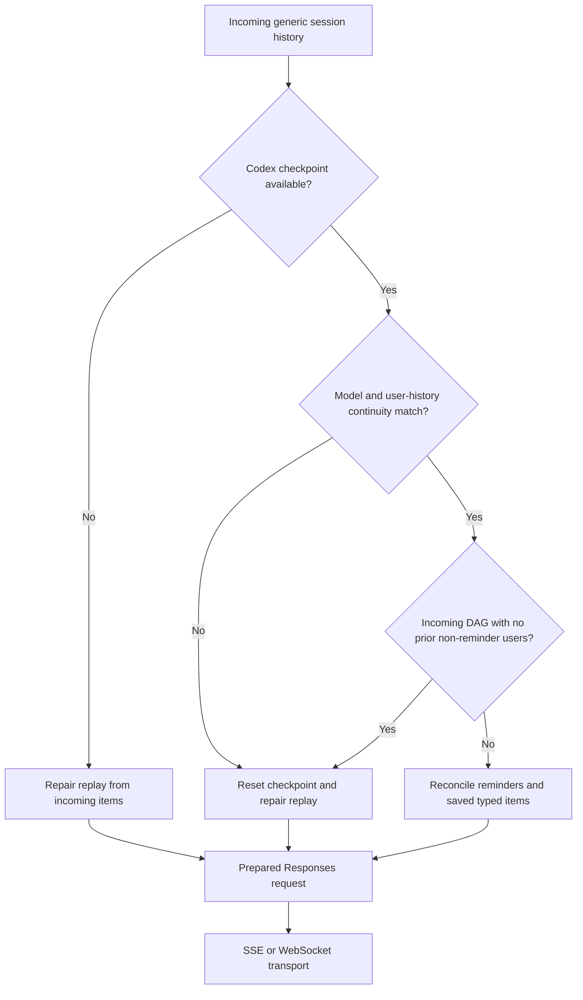
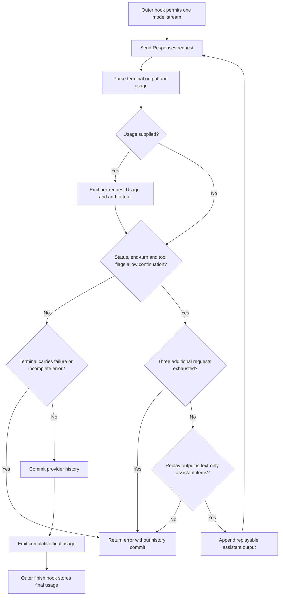

# Current state: Codex Responses provider

## Route and authentication

Codex is a dedicated provider, not the ordinary OpenAI chat-completion client. It
normally uses ChatGPT/Codex OAuth credentials, refreshing transport, request options
and Responses. A legacy API-key constructor also exists; only OAuth construction
enables streaming-backed `completion()`. SSE and explicit WebSocket transport
implementations sit below the model, but ordinary/default refreshing clients have
no WebSocket configured. Available WebSocket code is not proof of default enablement.
Credential lifecycle and transport negotiation are not generic compaction.

Fallback limits are 272,000 context and 4,096 output, subject to configured/registry
resolution. GPT model names receive the shared 80% family threshold. The October 16
Qwen incident does not demonstrate a Codex backend error.

Sources: `rust/providers/src/codex/mod.rs:54`,
`rust/providers/src/codex/model.rs:73`,
`rust/providers/src/codex/codex_oauth.rs:29`,
`rust/providers/src/codex/refreshing_client.rs:1`.
Construction: `rust/providers/src/codex/constructors.rs:35`, `:95`, `:154`;
`rust/providers/src/codex/refreshing_client.rs:45`, `:79`.

## Application history and provider checkpoint

Codex maintains typed provider history/checkpoints in addition to generic session
messages. Request preparation reconciles incoming user history with the checkpoint.
Model mismatch or a non-prefix replacement of non-reminder user ancestry resets
the history checkpoint and repairs replay. Assistant/tool history alone is not
the continuity test; the same user prefix can retain saved typed assistant/tool items.

A special case detects incoming DAG history when prior non-reminder user ancestry
is empty; this does not prove the whole old checkpoint was reminder-only. It is not
"reset whenever a DAG marker appears": the condition depends on prior/current
user-history structure. Automatic history reset is narrower than provider-session
reset: the latter resets routing as well as history. Generic reminder reset invokes
provider-session reset.

Sources: `rust/providers/src/codex/history.rs:75`, `:99`,
`rust/cli/src/interactive_helpers.rs:274`,
`rust/providers/src/session.rs:50`.

## Internal continuations

One model stream permits an initial logical request plus three continuations.
Transport setup can add an OAuth unauthorized refresh/retry and up to two 429/503
retries, so four is not a physical-attempt bound. Continuation requires no observed
tool call and either completed with `end_turn == false`, or incomplete with reason
exactly `interrupted` and `end_turn != true`. Broken-stream EOF before a terminal
response errors rather than following this continuation mechanism.
Replay requires a nonempty output-item list of assistant text messages; nonempty
text strings are not separately required. Other
incomplete reasons, such as max output or content filtering, are surfaced as errors.

Internal replay appends terminal assistant output to the full request input. It
does not directly set `previous_response_id`. The WebSocket optimization can
separately recognize a matching baseline, send only a suffix, and set that ID.
These mechanisms must not be conflated.

Sources: `rust/providers/src/codex/streaming.rs:46`, `:71`, `:135`,
`rust/providers/src/codex/lifecycle.rs:99`, `:134`,
`rust/providers/src/codex/websocket_baseline.rs:31`, `:46`.
Transport retries: `rust/providers/src/codex/recovery.rs:64`, `:107`.

No outer `on_completion_call` runs between those provider-internal requests. That
means the outer preflight cannot independently reject each growing continuation
payload. This does not mean all compaction is disabled: generic compaction still
operates at outer boundaries, and optional native behavior has separate controls.

## Cumulative usage used as context: conditional false trigger

Each terminal response with usage emits per-request Usage and adds to `total_usage`.
FinalResponse uses that total. The accumulator resets for a new model stream; it
is not a permanent sum of every request sharing a response-ID chain.
Missing usage adds nothing, so a successful final can contain zero usage without
establishing zero context occupancy or cost.

The sum also accumulates cached-input and reasoning details. Conversion does not
subtract these subsets from input/output, so the OpenAI additive-overlap concern
also applies. Usage/text can be emitted before continuation-limit, replay-validation,
terminal or checkpoint-save failure; such a stream may never deliver a successful
provider final/finish callback.

The presentation wrapper forwards the final callback unchanged. Rig invokes the
finish hook with that provider final response; `CompactionHook` stores its usage as
last-known context. The next pre-call check uses the larger of this count and the
payload estimate. Repeated inputs can therefore push the aggregate above threshold
even if the latest request fits. Another pre-call check is required for this false
trigger; the finish callback itself only stores state.

Sources: `rust/providers/src/codex/streaming.rs:128`, `:152`,
`rust/providers/src/codex/presentation.rs:66`,
`rust/patches/rig-core/src/agent/prompt_request/streaming.rs:756`,
`rust/core/src/compaction_hook.rs:212`, `:254`.

The display generally prefers authoritative per-request Usage events over aggregate
FinalResponse input. That protects some display paths, not hook state. The final
context-fill calculation still takes output from aggregate final usage, so even
the UI is not completely isolated from the aggregate.

Source: `rust/cli/src/interactive/stream_loop.rs:1140`, `:1158`.

## Native compaction: programmatic opt-in, default off

`NativeCapabilities` defaults hosted search and compaction to false. Enabling
compaction inserts a `compaction_trigger` input item. Output validation rejects
unnegotiated native compaction; provider history has explicit handling for accepted
native items. Ordinary model construction uses default capabilities.

The opt-in is `CodexResponsesModel::with_native_capabilities`; no production caller
was found in the inspected provider path. This is not an established CLI/profile/env
setting. Separate request-option `CodexCapabilities` do not enable it, and unknown
top-level options such as `context_management` are rejected rather than passed
through. Request resolution sets `store: false` and requests encrypted reasoning;
local checkpoints do not establish stored server conversations.

Accepted native output requires encrypted content. Commit moves request user items
into local `compacted_users` ancestry, clears ordinary replay items, and replaces
them with returned output. Generic session messages/DAG are not rewritten by that
provider-history operation.

This establishes client-side opt-in policy, not undocumented backend behavior.
Native opaque compaction is not the same representation as the generic searchable
summary DAG, and its presence alone would not fix the deferred-application race.

Sources: `rust/providers/src/codex/native.rs:5`, `:21`, `:134`,
`rust/providers/src/codex/model.rs:49`, `:73`,
`rust/providers/src/codex/history.rs:142`.
Options: `rust/providers/src/codex/request_options/types.rs:86`, `:126`;
`rust/providers/src/codex/request_options.rs:123`.

## Persistence and boundaries

The Codex provider extension can persist continuation checkpoint metadata through
session message envelopes. That path is separate from writing a generic manifest
compaction summary/boundary. Durable provider continuation does not establish
durability of an injected DAG, and resetting a provider checkpoint is not deletion
of original session history.

The SSE HTTP error path returns status without preserving the rejection body.
A context rejection can therefore lose wording needed by the text overflow
classifier. Terminal backend-error events have a different diagnostic path; this
is a conditional recovery risk, not a demonstrated backend overflow.

Sources: `rust/providers/src/codex/history.rs:45`,
`rust/cli/src/session/provider.rs:21`.
Reset/diagnostics: `rust/providers/src/codex/session.rs:46`,
`rust/providers/src/codex/routing.rs:62`, `rust/providers/src/codex/recovery.rs:137`.

Verification priorities: latest-request versus cumulative usage, per-internal-request
guards, SSE/WebSocket replay equivalence after replacement, explicit native opt-in,
provider reset on generic compaction, and checkpoint/DAG restoration together.
