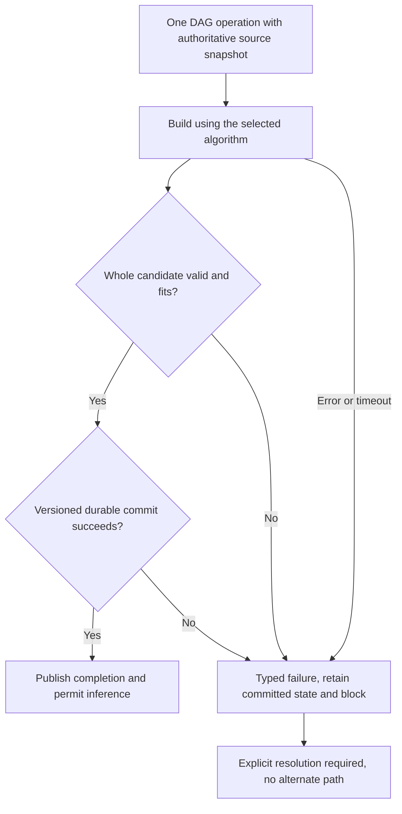

# CB-28: remove fallback behavior, not merely unify it

Date: **2026-10-17**. Documentation-only repair requirements for **CMPCT-051**.
Baseline: `28d8e812ef4269d46b25f517574501902836902b`.
**Static policy conflict; P1.** Existing fallback behavior conflicts with the
latest explicit requirement: **NO FALLBACKS**. This is not a newly reproduced
incident or an allegation that old completed cards violated their original rules.

The [original cards and academic evidence](../future-state/05-research-foundation.md)
support retaining the hierarchical DAG. CMPCT-016/020/047's deterministic fallback
policy is historical and superseded. Research-local CB-28 extends CB-01–27; it
does not silently rewrite those cards or claim production behavior has changed.

## Non-negotiable contract

One DAG algorithm, one full-candidate validator, one generation-aware commit owner.
Failure is a typed failure or blocked state, **not another representation of success**.
No fragment salvage, generic recovery DAG, deterministic truncation, flat/native
summary substitution, silent archive rebuild, fabricated tool output or automatic
transport downgrade may rescue a failed operation.

Keep immutable originals and the last committed DAG/checkpoint intact on failure.
A working builder view must be separate from committed memory; stopping a failed
builder cannot leave the only active copy cleared. Block ordinary inference until
an explicit resolution validates a usable generation. Publish failure/cancellation,
never CompactionComplete, for an uncommitted operation. New input may be queued but
must not trigger a hidden “Continue” attempt on the unsafe generation.

Type names below are proposed categories, not existing Rust symbols:
`HandlerUnavailable`, `SourceSnapshotUnavailable`, `BuilderTimedOut`, `InvalidDag`,
`IncompleteCoverage`, `BudgetExceeded`, `StaleGeneration`, `ReplayUnavailable`,
`TransportUnavailable`, `PersistenceFailed`.

## Removal inventory: runtime and builders

| Current route and evidence | Remove | Required replacement |
| --- | --- | --- |
| Automatic round, [A1] at 173–190 and 223–262 | Missing/poisoned handler converted to fallback pin, failure then completion then `Ok` | Typed dependency failure, unchanged committed generation, no completion |
| Automatic output, [A1] at 201–220 | Accept any output with one recognized node; otherwise recover/generate fallback | Reject the whole invalid/incomplete candidate |
| Builder timeout/depth/provider failure, [A2] at 120–164 and 201–370 | Caller converts generation error to successful replacement | Preserve typed failure across both caller routes |
| GenerateCompaction, [A2] at 565–619 | Self-lock contention substitutes `existing_dag = None` and FRESH rebuild | Owner-mediated authoritative snapshot or typed failure |
| GenerateCompaction, [A2] at 703–817 | Failed/bad output queued or directly pinned as fallback; success note | No queue/pin/complete on failure, no destructive stale replacement |
| Shared recovery, [A3] at 231–309 | Extract partial nodes; fabricate generic range-spanning node; force injection | Remove production callers and obsolete helpers once tests cover failure paths |
| Watchdog, [A4] at 1465–1553 | Synthetic Continue/escalated strategy and recovered/generic forced DAG | Bound the operation, report exhaustion, clear busy state but retain blocked status |
| Terminal recovery, [A4] at 1586–1619 | Cleanup removes builder, then missing-handler fallback is invoked | Fix CB-02 lock ownership and CB-03 dependency lifetime; absence is an error |

Deterministically extracting file metadata or assembling **validated** selected
nodes is normal DAG operation, not permission to turn a failed candidate into a
“best available” summary. Fresh construction is legitimate only for a session that
truly has no previous DAG; it must not mask inability to access an existing one.

## Removal inventory: parser, replay and transport

| Current route and evidence | Remove or constrain | Required replacement |
| --- | --- | --- |
| `parse_dag_nodes`, [A5] at 454–550 | Drop/clamp invalid metadata then accept original text; success from surviving subset | Reject malformed candidates as a whole using persisted coordinates; allow intentional cross-depth hierarchy |
| `detect_existing_dag`, [A3] at 146–159 | Malformed marked DAG becomes `Some(..., 0)` | Explicit invalid-source outcome, not invented zero coverage |
| Checkpoint snapshot/restore, [A6] at 41–48 | Lock failure becomes absence; unsupported version silently filtered | Distinguish genuinely absent state from inaccessible/incompatible checkpoint |
| Checkpoint reset/persist, [A6] at 57–138 | Unavailable state or failed continuity silently repairs incoming history; reset save failure only logged | Versioned explicit reset/restore contract or typed blocked failure, no weakened reconstruction |
| `history_replay::finish_pending`, [A7] at 64–89 | Missing result replaced by “Tool execution cancelled by interruption.” | Recorded real cancellation/result, otherwise explicit replay failure |
| WebSocket upgrade, [A8] at 144–147 and [A9] at 121–126 | 404/405/426/501 returns `None`, client automatically sends HTTP | Configured WS fails explicitly; fixture must observe zero HTTP requests |
| WebSocket baseline, [A10] at 46–66 | Incompatible delta baseline silently switches to full input | Choose an explicit request mode; incompatible delta mode fails, never secretly switches |
| Native/flat memory alternatives | Any automatic switch on DAG failure | DAG remains sole memory algorithm for this repair; native remains disabled |

This does not claim all WebSocket errors downgrade: ordinary setup/send/stream
errors already fail without replay. The four upgrade statuses are the specific
automatic WS→HTTP route. Full-input encoding on the same socket is separately
identified so it is not confused with HTTP downgrade or raw-transcript resurrection.

An explicitly configured **full-current-DAG request mode** is valid from the start;
it is not a fallback when it is the only selected mode. Optional delta mode would
need an explicit generation-bound baseline lifecycle and rejection on mismatch.
An intentional commit-time provider reset can be part of the DAG protocol; an
error-driven reset that conceals incompatible/missing state is not equivalent.

No automatic model/provider switch, guessed context limit after resolution failure,
or generic text classifier rescuing an unrecognized typed error is authorized.
Return an explicit unknown/unsupported outcome where the contract is unavailable.
Provider-native textual error fields may be inputs to its declared parser; that
is not a second broad substring classifier that changes recovery strategy.

## Bounded termination, not guaranteed successful compaction

LCM's deterministic 512-token truncation underpins its terminal escalation; we
intentionally do not adopt it. Fixed instructions can themselves exceed capacity.
Therefore require bounded **termination**, not forced successful shrinking:

- Before any request, validate the configured budget and current generation.
- Reject invalid/oversized candidates; never silently shorten durable decisions.
- Bound source capture, inference, lock waits, commit and publication separately.
- If same-operation retries are permitted, use the same DAG algorithm, source
  contract and validator with an explicit budget. No automatic strategy escalation.
- On exhaustion, fail and block. Preserve evidence and expose the failed operation.
- Resume only after explicit resolution selects a validated committed generation.

Same-transport OAuth refresh or bounded retry of a transient status is not a memory
fallback, but must remain within its declared retry contract, preserve diagnostics
and not change model, transport, source history or compaction algorithm.

## Required negative regression assertions

Each case needs a Gherkin scenario and a corresponding failing integration test
before production changes. Use real stores and scripted transport fixtures.

| Trigger | Required assertion |
| --- | --- |
| Handler missing/registry unavailable | No fallback helper, replacement, success or completion |
| Timeout/depth/provider failure with valid-looking blocks in error text | Diagnostic text never becomes a candidate |
| Opening-only tags, mixed valid/bad nodes, missing durable facts or invalid bounds | Entire candidate rejected; no metadata filtering/clamping into success |
| Self-target snapshot contention | No silent fresh rebuild or loss of existing D2/file awareness |
| Watchdog exhaustion or cancellation | Bounded typed outcome, no synthetic Continue or forced pin |
| Stale source, failed checkpoint write or impossible mandatory budget | Committed generation unchanged; no ordinary inference until explicit resolution |
| Checkpoint lock/version failure | No “absent checkpoint” success or raw-history replay |
| Missing tool result | No invented cancellation/result text sent to provider |
| Configured WS upgrade returns 404/405/426/501 | Typed transport failure and zero HTTP attempts |
| Delta baseline mismatch | Explicit incompatibility, no automatic full-input request |
| Unsupported native item or unavailable provider | No memory/model/provider substitution |
| Cold resume after failed compaction | Restore last committed DAG plus verified suffix, retain failed/blocked outcome |

Inspect executable call sites, not just absence of a function name: renaming
fallback helpers does not remove degradation. Existing success-oriented fallback
tests/specifications must be replaced in the implementation slice rather than
weakened or left documenting a supported alternate path. Historical completed
cards/attachments remain evidence; new acceptance criteria record supersession.

## Source references

[A1]: ../../rust/cli/src/compactor_sub_agent.rs#L157
[A2]: ../../rust/agent-loop/src/generate_compaction_handler.rs#L71
[A3]: ../../rust/cli/src/compaction_dag.rs#L146
[A4]: ../../rust/agent-loop/src/agent_loop.rs#L1465
[A5]: ../../rust/core/src/compaction/model.rs#L454
[A6]: ../../rust/providers/src/codex/history.rs#L41
[A7]: ../../rust/providers/src/codex/history_replay.rs#L64
[A8]: ../../rust/providers/src/codex/websocket.rs#L144
[A9]: ../../rust/providers/src/codex/client_http.rs#L101
[A10]: ../../rust/providers/src/codex/websocket_baseline.rs#L46

This chapter is a static source audit and required repair plan, not implemented
code or a successful runtime test. See [verification priorities](07-verification-priorities.md).
