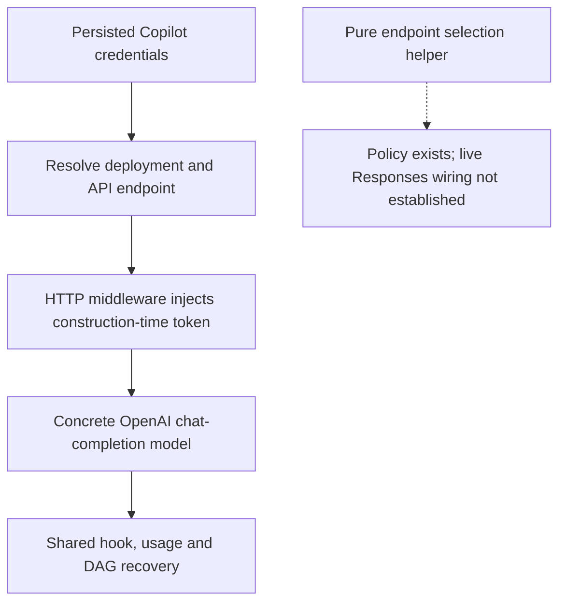
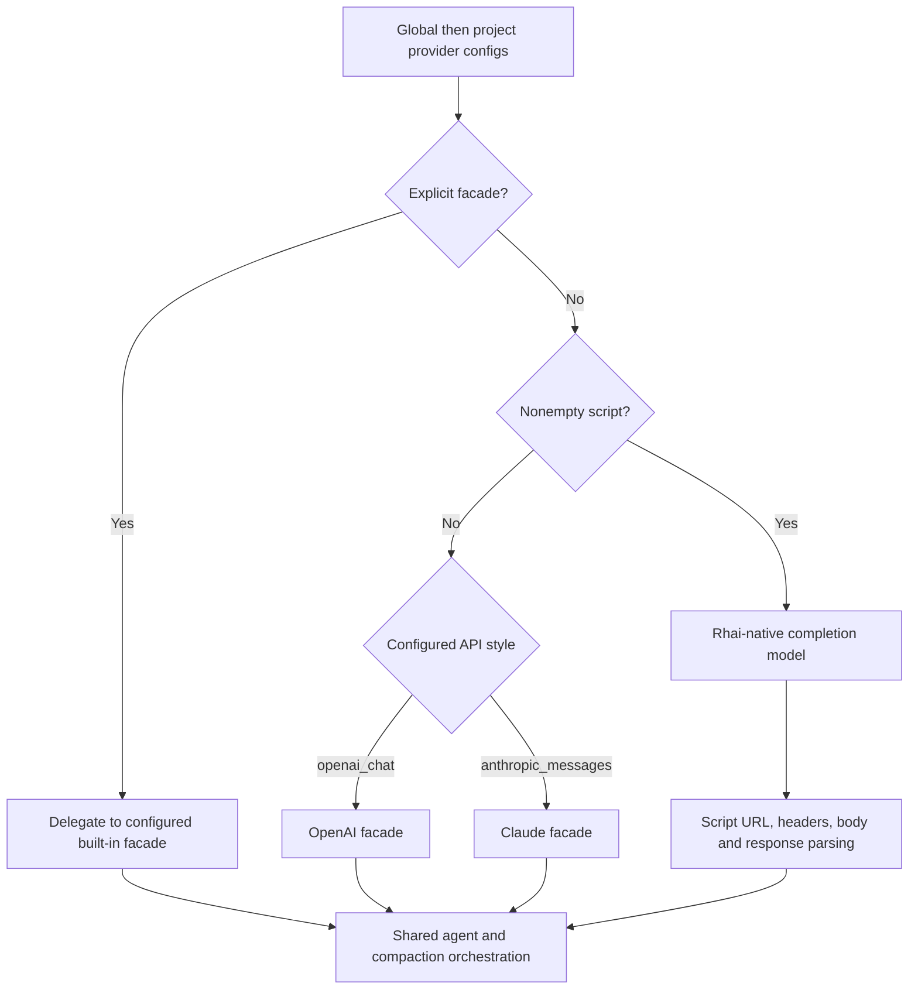

# Current state: Copilot, custom providers and stub

## GitHub Copilot

Copilot loads persisted device-flow credentials, selects GitHub.com or enterprise
deployment, and uses the persisted API endpoint when available. Middleware injects
the token bound at client construction; it does not refresh/rebind it. A separate
refresh helper persists auth state, but even the direct completion helper does not
rebuild its existing client after refresh. A long-lived client can retain a stale
token; this is a source-visible risk, not a live reproduction. The concrete agent is
`openai::completion::CompletionModel<CopilotHttpClient>`.

It therefore uses chat-completion streaming/usage behavior and the shared generic
compaction flow. Its fallback context/output are 200,000/4,096. The agent builder
accepts thinking configuration for interface parity but does not apply that argument
on this chat-completion path.

Sources: `rust/providers/src/manager.rs:890`,
`rust/providers/src/copilot/provider.rs:113`,
`rust/providers/src/copilot/rig_agent.rs:17`, `:56`.
Token binding: `rust/providers/src/copilot/refreshing_client.rs:38`, `:146`;
`rust/providers/src/copilot/token_refresh.rs:67`;
`rust/providers/src/copilot/provider.rs:268`.

### Endpoint policy versus actual wiring

A pure selector declares `/responses` for numeric GPT families at least 5 except
exact `gpt-5-mini`; other models select `/chat/completions`. Separate prompt and
behavior facades also exist. The concrete provider/agent construction inspected
here still uses the chat model. The middleware does not establish an endpoint
rewrite. Do not document the selector as proof of live Responses dispatch.

Sources: `rust/providers/src/copilot/endpoint.rs:61`,
`rust/providers/src/copilot/refreshing_client.rs:134`,
`rust/providers/src/copilot/rig_agent.rs:56`.

### Cache and opaque reasoning

Claude-family Copilot requests can receive `copilot_cache_control` markers on system,
tools, and recent messages. GPT behavior helpers can extract/reinject opaque reasoning.
Neither helper proves automatic persisted round-tripping or backend conversation
retention. The model's marketing family does not turn this concrete transport into
the Anthropic or native Gemini implementation.

Sources: `rust/providers/src/copilot/prompt_cache.rs:48`,
`rust/providers/src/copilot/behavior_facade.rs:37`, `:133`.

## Custom-provider discovery and dispatch

Global JSON configs load before project `.fspec/providers/*.json`; project configs
override matching global names. `FSPEC_HOME` affects global discovery. Custom slugs
can shadow built-ins unless shadowing is disabled. The available set is dynamic,
so a complete static list of custom deployments cannot be inferred from this repo.

Dispatch priority is explicit facade, otherwise nonempty script uses the Rhai-native
model, otherwise API style derives a built-in facade. `openai_chat` maps to OpenAI
and `anthropic_messages` to Claude. Tool style is separate and can be OpenAI,
Anthropic/Claude, Gemini, or Codex. A Codex tool style is not proof of Codex transport.

Sources: `rust/providers/src/custom/discovery.rs:17`,
`rust/providers/src/custom/config.rs:60`,
`rust/providers/src/custom/management.rs:427`.

## Rhai-native request and history semantics

The model converts supplied Rig history and preamble to internal messages, then
asks scripts to build URLs, headers, request bodies, and parse completion/SSE data.
API-style metadata alone does not prove the resulting wire protocol or usage basis.
The request bridge includes messages, tools, and thinking configuration.
It does not automatically pass a configured maximum-output limit as a generation
parameter; the script must implement the corresponding request setting.

History conversion is explicitly lossy: user audio/video/documents are ignored,
assistant images are skipped, and assistant reasoning becomes text. Supported
text/images and tool parts are retained in defined order. This is application
history serialization, not evidence of server-side memory.

Sources: `rust/providers/src/custom/rig_model.rs:254`, `:371`,
`rust/providers/src/custom/rig_message_convert.rs:44`,
`rust/providers/src/custom/request_bridge.rs:52`,
`rust/providers/src/custom/provider_dispatch.rs:61`.

## Custom limits and compaction

JSON model defaults are 200,000/4,096, while the bare manager's custom fallback is
128,000/4,096. Optional script `get_model_limits` accepts positive values, falls
back for invalid/missing ones, and caches results in the provider instance. A
threshold override is available separately.

Rhai/facade agents still participate in the common hooks and DAG lifecycle, but
actual usage may be missing, cumulative, or differently normalized according to the
script. That uncertainty must be recorded per deployment, not filled in using the
tool facade name. Clean-context research/compactor tools must retain their restricted
surface rather than inheriting the full production write-tool set.

The Rust usage bridge has a specific merge rule despite `UsageDelta` naming:
supplied nonnegative integer fields replace the previous value, omitted/invalid
fields retain it, and explicit zero clears a prior detail. Values are snapshots,
not increments. Final usage takes that merged snapshot; total is input + output,
excluding cache/reasoning details. Whether the script's snapshots describe actual
backend usage remains deployment-specific.

Sources: `rust/providers/src/custom/rig_model.rs:115`, `:514`, `:570`;
`rust/providers/src/custom/stream_convert.rs:97`.

Sources: `rust/providers/src/custom/model_limits.rs:55`,
`rust/providers/src/custom/provider.rs:106`,
`spec/features/custom-provider-compactor-sub-agent-read-only-tool-surface.feature`.

## Test stub

The deterministic stub provider/model exists only behind `test-support`. It enables
real dispatch and transport tests without credentials or a production backend.
It does not validate real vendor token usage, cache semantics, opaque replay, or
native compaction. Production builds must not silently resolve `stub` as a built-in.
Its test registration resolves through Custom, not a seventh built-in enum variant.

Sources: `rust/providers/src/lib.rs:41`,
`rust/providers/src/stub_model.rs:1`,
`rust/agent-loop/src/dispatch.rs:142`.

## Coverage boundary

All six runtime families, dynamic custom routing, and the stub are accounted for.
Catalog-only vendors require a selected executable route; their settings rows do
not warrant invented vendor-specific compaction descriptions. Backend-specific
guarantees remain unverified without deployment configuration and response fixtures.
