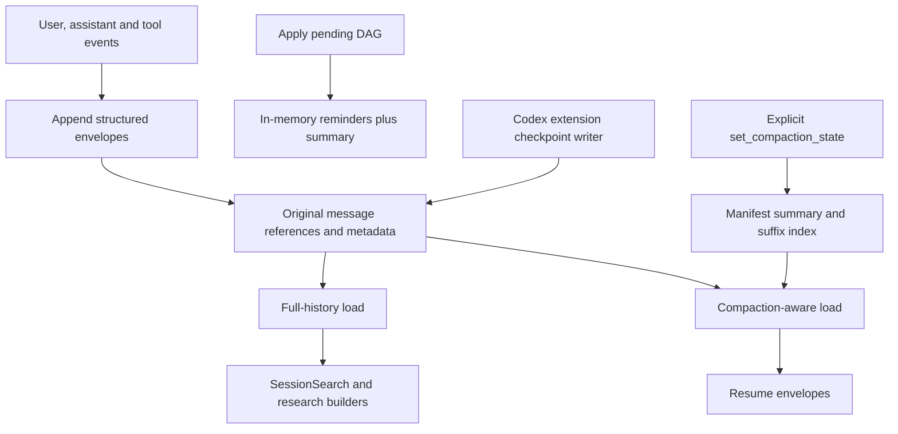
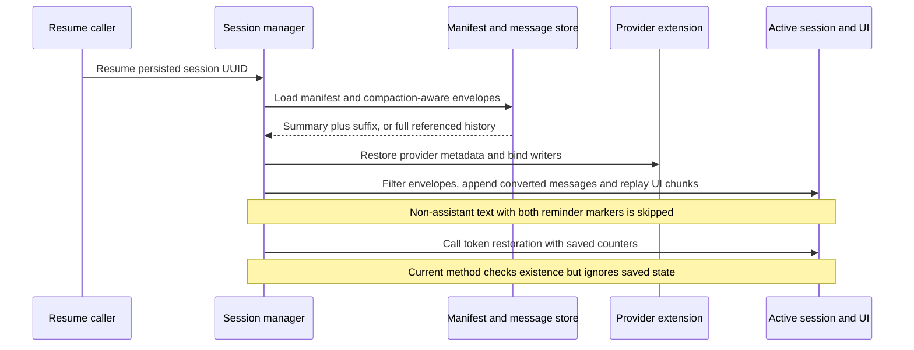

# Current state: persistence, search and resume

## Three independent representations

The application has a searchable original conversation, an active model context,
and provider continuation metadata. These have different owners and write paths.
Compaction of active messages does not imply deletion from the message store;
successful provider checkpoint persistence does not imply durable generic DAG
pinning. A summary tool result persisted as ordinary conversation is also not a
committed compaction boundary.

| Representation | Write path | Read path |
| --- | --- | --- |
| Original messages and structured tool content | Helpers append envelopes and preview text | Full-history records; SessionSearch does not search every metadata payload |
| Active reminders and DAG | Reset and injection mutate the inner session | Next stream's application history |
| Generic persisted summary and suffix boundary | `set_compaction_state` saves manifest compaction fields | Compaction-aware message/envelope loading |
| Codex typed checkpoint | Provider extension writer adds metadata envelope | Provider extension restore before generic message replay |
| Token totals | Token-state persistence updates manifest counters | Resume passes saved counters to a currently no-op restoration method |

Sources: `rust/agent-loop/src/persist.rs:26`, `:68`, `:142`, `:216`;
`rust/core/src/persistence/manifest.rs:93`, `:855`, `:1166`;
`rust/cli/src/session/provider.rs:15`, `:21`.

## Reminder filtering also affects wrapped summaries

The skip rule is a literal substring check, not typed reminder validation: a
non-assistant envelope's joined text or string content containing both
`<system-reminder>` and `<!-- type:` is skipped. Assistant text follows a different
branch without this predicate. In the array branch, skipping also discards that
envelope's buffered UI chunks, including accompanying tool-result chunks.

This includes a marker-bearing DAG inside a synthetic manifest summary: adding
`[Previous conversation summary]` before it does not defeat the substring check.
Consequently, even explicitly saving the wrapped DAG through
`set_compaction_state` would not alone establish its replay into generic active
history. This is a second boundary, distinct from the missing injection-to-manifest
write described below. Provider restoration already saw the unfiltered envelopes.

Source comments promise fresh reminder injection after restore, but no such call
appears in `restore_session_messages` or the remainder of `resume_session`.
Cold resume does run reminder initialization during session creation, **before**
replay. Resume into an existing in-memory session skips that creation step. Neither
path establishes a fresh-injection step after replay or rescues the filtered DAG.

Sources: `rust/sessions/src/handle_impl.rs:556`, `:650`, `:701`, `:718`;
`rust/core/src/persistence/manifest.rs:969`, `:1039`.
Creation: `rust/sessions/src/handle_impl.rs:203`,
`rust/sessions/src/session_manager.rs:1009`,
`rust/sessions/src/session_creation_helper.rs:219`.

The diagram intentionally has no established edge from `Apply pending DAG` to
`set_compaction_state`: that is the wiring gap found in the inspected live route.

## What ordinary persistence retains

`persist_user_message`, `persist_assistant_message_internal`, and
`persist_tool_result_internal` serialize structured envelopes into message metadata.
The searchable text field may be shortened or summarized, while the structured
metadata carries the underlying tool result/content. Blob rehydration is another
layer; a preview is not necessarily the original payload.

Ordinary tool-result persistence puts only about 200 bytes in `StoredMessage.content`
and the full result in metadata. SessionSearch resolves content and blob references,
not generally `metadata.message.content`; ordinary message storage starts with empty
blob references. Compaction-mode trimming and show limits further reduce returned
text. Thus full-history **record loading** is not exhaustive structured-payload
search/retrieval. Original retention must not be advertised as guaranteed lossless
access through SessionSearch.

Sources: `rust/agent-loop/src/persist.rs:159`, `:177`;
`rust/agent-loop/src/session_search_handler.rs:248`, `:398`, `:479`, `:729`;
`rust/core/src/persistence/messages.rs:241`.

`append_message_with_metadata` stores a message, appends its reference to the
manifest and saves the manifest. Manifest save serializes and writes JSON. This
research does not establish a transaction spanning a message, provider checkpoint,
generic compaction state and token counters.

Save uses direct `fs::write`, not atomic checkpoint promotion. `load_session` clones
an in-memory manifest cache; reloading in the same process is not a disk-restart
test. Writers independently load/modify/save whole manifest snapshots, creating a
stale-snapshot overwrite risk across message, provider and token updates. No data
loss from that interleaving was reproduced here.

Sources: `rust/core/src/persistence/manifest.rs:329`, `:357`, `:617`, `:891`;
`rust/cli/src/session/provider.rs:26`.

Structural annotations are written separately. Their persistence helper loads full
history and maps active indices after subtracting reminder count. That mapping is
not a universal persisted-turn identity after arbitrary history replacement.

Sources: `rust/agent-loop/src/persist.rs:26`, `:68`, `:142`, `:243`;
`rust/core/src/persistence/manifest.rs:315`, `:882`, `:1033`.

## Manifest compaction support

`CompactionState` contains `summary`, `compacted_before_index`, and `compacted_at`.
The setter stores these fields and saves the manifest. It does not remove original
message references.

`get_session_messages` reconstructs a synthetic user message prefixed
`[Previous conversation summary]`, then loads messages from
`compacted_before_index` onward. With no compaction state it loads every referenced
message. `get_session_messages_full` ignores this boundary, preserving a separate
route for original-history search. The envelope converter preserves structured
metadata where available and rehydrates blob references.

Sources: `rust/core/src/persistence/manifest.rs:93`, `:962`, `:1012`, `:1033`,
`:1166`.

## Live resume ordering

`resume_session` loads the manifest, creates an in-memory session when necessary,
then loads compaction-aware envelopes. `restore_session_messages` first restores
the provider extension from those envelopes and binds its persistence writers.
It then converts and filters envelopes into generic messages and UI chunks, **appends**
converted messages to the existing `inner.messages`, and dispatches replay chunks.
This method does not clear existing active messages first; repeated restoration
into an already populated session is not established to be idempotent.

Generic history replay is also lossier than UI replay. Assistant thinking/tool-use
and user tool-result blocks produce UI chunks, but generic messages are rebuilt
from joined text only. Pure tool envelopes can appear in scrollback without equivalent
structured model-history messages. Assistant string content is skipped because that
branch requires an array. Provider restore sees unfiltered envelopes separately.

Source: `rust/sessions/src/handle_impl.rs:583`, `:593`, `:658`.

After message replay, resume constructs saved token state and calls
`restore_session_token_state`. That implementation ignores its `_state` argument
and only verifies that the session exists. Thus the call is present but actual
restoration of saved counters is not implemented on this route.

Sources: `rust/sessions/src/handle_impl.rs:215`, `:233`, `:537`, `:560`, `:739`,
`:763`.

## What the generic injection path does not establish

The live `create_handler` stores a wrapped DAG in a pending in-memory slot.
`apply_pending_dag` resets active messages and recalculates tokens. Neither directly
calls `set_compaction_state`. The surrounding ordinary persistence helpers write
conversation, tokens and annotations, not an explicit generic compaction manifest
commit in the traced path.

Consequently, this investigation does **not** prove that the same injected DAG and
suffix boundary survive restart. Without a committed boundary, compaction-aware
loading can reconstruct original history rather than the intended reduced context.
Do not strengthen this into a claim that original messages were lost: the inspected
compaction setter and reset paths do not delete them.

Sources: `rust/agent-loop/src/inject_summary_handler.rs:48`, `:245`, `:323`;
`rust/agent-loop/src/agent_loop.rs:1398`; `rust/agent-loop/src/persist.rs:1`.

Self-targeted GenerateCompaction queues the same way; its cross-target direct pin
also has no generic manifest commit. Cross-target pin explicitly calls
`reset_after_compaction`, whereas deferred apply does not explicitly do so.
Source: `rust/agent-loop/src/generate_compaction_handler.rs:728`, `:769`.

## Token persistence is not per-request settlement

The manifest already separates current context, cumulative billed input/output,
cache details and session-cumulative reasoning. BackgroundOutput persists cached
input/output on Done. Its helper adds these counts to billed totals, overwrites
context input, passes zero cache details, and stores reasoning without adding it.
This is not proof of complete or idempotent per-request billing. Deferred DAG apply
recalculates the inner tracker but does not explicitly persist these counters.

Sources: `rust/core/src/persistence/manifest.rs:37`, `:177`;
`rust/agent-loop/src/background_output.rs:441`, `:475`;
`rust/agent-loop/src/persist.rs:202`.

## Codex checkpoint is a separate durability feature

`CodexCheckpoint` has version, model, typed items and compacted-user history.
`CodexHistory::restore` accepts version 1. The provider session delegates envelope
decoding to its extension; `CodexHistory::restore` itself is not an envelope parser.
The writer appends an empty assistant message carrying provider metadata.

Generic reminder reset calls provider reset. Resume therefore needs both a correct
generic context and a compatible provider checkpoint; restoring just one does not
prove they describe the same compaction generation.

Sources: `rust/providers/src/codex/history.rs:11`, `:45`;
`rust/providers/src/session.rs:20`; `rust/cli/src/session/provider.rs:21`;
`rust/cli/src/interactive_helpers.rs:274`.

## Verification boundary

Existing persistence and Codex reload tests are useful component evidence. A
separate end-to-end test must pin during live streaming, restart, resume, inspect
the next request and still recover the original messages through full-history
search. No such complete round trip was executed in this research.
Use a fresh process or explicit singleton reset/reinitialization, not only teardown
of active sessions. Include a tool-result sentinel beyond its preview and verify
structured replay as well as UI chunks; searching original user text is insufficient.

Relevant tests: `rust/agent-loop/tests/rpc080_agent_loop_persistence.rs:1`,
`rust/agent-loop/tests/prov149_codex_reload.rs:1`,
`rust/sessions/tests/data_consistency_save_restore.rs:1`.
