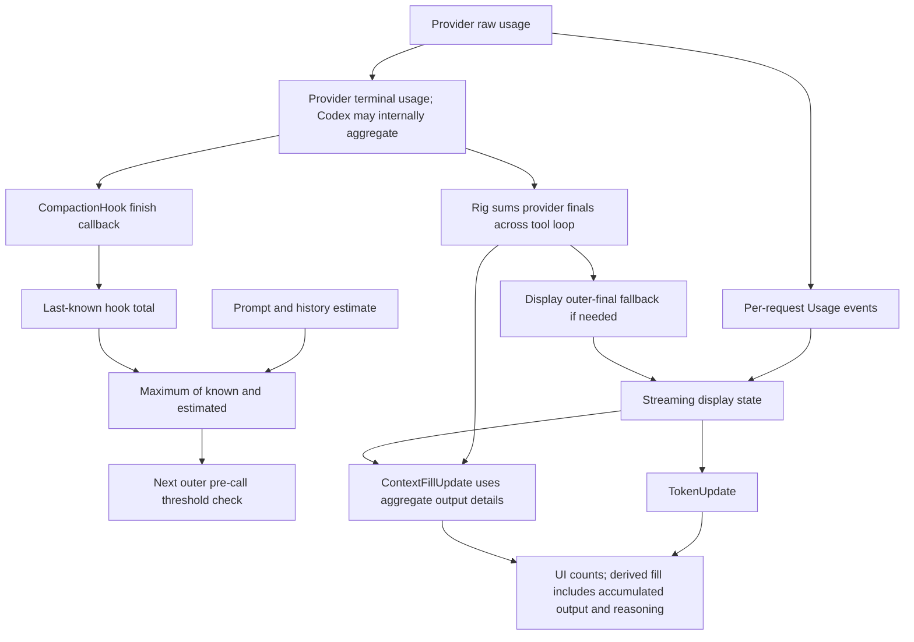
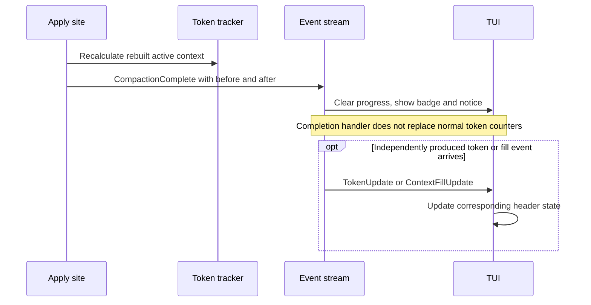

# Current state: token accounting and UI events

## Token numbers answer different questions

| Number | Intended question | Important limitation |
| --- | --- | --- |
| Provider per-request usage | What did this request consume? | Provider fields can overlap or disappear in conversion |
| Provider terminal usage | What did this adapter operation report? | Codex internally aggregates; other adapters usually report one request |
| Rig outer final aggregate | What usage was reported across this tool loop? | Sum of provider finals, not latest physical context or proven bill |
| Hook last-known total | Should the next outer model call compact? | Consumes final response usage, not UI state |
| Payload estimate | How large is this supplied prompt/history? | Approximation, not full wire-payload tokenization |
| Tracker input | What context input should be displayed? | Cache-inclusive after normal tracker updates |
| Display output/reasoning | How much generation has accumulated? | Includes prior output/reasoning base, not only current request |
| Cumulative billed counters | What has the session spent? | Not current context occupancy |
| Post-pin estimate | How large are rebuilt active messages? | Estimated content, not backend-reported usage |
| Fill percentage | How close is usage to the trigger? | Denominator is trigger threshold, not always full model window |

These values are neither interchangeable nor synchronized by one atomic operation.
The screenshot's old header and new reduction notice are therefore not contradictory
measurements of one state at one instant.

## Shared formulas and their assumptions

`ApiTokenUsage` was designed around disjoint Anthropic-style input categories:

- `total_input = input + cache_read + cache_creation`.
- `total_context = total_input + output + reasoning`.
- The hook's `TokenState::total` adds input, cache and output, but has no separate
  reasoning field.
- The pre-call hook uses `max(last_known_total, estimated_payload)` and triggers
  only when that result is strictly greater than the effective threshold.
- The UI fill event computes `100 * total_context / threshold`, truncating to an
  integer; values above 100 are allowed.

Those are implementation formulas, not a proof that raw counters from every
provider are disjoint. A provider can already include cached tokens in prompt
input or reasoning tokens in output. Blind addition can then double-count subsets.
Conversely, dropping Anthropic terminal cache detail can undercount cached input.

Sources: `rust/core/src/token_usage.rs:64`, `:70`;
`rust/core/src/compaction_hook.rs:18`, `:212`, `:254`;
`rust/cli/src/interactive/stream_loop.rs:119`.

The compaction model also exposes a cache-discounted `effective_tokens` cost model.
A billing discount is not a physical-context discount and must not be used to
explain why cached input would stop occupying a context window.

Source: `rust/core/src/compaction/model.rs:90`.

## Persistence and forwarding boundaries

The manifest has distinct context/spend fields, but Done-time persistence adds cached
counts rather than settling each request and passes zero cache details (chapter 10).
Typed TokenUpdate supports reasoning and cumulative billing, but its bridge/subordinate
JSON projection omits all three fields. That projection is used for forwarding;
it is not established as the screenshot's primary TUI path.

Sources: `rust/agent-loop/src/stream_chunk_json.rs:96`,
`rust/agent-loop/src/agent_loop.rs:850`,
`rust/agent-loop/src/agent_manager_handler.rs:299`.

## Provider differences that survive the shared abstraction

| Route | Current conversion concern | Consequence to investigate |
| --- | --- | --- |
| Claude streaming | Cache detail present early, missing in terminal collector | Hook can miss cached context |
| OpenAI-compatible | Prompt copied with cached detail still separate; reasoning may already be in output | Additive shared formula can overcount subsets |
| Gemini | Live output includes cached/candidate/thought counts; terminal output is candidates | Live display and final-hook basis can differ |
| Codex | Per-request events but cumulative internal-continuation FinalResponse | Hook can treat repeated billed input as current context |
| Copilot | Selected underlying adapter controls parsing | Branch-specific semantics, not one universal formula |
| Custom scripts | Script mapping controls usage or omits it | Estimates and script contract must be checked |

See the individual provider chapters for source references and exact formulas.
None of these accounting findings alone quantifies the October 16 Qwen excess.

## Streaming display versus finish hook

The stream loop prefers authoritative live usage over replacing display input with
FinalResponse aggregates. If no authoritative output exists and final input is
nonzero, it updates from final usage instead. Patched OpenAI streaming can emit
usage-only chunks, despite older CLI comments implying otherwise.

Final fill calculation combines display input/cache counts with output and
reasoning from final usage. Thus even a display that avoids Codex aggregate input
can still use aggregate output for the final fill event. The separate hook always
receives the provider final-response callback; UI preference cannot repair it.

Source: `rust/cli/src/interactive/stream_loop.rs:1140`, `:1158`.

Cache-inclusive **hook TokenState** seeds must zero separate cache fields. The
ordinary streaming-display constructor instead retains a valid cache breakdown
and subtracts it from inclusive input, dropping an inconsistent split. Gemini's
display-basis reseed starts with raw input plus separate cache fields. These are
different contracts, not a universal zero-cache rule; none normalizes overlapping
raw provider fields upstream.

Sources: `rust/core/src/compaction_hook.rs:46`;
`rust/core/src/streaming_display/streaming_token_display.rs:142`;
`rust/cli/src/interactive/gemini_continuation.rs:161`.

Display output/reasoning carry prior tracker/session bases plus current-segment
values. TokenUpdate exports these accumulated counters, which the TUI can add into
derived fill. Backend live fill instead uses current-segment output/reasoning;
final fill uses Rig outer-final output/reasoning. These bases can disagree even
without stale delivery, provider field overlap or compaction.

Sources: `rust/cli/src/interactive/stream_loop.rs:577`, `:1099`, `:1158`;
`rust/core/src/streaming_display/output_token_tracker.rs:49`;
`rust/core/src/streaming_display/streaming_token_display.rs:311`;
`rust/cli/src/interactive/output.rs:54`.

## What completion changes, and what it does not

The deferred apply path estimates rebuilt active messages, sets tracker input to
that estimate and output to zero, then emits CompactionComplete. Its original
basis is producer-specific: automatic start snapshots background cached display
input; manual/generation capture can use tracker or cached counters. Deferred apply
falls back to pre-apply content estimation when the captured value is zero.
Reduction is clamped against reporting growth as savings.
These before/after bases should not be described as identical backend tokenizer
measurements.

Sources: `rust/cli/src/interactive_helpers.rs:205`, `:223`, `:241`;
`rust/agent-loop/src/inject_summary_handler.rs:103`, `:245`.
Automatic basis: `rust/agent-loop/src/background_output.rs:525`;
`rust/sessions/src/background_session.rs:897`;
`rust/agent-loop/src/agent_loop.rs:1371`.

The TUI completion handler clears progress, stores a rounded reduction badge,
arms a ten-second hide timer and enqueues one notice per handled completion event
in the originating session. It has no event deduplication; absent session context
can drop the notice. The slash-command success branch does not add a second notice.
It does **not** assign ordinary token counters or context-fill state. Those are
separate paths: TokenUpdate replaces counters and can recompute fill; ContextFillUpdate
replaces fill/valid threshold but not counters. TokenUpdate uses input + output +
reasoning and the last threshold; input is expected already to include cache.

The apply producer does not explicitly refresh background cached counters, emit
ordinary token/fill events, or persist token state. No immediate normal-token refresh
is guaranteed by its completion event. Header size prefers threshold over window,
rendering integer thousands (155,904 becomes 155k); 85% and above renders red. The
badge rounds reduction to an integer; the notice uses one decimal place.

Sources: `rust/fspec-tui/src/app/dispatch_compaction_complete.rs:45`,
`rust/fspec-tui/src/app/dispatch_compaction_hide.rs:1`,
`rust/fspec-tui/src/store/agent_view/token_state.rs:64`.
Rendering/delivery: `rust/fspec-tui/src/views/agent/header_build.rs:153`, `:191`,
`:205`; `rust/fspec-tui/src/app/dispatch_slash_commands.rs:81`;
`rust/fspec-tui/src/app/dispatch_slash_clear.rs:30`.

## Misleading labels and safe interpretation

- `turns_summarized` and `turns_kept` are hard-coded zero in the deferred producer;
  zero does not establish that no conversation was condensed.
- A 105% fill can mean above the configured compaction threshold, not necessarily
  above the provider's absolute window.
- "Retry budget exhausted" describes a control-flow limit. It does not measure a
  pending summary that has not yet been applied.
- An in-memory reduction estimate does not establish successful next-request
  inference, durable checkpoint commit, summary fidelity or resumed-state equality.

The proposed event/accounting contract is documented separately in future state.
