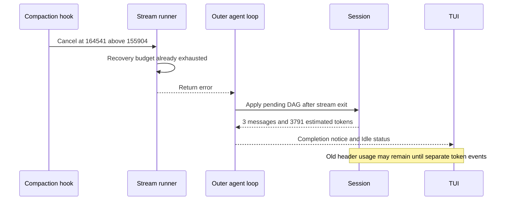

# Current state: October 16 incident and evidence

## Scope and identity

**Observed:** the screenshot shows `qwen3.8-flash-next-iq3_s` through the
OpenAI-compatible profile route, investigating Codex OAuth. It is not a screenshot
of a Codex-provider context error. The assistant's visible OAuth theories are
conversation content, not evidence explaining fspec's compaction breaker.

Matching log session: `24b204fd-6252-4032-93c5-8519d52995e2`.
Provider: `openai:Strada/qwen3.8-flash-next-iq3_s`.
Earlier investigation candidate `5cd45eb6-4120-4a79-bde1-8f9cf4a589c5` is not the
confirmed matching session and must not be used for this timeline.

Local screenshot: `/Users/rquast/Desktop/Screenshot 2026-10-16 at 3.48.40 pm.png`.
Log: `/Users/rquast/.fspec/logs/fspec-combined.log.2026-10-16:8707`.
These paths are local evidence pointers; no private transcripts or credentials are
copied here. Timestamps below are UTC; screenshot filename time is local.

## Visible symptoms

The header displays approximately a 155k threshold, input 163,582, output 1,996 and
105% fill. The error is `Compaction retry budget exhausted after 3 attempts`.
The following notice says `97.7% reduction (163582 → 3791 tokens, 0 turns summarised)`.

The input header, hook's 164,541 count, threshold, and reduction bases are different
measurements. They must not be silently treated as the same token counter.

## Timeline

| UTC time on 2026-10-16 | Recorded event |
| --- | --- |
| 05:37:17 | Earlier hook trigger: 158,082 > 155,904 |
| 05:42:24 | Earlier hook trigger: 162,593 > 155,904 |
| 05:45:51 | Earlier hook trigger: 157,441 > 155,904 |
| 05:48:20.059101 | Manifest save for matching session: 197 message references |
| 05:48:20.082956 | Hook: 164,541 > 155,904 |
| 05:48:20.082985 | Rig observes cancellation and yields PromptCancelled |
| 05:48:20.083042 | Recovery sees compaction already flagged |
| 05:48:20.083049 | Status changes Running → Compacting |
| 05:48:20.083123 | Stream reports compaction retry budget exhausted |
| 05:48:20.085496 | DAG metadata warning: start 101 is outside message count 37 |
| 05:48:20.085504 | DAG metadata warning: start 156 is outside message count 37 |
| 05:48:20.087420 | Pending DAG applied: 3 active messages, 3,791 tokens, 2 parsed nodes |
| 05:48:20.087697 | Status changes Compacting → Idle |
| 05:48:20.097288 | TUI selects idle display |

The final sequence is at log lines 8707–8718. Application follows the retry error
by **4.297 milliseconds between log observations**. The apply log is after mutation
and completion emission, not a timestamp of their exact start. Earlier triggers are contextual observations;
the final sequence alone is sufficient to establish error-before-application.

## Root sequencing explanation

**Code-confirmed:** InjectSummary's handler stores content because the stream
already holds the inner-session lock. It returns success before replacing the
session or Rig history. Rig can automatically request another completion after
tool execution. The in-loop recovery breaker can error before the streaming runner
returns. Only then does the outer loop drain and apply the pending DAG, including
on the returned error path.

**Observed:** the final incident logs match that ordering. They do not independently
identify every intermediate pending-slot overwrite or prove that each earlier
restart used the same candidate DAG. The causal claim is the acknowledged-pending
versus effective-context gap, not a reconstruction of unlogged tool calls.

Sources: `rust/agent-loop/src/inject_summary_handler.rs:65`,
`rust/patches/rig-core/src/agent/prompt_request/streaming.rs:791`,
`rust/cli/src/interactive/stream_loop.rs:659`,
`rust/agent-loop/src/agent_loop.rs:1398`.

## Separate findings, not alternate incident proofs

| Finding | Evidence class | What remains unproved |
| --- | --- | --- |
| Pending summary applies after stream exit | Code-confirmed and observed in incident | Exact timing of all prior pending submissions |
| Header counters and completion notice use separate update paths | Code-confirmed | Exact screenshot event delivery history |
| Deferred producer reports zero summarized turns | Code-confirmed | Actual number of original turns represented by the summary |
| DAG metadata bounds reject two nodes | Observed warnings | Whether any summary text was lost; metadata rejection alone does not establish this |
| Codex final usage accumulates internal requests | Code-confirmed conditional false-trigger risk | Live Codex reproduction; not the Qwen incident cause |
| OpenAI cache/reasoning fields can overlap shared additive formulas | Code-confirmed conditional risk | Numeric contribution to this Qwen run |
| Generic pin lacks direct manifest boundary write in traced path | Code-confirmed wiring gap | Crash/resume loss of intended active context in an executed reproduction |
| Resume filters non-assistant text containing both reminder markers | Code-confirmed; also matches a wrapped synthetic DAG summary | Complete durable DAG round trip through live resume |
| Resume token-state method ignores saved counters | Code-confirmed no-op in the live trait implementation | Resulting display/counter behavior through other initialization paths |
| Provider-internal Codex continuation bypasses outer preflight | Code-confirmed boundary | Actual oversized continuation rejection in this incident |
| Terminal-error helper re-locks the still-held inner mutex | Code-confirmed static lock defect | Runtime reproduction; Idle can be emitted before that blocking point |
| Broader overflow macro selects clean compactor on first round | Code-confirmed evaluation order | Whether that classifier branch ran in this incident |
| Watchdog fallback lacks completion and attempts can survive success | Code-confirmed control flow | Which watchdog episodes occurred during the incident |
| SessionSearch does not generally search full tool metadata | Code-confirmed retrieval gap | Complete recovery of original structured payloads after compaction |

The historical executable's exact source/build identity is not established by this
log excerpt. In particular, the current terminal-error lock defect must not be
retroactively asserted as a reproduced incident outcome. Current source can apply
the DAG and emit Idle **before** reaching the blocking error helper, so Idle alone
does not establish completed cleanup or the ability to process another turn. The
log excerpt ends before settling that question. Source audit and historical
observation remain separate evidence classes at the same research baseline.

## Test evidence and missing sequence

Tests exist for triggers, cancellation preservation, recovery policies, Gemini
reseeding, clean-context pins, generation, Codex history/native capabilities and
UI badges. These are valuable but do not establish a whole-system guarantee just
because their feature names mention compaction.

Representative targets inspected or inventoried:

- `rust/cli/tests/compaction_cancel_preservation_test.rs:1`.
- `rust/cli/tests/compaction_recovery_unification_test.rs:1`.
- `rust/cli/tests/compaction_convergence_watchdog_test.rs:1`.
- `rust/cli/tests/cmpct044_compactor_pin_test.rs:1`.
- `rust/agent-loop/tests/cmpct045_generate_compaction_behavioral.rs:1`.
- `rust/providers/tests/prov149_codex_history.rs:1`.
- `rust/providers/tests/prov158_codex_compaction_transport.rs:1`.
- `rust/fspec-tui/tests/single_sourced_compaction_notice_rpc421.rs:1`.

Within the previously scoped audit, no test proved this complete sequence:
live stream tool injection → pending apply → next actual provider request uses
reduced context → committed resume restores the same generation. No Rust or live
provider tests were run for this documentation task. Mermaid attachment validation
checks diagram syntax, not that missing runtime sequence.

## Priorities justified by the evidence

1. Make summary application an inference boundary, not merely a tool acknowledgement.
2. Normalize request-context usage separately from cumulative billing.
3. Commit the generic summary/boundary with compatible provider state for resume.
4. Refresh UI context counters from committed state and report honest coverage.
5. Test bounded fallback with oversized reminders, cancellation and crash windows.

Future-state chapters turn these into proposals, not claims of existing behavior.
