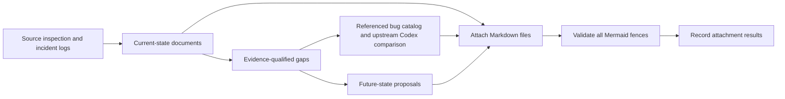

# Compaction research

Research snapshot: **2026-10-17**, repository baseline `28d8e812`.
Tracking work unit: **CMPCT-051**. This is documentation, not an implementation.
Re-audited against executable source at `28d8e812ef4269d46b25f517574501902836902b`.

## Reading order

Start with the current state. Future-state documents are proposals, not descriptions
of capabilities already implemented.

**Selected direction: retain and repair the research-backed hierarchical DAG;
no fallbacks.** The original CMPCT-005/016 cards and attached research underpin
this choice. LCM reports measured long-context wins over Claude Code; this is not
an untested architecture invented for this repair. Read the research foundation
for the exact results and their scope. Failed operations must terminate explicitly,
not install partial/generic summaries or switch memory, replay or transport modes.

| Part | Document | Purpose |
| --- | --- | --- |
| Current | [Architecture](current-state/01-architecture.md) | Runtime topology, state owners, common request lifecycle |
| Current | [Triggers and recovery](current-state/02-triggers-and-recovery.md) | Thresholds, hook checks, retries, overflow escalation |
| Current | [DAG construction and application](current-state/03-dag-construction-and-application.md) | Fresh/incremental summaries, deferred and immediate pins |
| Current | [Provider inventory](current-state/04-provider-inventory.md) | Every built-in route, catalog entries, custom providers |
| Current | [Claude](current-state/05-claude.md) | Anthropic API/OAuth, caching, usage, compaction |
| Current | [OpenAI-compatible providers](current-state/06-openai-compatible.md) | OpenAI, local/profile endpoints, Z.AI |
| Current | [Gemini](current-state/07-gemini.md) | Empty-response continuation, signatures, token reseeding |
| Current | [Codex](current-state/08-codex.md) | Responses, replay/checkpoints, internal continuation, native compaction |
| Current | [Copilot and custom providers](current-state/09-copilot-and-custom.md) | Routing, script semantics, test stub |
| Current | [Persistence and resume](current-state/10-persistence-and-resume.md) | Disk history versus active history and durable checkpoints |
| Current | [UI and token accounting](current-state/11-ui-and-token-accounting.md) | Different token bases, events, misleading counters |
| Current | [Incident and evidence](current-state/12-incident-and-evidence.md) | October 16 timeline, findings, coverage boundaries |
| Future | [Lifecycle proposal](future-state/01-transactional-lifecycle.md) | Safe inference boundary and committed compaction generation |
| Future | [Provider contracts](future-state/02-provider-contracts.md) | Context usage, continuation, replay and native-compaction contracts |
| Future | [Verification and rollout](future-state/03-verification-and-rollout.md) | Acceptance candidates, tests, observability, migration |
| Future | [DAG and Codex reuse decision](future-state/04-dag-codex-reuse.md) | Keep repaired fspec memory and borrow Codex lifecycle safeguards without alternate compactors |
| Foundation | [Original cards and academic evidence](future-state/05-research-foundation.md) | LCM/CMV results, design lineage and deliberate rejection of deterministic fallback |
| Bugs | [Referenced bug catalog](compaction-bugs/00-bug-index.md) | Evidence-qualified findings, priorities and regression candidates |
| Bugs | [Upstream Codex comparison](compaction-bugs/06-upstream-codex-contract.md) | Actual `/tmp/codex` local/remote-v2 implementation at a pinned revision |
| Bugs | [No-fallback removal plan](compaction-bugs/08-no-fallback-removal-plan.md) | CB-28 removal inventory and required negative regressions |
| Cards | [Repair cards and workstreams](fix-cards/00-fix-card-index.md) | CMPCT-052–083 ownership, dependencies and implementation briefs |
| Cards | [Confirmation and decision audit](fix-cards/00-confirmation-audit.md) | Second source confirmation, qualifications and resolved HITL decisions |
| Validation | [Attachment validation](VALIDATION.md) | Per-file attachment results and validation limitations |

## Evidence conventions

- **Observed:** supported by the incident's local runtime logs.
- **Code-confirmed:** supported by the inspected source at the baseline above.
- **Conditional risk:** a reachable control-flow concern, not a reproduced failure.
- **Not established:** missing end-to-end evidence or a boundary outside inspection.
- **Proposed:** future-state design requiring separate acceptance criteria and tests.

Source references use repository paths and line anchors from the research snapshot.
Line numbers will drift; symbols and paths are the primary navigation aids.
Local log paths are evidence pointers, not portable fixtures. No credentials or full
conversation transcripts are copied into this research.

## Scope and non-goals

This research covers the live Rust agent-session path, provider routing, active
context replacement, builder tools, overflow recovery, persistence, and rendering.
The dormant NAPI twin is identified where relevant but is not treated as the live
implementation. Provider catalog metadata is not mistaken for implemented transport.

The original research stage did not change production behavior, enable native compaction, repair
history, or claim live-provider reproduction. Rust builds/tests were not needed to
create these documents. Mermaid validation is performed through `add-attachment`,
which validates fenced blocks before copying/registering each Markdown file.

The human subsequently authorized implementation through HITL. Durable commits and
lossless structured replay are first-milestone requirements, with single-process
session ownership and exact durable identities. Codex native compaction and delta
mode must be removed entirely. Research validation does not certify later code.

The `compaction-bugs/` extension separates static defects, observed sequencing,
conditional risks and capability gaps. Its Codex comparison reads the checkout at
`/tmp/codex`, commit `bb64b894fd67158be0f874872e6d7bfe717e7368`, rather than assuming
an older `/responses/compact` implementation. Upstream references are commit-pinned.

## Source re-audit highlights

The second review followed executable call sites rather than trusting comments.
It corrected recovery-route/macro ordering, reminder preservation, usage-layer
terminology, Copilot refresh claims and Codex capability/configuration scope. It
also documents a static terminal-error re-lock defect, watchdog reset/event gaps,
preview-only search boundaries, lossy generic resume and Done-time token persistence.
The incident's error-before-apply ordering remains verified; its executable build
identity and backend-specific token excess remain unestablished. Static defects
must not be retroactively substituted for the observed historical outcome.

This is a compaction-focused review of linked runtime, provider, persistence and UI
code, not a certification of every file in the repository or a runtime test result.

## Working with the documents

Canonical editable files live here. Research and shared planning attachments live
under `spec/attachments/CMPCT-051/`; individual briefs and the shared contract are
also attached to their owning CMPCT-052–083 cards. Basenames are unique within each
attachment directory. If a
canonical document changes, its previous attachment must be replaced and validated
again. A successful attachment proves acceptance by fspec's configured Mermaid
parser, not visual rendering in every browser or the factual truth of a diagram.
