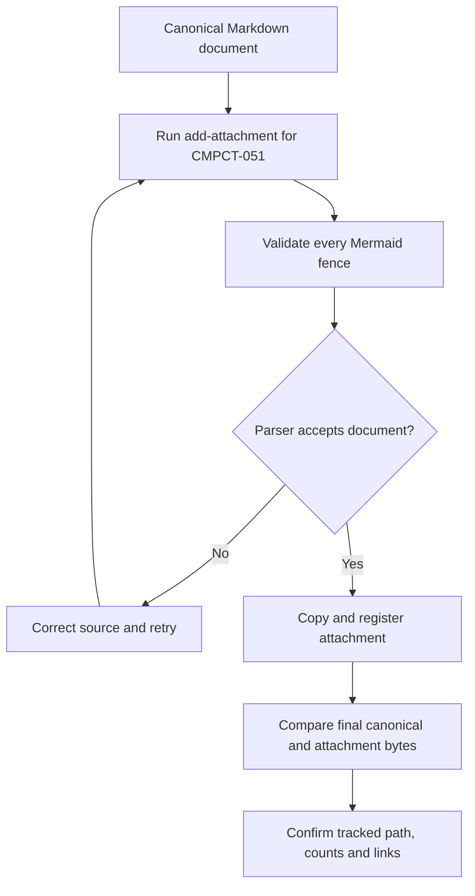

# Research validation record

Date: **2026-10-17**. Source baseline: `28d8e812`.
Work unit: **CMPCT-051**. Scope: documentation and attachment validation only.
Second source audit: `28d8e812ef4269d46b25f517574501902836902b` (same baseline).

## Result

The complete research/planning set contains **63 Markdown documents and 80 Mermaid
diagrams**. The original research subset contains 28 documents and 45 diagrams:
12 current-state chapters, five future-state chapters, nine bug-research
chapters, the index and this ledger.
Each document is attached to CMPCT-051 through `add-attachment`. The command checks
all Mermaid fences before copying the document and registering its attachment.

| Canonical document | Mermaid fences | Attachment result |
| --- | ---: | --- |
| [Index](README.md) | 1 | PASS; refreshed after second audit |
| [Architecture](current-state/01-architecture.md) | 2 | PASS; refreshed after second audit |
| [Triggers and recovery](current-state/02-triggers-and-recovery.md) | 2 | PASS; refreshed after second audit |
| [DAG construction and application](current-state/03-dag-construction-and-application.md) | 3 | PASS; refreshed after second audit |
| [Provider inventory](current-state/04-provider-inventory.md) | 1 | PASS; refreshed after second audit |
| [Claude](current-state/05-claude.md) | 1 | PASS; refreshed after second audit |
| [OpenAI-compatible](current-state/06-openai-compatible.md) | 2 | PASS; refreshed after second audit |
| [Gemini](current-state/07-gemini.md) | 2 | PASS; refreshed after second audit |
| [Codex](current-state/08-codex.md) | 2 | PASS; refreshed after second audit |
| [Copilot and custom](current-state/09-copilot-and-custom.md) | 2 | PASS; refreshed after second audit |
| [Persistence and resume](current-state/10-persistence-and-resume.md) | 2 | PASS; refreshed after second audit |
| [UI and accounting](current-state/11-ui-and-token-accounting.md) | 2 | PASS; refreshed after second audit |
| [Incident and evidence](current-state/12-incident-and-evidence.md) | 1 | PASS; refreshed after second audit |
| [Transactional lifecycle](future-state/01-transactional-lifecycle.md) | 3 | PASS; refreshed after second audit |
| [Provider contracts](future-state/02-provider-contracts.md) | 2 | PASS; refreshed after second audit |
| [Verification and rollout](future-state/03-verification-and-rollout.md) | 2 | PASS; refreshed after second audit |
| [DAG and Codex reuse decision](future-state/04-dag-codex-reuse.md) | 4 | PASS; source-reviewed compatibility recommendation |
| [Original cards and academic evidence](future-state/05-research-foundation.md) | 1 | PASS; primary-paper evidence and original design lineage |
| [Bug catalog](compaction-bugs/00-bug-index.md) | 1 | PASS |
| [Runtime and concurrency bugs](compaction-bugs/01-runtime-and-concurrency.md) | 1 | PASS |
| [Persistence and retrieval bugs](compaction-bugs/02-persistence-and-retrieval.md) | 1 | PASS |
| [Accounting and presentation bugs](compaction-bugs/03-accounting-and-presentation.md) | 1 | PASS |
| [Builder and convergence bugs](compaction-bugs/04-builders-and-convergence.md) | 1 | PASS |
| [Codex-specific findings](compaction-bugs/05-codex-specific-findings.md) | 1 | PASS |
| [Upstream Codex contract](compaction-bugs/06-upstream-codex-contract.md) | 1 | PASS |
| [Bug verification priorities](compaction-bugs/07-verification-priorities.md) | 1 | PASS |
| [No-fallback removal plan](compaction-bugs/08-no-fallback-removal-plan.md) | 1 | PASS; CB-28 removal inventory and negative regressions |
| This ledger | 1 | PASS; refreshed after second audit |

Attachment destinations use the same unique basenames under
`spec/attachments/CMPCT-051/`. Canonical documents retain the reading-order directory
structure; flattened attachment copies are validation/reference snapshots, not a
separate navigable book. Read relative chapter links from the canonical directory.

## Repair-card extension and final checks

The `fix-cards/` extension adds 35 Markdown documents, each with one Mermaid fence:
32 specific briefs and three shared documents (index, confirmation audit, contract).
The shared documents are attached to CMPCT-051, bringing its total to 31.
Each CMPCT-052–083 card has its specific brief and shared contract attached:
64 card attachments, or **95 registered snapshots** across the complete set.
All were registered through `add-attachment`, including refreshes after final edits.

Final mechanical review checks all 63 canonical documents, 80 Mermaid fences,
attachment registration and byte equality for all 95 snapshots, files below 300
lines, local document links and explicit repository source paths/line bounds.
All 32 cards match their briefs' types, dependencies, acceptance rules and examples;
the epic includes the exact card set, and the dependency graph is acyclic.
The set contains 28 bugs and four stories; capability/policy gaps are not relabeled
as reproduced defects. No production changes, feature scenarios or Rust tests
are included in this work.

Independent final planning review read all 35 card documents and the bug research.
It found three design decisions, subsequently answered by the human through HITL
on CMPCT-064, CMPCT-072 and CMPCT-081 and explained in the
[decision record](fix-cards/00-confirmation-audit.md#resolved-design-decisions).
Source-defect research is complete for this scope. Implementation is now authorized;
the original documentation-only validation does not certify subsequent code changes.

## What was checked

- Successful `add-attachment` registration and Mermaid parsing for each document.
- Exact byte equality of the final canonical documents and their attachment copies.
- Unique basenames, work-unit tracking, diagram counts and files below 300 lines.
- Local Markdown document links and explicitly referenced repository source paths.
- Final incident timeline against the October 16 local runtime log.
- Executable-source re-audit of every current-state chapter and proposal assumptions.

The source audit corrected an earlier description of resume: the live method
appends converted messages, filters non-assistant text containing both reminder
markers, and calls a token-state method that currently ignores the saved state.
The persistence chapter separates these findings from the missing generic pin
manifest write. Corresponding future-state test candidates are proposals only.

## Second audit scope and corrections

Read all 17 documents and traced the linked compaction runtime across agent-loop,
shared CLI, patched Rig, all six built-in provider routes, dynamic custom/stub
dispatch, persistence/search, live sessions, executable frontend wiring and fspec-tui.
Follow-up searches independently challenged the held-lock and macro-order findings,
then checked amended provider claims and lifecycle/accounting descriptions.

The corrections include:

- Rig owns the hook/provider/tool loop; combined mode uses embedded RPC.
- Broader overflow selects the clean builder on its first admitted macro round;
  legacy overflow, typed cancellation and the post-loop safety net differ.
- Terminal Err recovery re-enters the held mutex, and cleanup already removed its
  builder. Idle may precede that wait; the historical outcome is not reproduced.
- Watchdog is post-stream, can retain attempts after success, and emits no completion
  for its own fallback. Pending DAGs are unversioned and can replace later work.
- Recognized-reminder partitioning, weak metadata-only validation and non-enforced
  budget helpers are not stronger preservation/convergence guarantees.
- Provider/request/Rig-aggregate usage, display accumulation and hook/display seed
  contracts differ. Copilot refresh and Codex native opt-in claims are narrowed.
- Original retention is not full-payload SessionSearch; generic model replay is
  lossier than UI replay. Cached loads do not constitute disk-restart tests.
- Done-time accounting, JSON field loss and whole-manifest stale-writer risks are
  distinguished from existing context/spend schema and untested billing outcomes.

The incident log window was rechecked, including the matching session and 4.297 ms
between error/apply log observations. It does not establish exact mutation timing,
historical executable identity, successful next inference or durable resume.

This is a compaction-focused static audit, not exhaustive verification of unrelated
repository code. Source anchors were checked for path existence and valid line
bounds; that mechanical check alone does not prove claim accuracy. The separate
source tracing supports the documented behavior, with runtime/concurrency outcomes
explicitly qualified where no reproduction was run.

## Bug-research extension

The eight `compaction-bugs/` chapters catalog 27 research-local findings with
source references, evidence classifications, impact and proposed verification.
They separate confirmed source behavior from conditional concurrency/provider
risks, capability gaps and the observed historical Qwen sequence.

The Codex comparison reads the clean checkout in `/tmp/codex`, revision
`bb64b894fd67158be0f874872e6d7bfe717e7368`, dated 2026-10-15. All upstream links
are pinned to that commit. A focused follow-up source audit corrected four details:
nonempty native-content validation is streaming-specific; speculative background
requests are not all gated by disabled automatic installation; captured-prefix
validation/suffix retention applies to speculative adoption; and the remote-v2
collector requires exactly one **Compaction** item, not exactly one output item.

The upstream chapter traces ordinary Responses streaming with a compaction trigger,
opaque result installation, local textual compaction, scheduling, speculative
validation, checkpoint replay and transport continuity. It explicitly does not
certify atomic crash durability or report executed upstream tests.

All eight chapters passed `add-attachment` validation. The index and ledger were
refreshed afterward. That extension's mechanical pass checked 25 documents, 39 Mermaid
fences, all local link targets and 21 pinned upstream source targets against the
local checkout, including source line bounds. Attachment byte equality and
work-unit registration are checked separately after refresh.

## DAG and Codex reuse extension

The fourth future-state document directly answers how repaired fspec compaction
remains the selected memory system while Codex supplies inference. It distinguishes the existing
provider integration from modifying upstream Codex, compares readable DAGs with native
opaque items, and proposes reuse boundaries, installation/transport flows and a fair
evaluation. All four Mermaid diagrams passed `add-attachment`; a sequence-label
semicolon rejected by the parser was removed before successful attachment.

Three focused read-only searches examined compatibility, upstream lifecycle patterns
and current provenance/retrieval limitations. Direct follow-up source inspection
verified live search preview/pagination behavior and upstream checkpoint/recompute
and reconstruction anchors. These are source reviews, not interoperability tests.

That extension's mechanical pass checked 26 documents, 43 Mermaid fences, all local/source
link targets and 25 distinct commit-pinned upstream targets, including referenced
source line bounds. The new document is below 300 lines. Index and ledger snapshots
are refreshed after this extension; attachment registration and byte equality are
checked again for the complete set. No native capability or production behavior
is changed, and no comparative quality/cost benchmark was run.

## Academic foundation and no-fallback extension

Read CMPCT-005/016 card descriptions, architecture notes and attached research.
A focused review read all five design/research/gap/fix/inventory Markdown attachments
and checked the new foundation chapter against them. It corrected attribution:
the research review explicitly reports Volt's OOLONG wins; the design attachment
synthesizes the architecture without stating that particular comparison.

Primary LCM version `2605.04050v1` and CMV `2602.22402v1` were checked directly.
LCM reports 74.8 versus 70.3 average score and wins at every tested length 32K–1M;
the chapter distinguishes that empirical system result from an isolated DAG ablation
or fspec benchmark. It records original in-view ownership, retained builder evidence,
LCM's deterministic truncation and its deliberate rejection under the new policy.

CB-28 audits fallback success in builders/watchdog, partial salvage, checkpoint and
replay masking, fabricated tool results, WS→HTTP and delta→full substitution.
A focused source review confirmed the cited in-scope behavior; watchdog and parser
were checked directly. The future-state and bug-repair recommendations now require
one DAG protocol, bounded typed failure and blocked unsafe inference, without
fallback success, native/hybrid substitution or a new benchmark gate for DAG retention.
Final consistency review tightened overflow policy and gated replay reset on a
durably recorded commit-time decision rather than automatic mismatch repair.

The complete mechanical pass checks 28 documents, 45 Mermaid fences, local/source
link targets and 25 distinct pinned upstream targets, including source line bounds.
All documents remain below 300 lines. New and changed documents pass `add-attachment`;
registration and exact snapshot byte equality are rechecked after the ledger refresh.
No original historical attachments were edited. No production fixes or runtime tests
are claimed; this extension changes research and repair requirements only.

## Validation mechanism and limitations

The implementation is `rust/fspec-core/src/commands/add_attachment.rs:133`.
It invokes `validate_mermaid_attachment` before the duplicate guard, copy and
tracking mutation. Markdown validation extracts each Mermaid fence and uses the
`merman` parser plus fspec's syntax checks. Relevant implementation:
`rust/fspec-core/src/utils/mermaid_validation.rs:37`, `:141`, `:161`.

PASS means acceptance by that configured validator and successful attachment. It
does **not** prove browser rendering/layout, accessibility, source-code correctness,
summary fidelity, provider interoperability, or runtime convergence. Source/log
inspection supports the research claims separately; future-state diagrams remain
unimplemented proposals.

No Rust builds, Rust tests or live-provider reproductions were run during the original
documentation stage. No production source or feature scenarios were changed then. The
work-unit metadata establishes the research task, repair epic/cards, dependencies,
rules/examples, subsequently answered design questions and attachments; it does not
mark fixes done. Subsequent implementation validation is tracked on its owning card.

## Refresh procedure

When changing a canonical file, remove its old attachment registration with
`keepFile: true`, then run `add-attachment` again on the canonical path. Successful
reattachment validates the updated diagrams and replaces the old snapshot. Do not
edit only the attachment copy or treat an old success as validating new content.

Recheck canonical links, tracked paths and byte equality after the last attachment.
The ledger is itself attached and validated; updating it requires refreshing its
attachment as well. Reproduce attachment operations through fspec rather than
manually editing `spec/work-units.json`.
