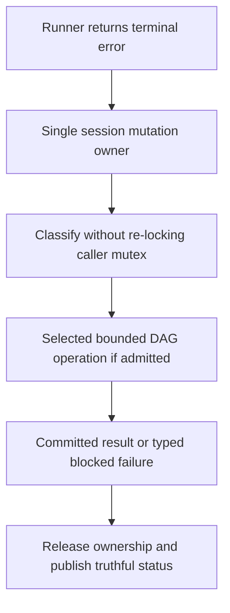

<!-- card: {"id":"CMPCT-053","type":"bug","priority":"P0","findings":"CB-02","dependsOn":[]} -->
# CMPCT-053: Remove terminal error recovery's held-mutex self-deadlock

## Confirmation

**Confirmed static defect, not a runtime reproduction.**
`rust/agent-loop/src/agent_loop.rs:518` acquires the inner-session guard, still
in scope at terminal recovery `:1614`. The awaited helper immediately locks the
same mutex at `rust/agent-loop/src/terminal_overflow_recovery.rs:37`, before error
classification. Any terminal Err reaching this arm can self-block, not only overflow.

## Acceptance criteria

- Terminal error classification and recovery never await a lock held by the caller;
  one explicit owner governs session mutation through this boundary.
- Ordinary errors, overflow, cancellation and recovery failure return within a
  harness deadline and release locks/status resources correctly.
- No lock fix may restore fallback-success behavior; failed recovery remains typed
  and blocked, with no inference or completion on an unsafe generation.

## Regression scenarios

- Given a real outer agent loop, when a non-overflow provider Err reaches the
  terminal arm, then it returns and a later status operation can acquire the lock.
- Given an overflow Err and a failed DAG operation, when terminal recovery runs,
  then it returns typed failure within the deadline without replacement or completion.

## Coding notes

Choose either a helper receiving already-owned mutable state or release-and-reacquire
with generation validation. Do not merely clone the Arc or wrap the builder in a
timeout: the blocking wait precedes the builder. Preserve partial outputs and
cancellation ownership. Inspect guard lifetime through `agent_loop.rs:1679`.
Use an actual outer-Err integration test, not a direct helper-only test.

Mandatory companion: `00-shared-contract.md`. Research: CB-02 in
`compaction-research/compaction-bugs/01-runtime-and-concurrency.md`.
