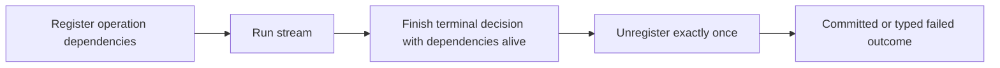

<!-- card: {"id":"CMPCT-054","type":"bug","priority":"P1","findings":"CB-03","dependsOn":["CMPCT-053"]} -->
# CMPCT-054: Keep compaction dependencies alive through terminal resolution

## Confirmation

**Confirmed static ordering defect; currently masked by the terminal self-lock.**
`rust/agent-loop/src/agent_loop.rs:1587` unregisters the handler before recovery
at `:1614`. `rust/cli/src/compactor_sub_agent.rs:173` then looks up that handler.
Absent concurrent registration, an admitted recovery cannot invoke it. Today its
absence feeds fallback; CB-02 prevents reaching that consequence in the blocked arm.

## Acceptance criteria

- Handler registration remains owned until all permitted terminal recovery decisions
  finish; success, failure and cancellation each clean up exactly once.
- Genuine handler absence or registry failure returns a typed unavailable outcome;
  it never selects fallback, reports success or emits completion.
- A post-error session can explicitly resolve or terminate without leaking a handler
  or reusing a stale handler from another operation.

## Regression scenarios

- Given a terminal overflow with compactable history, when recovery is admitted,
  then its registered builder is invoked before unregistration.
- Given a missing handler or cancellation during recovery, when cleanup runs,
  then no substitute DAG is pinned and registry ownership is released once.

## Coding notes

Use an operation-scoped lifecycle owner, not unconditional re-registration in an
error handler. Inspect terminal `.expect` assumptions at
`rust/agent-loop/src/terminal_overflow_recovery.rs:80`: no-fallback recovery is
allowed to fail. CMPCT-079 owns broad runtime fallback removal; this card owns
dependency lifetime and propagation. Test the outer ordering after CMPCT-053.

Mandatory companion: `00-shared-contract.md`. Research: CB-03 in
`compaction-research/compaction-bugs/01-runtime-and-concurrency.md`.
