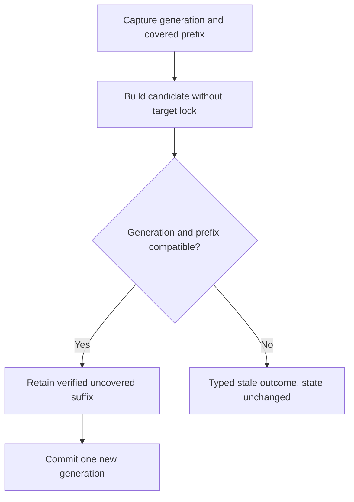

<!-- card: {"id":"CMPCT-055","type":"bug","priority":"P0","findings":"CB-04","dependsOn":["CMPCT-053","CMPCT-056"]} -->
# CMPCT-055: Reject stale DAG commits and preserve uncovered suffixes

## Confirmation

**Confirmed absent freshness protection; damage requires an advancing target.**
`rust/agent-loop/src/inject_summary_handler.rs:66` overwrites a single pending
string; `:292` resets then-current history without candidate provenance.
`rust/agent-loop/src/generate_compaction_handler.rs:624` captures target state,
releases it for generation, then resets at `:773` without comparing versions.
This is an active-context risk, not demonstrated deletion of persisted originals.

## Acceptance criteria

- Every candidate identifies operation, source generation, durable coverage watermark,
  model/protocol identity and owned target; no unversioned last-writer-wins pin.
- Commit validates the captured prefix and preserves verified uncovered suffixes;
  incompatible/stale candidates fail explicitly without overwriting newer memory.
- Competing self, cross and pending producers have explicit ownership/supersession;
  cancellation or rejection never force-pins another representation.

## Regression scenarios

- Given a paused builder, when the target appends work before commit, then that
  suffix survives or the candidate is explicitly rejected with state unchanged.
- Given a newer committed DAG, when an older pending candidate arrives afterward,
  then it cannot replace the newer generation or publish successful completion.

## Coding notes

Use persisted identities rather than active message positions. Capture immutable
source data without holding a caller lock over inference; reacquire only for
version-checked commit. Borrow upstream's prefix/suffix ownership invariant, not
native compaction or archive-rebuild fallback. Coordinate generic and Codex state
with CMPCT-059/078. Use barriers to force both producer orderings.

Mandatory companion: `00-shared-contract.md`. Research: CB-04 in
`compaction-research/compaction-bugs/01-runtime-and-concurrency.md`.
