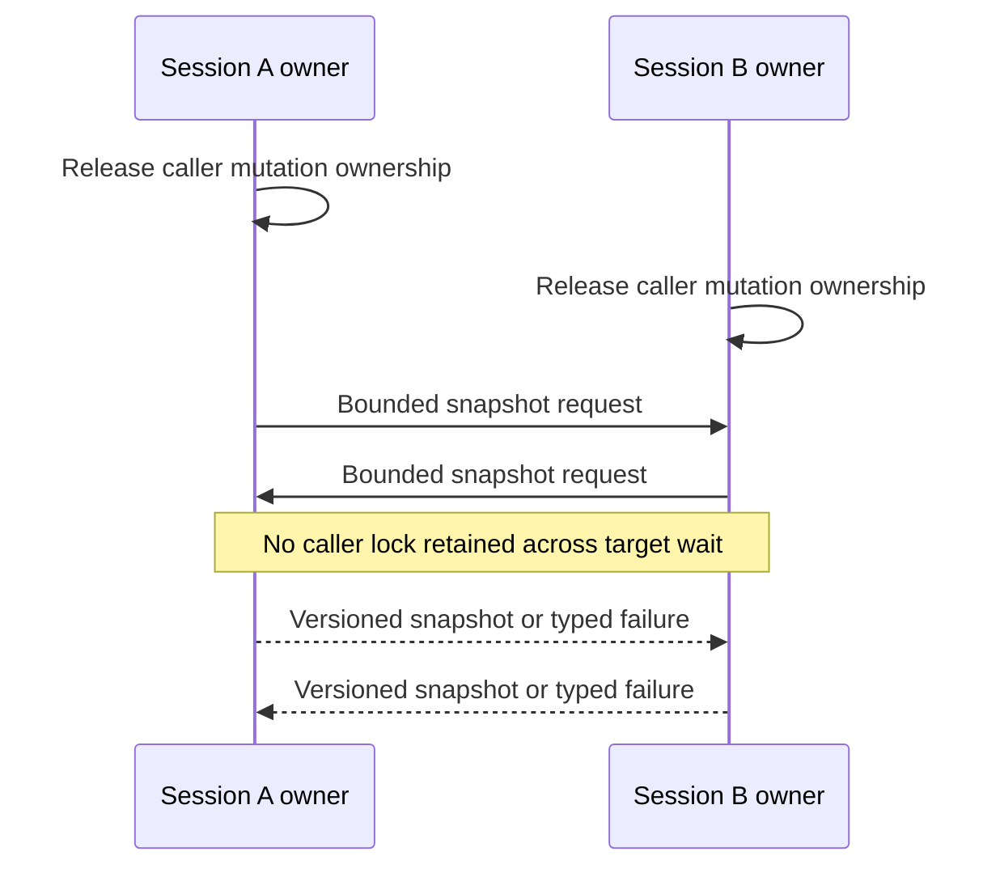

<!-- card: {"id":"CMPCT-056","type":"bug","priority":"P0","findings":"CB-05","dependsOn":["CMPCT-053"]} -->
# CMPCT-056: Eliminate cross-session compaction lock cycles

## Confirmation

**Confirmed possible lock cycle; manifestation needs concurrent cross requests.**
The caller holds its own inner lock across streaming at
`rust/agent-loop/src/agent_loop.rs:518`. Cross-target GenerateCompaction awaits
the target lock at `rust/agent-loop/src/generate_compaction_handler.rs:625` and
`:773`; concurrent A→B/B→A can cycle. Those waits are outside builder timeout.
External cancellation and a separate long stream stall deadline still exist.

## Acceptance criteria

- Never retain a caller session lock while awaiting another target session lock;
  capture and commit use bounded owner-mediated operations.
- Concurrent reciprocal requests and cancellation terminate without a lock cycle,
  leaving both sessions' committed memory and progress/status truthful.
- Restore the target's actual pre-operation activity state; an Idle target is not
  unconditionally set Running after a cross-target commit.

## Regression scenarios

- Given two streaming sessions synchronized by a barrier, when each requests the
  other's compaction, then both operations terminate within harness deadlines.
- Given an Idle cross target and cancellation at capture or commit, when ownership
  is released, then it remains accurately Idle or explicitly blocked, never stuck busy.

## Coding notes

Do not solve only self-target `try_lock`; that already exists and does not order
cross-session acquisition. Prefer explicit snapshot/commit messages to session
owners, with cancellation and version checks. A lock deadline is not permission
to return `existing_dag=None` and rebuild fresh. Use barriers, not sleeps.

Mandatory companion: `00-shared-contract.md`. Research: CB-05 in
`compaction-research/compaction-bugs/01-runtime-and-concurrency.md`.
