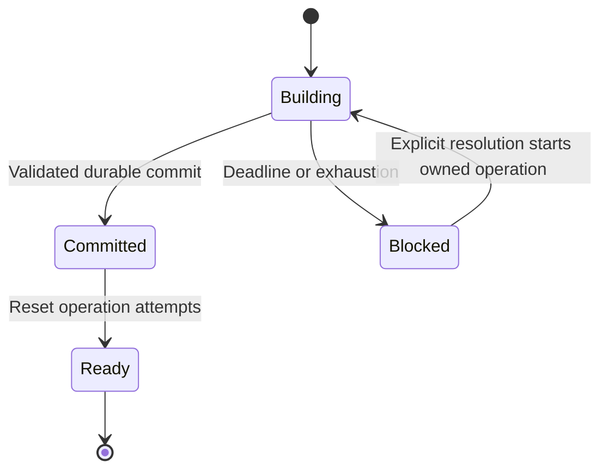

<!-- card: {"id":"CMPCT-057","type":"bug","priority":"P1","findings":"CB-06","dependsOn":["CMPCT-052","CMPCT-079"]} -->
# CMPCT-057: Make watchdog deadlines and attempt resets follow committed operations

## Confirmation

**Confirmed control-flow defect, not evidence that all watchdog episodes fail.**
`rust/agent-loop/src/agent_loop.rs:1465` checks only after runner completion.
Successful injection clears the flag at
`rust/agent-loop/src/inject_summary_handler.rs:73`, and apply consumes pending
state before the conditional attempt reset at `agent_loop.rs:1548`.
A previous failed attempt can survive a later successful commit.

## Acceptance criteria

- Operation deadlines cover executing work, not only a post-stream observation;
  attempt state is scoped to an operation and reset by committed success.
- Exhaustion/cancellation clears busy indicators, retains a blocked outcome and
  requires explicit resolution; no synthetic Continue or forced generic pin.
- Failure emits failure/cancellation, never completion. Do not repair the old
  forced-pin event inconsistency by adding a completion event.

## Regression scenarios

- Given failure followed by explicit resolution and successful commit, when another
  operation fails, then its attempts start fresh rather than inheriting exhaustion.
- Given a builder that never completes, when its declared deadline expires, then
  the operation returns typed failure and leaves committed state unchanged.

## Coding notes

CMPCT-079 removes the old synthetic/forced fallback routes; this card owns the
remaining operation deadline, cancellation and reset lifecycle. Inspect existing
`rust/cli/tests/compaction_convergence_watchdog_test.rs:1` but replace fallback
success assertions, not just their labels. Test event sequences and lock release.

Mandatory companion: `00-shared-contract.md`. Research: CB-06 in
`compaction-research/compaction-bugs/01-runtime-and-concurrency.md`.
