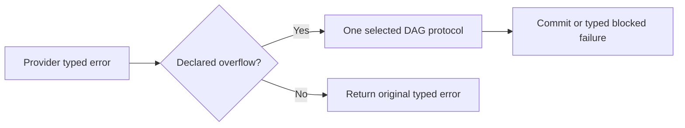

<!-- card: {"id":"CMPCT-058","type":"bug","priority":"P2","findings":"CB-07","dependsOn":["CMPCT-079","CMPCT-082"]} -->
# CMPCT-058: Remove classifier-dependent compaction strategy escalation

## Confirmation

**Confirmed macro-order mismatch and conflicting executable route policy.**
`rust/cli/src/interactive/stream_loop.rs:659` increments the counter before
evaluating its strategy argument. The broad overflow call at `:1943` supplies
`compaction_retry_count > 0`, so the first admitted round already selects clean
construction. The earlier legacy branch at `:1846` selects another route.
First-round clean construction alone is not a bug under the selected DAG policy.

## Acceptance criteria

- All admitted typed overflow routes use the same selected DAG protocol; error
  wording and macro evaluation order cannot choose another construction strategy.
- Remove automatic first-in-view/clean escalation and obsolete policy comments;
  do not fix the mismatch by reinstating the historical escalation sequence.
- Bounded retry retains one operation/source/validator contract; exhaustion returns
  typed blocked failure without forced pinning or success.

## Regression scenarios

- Given equivalent typed overflow outcomes from legacy and broader adapters, when
  recovery is admitted, then the same DAG protocol and commit rules execute.
- Given an unrecognized error containing token-like wording, when routing runs,
  then no broad rescue classifier selects compaction or a substitute strategy.

## Coding notes

Test expanded executable behavior rather than source-text comparisons. Move
selection out of macros with side-effect-dependent arguments. CMPCT-082 owns
provider-native typed parsing; CMPCT-079 owns removal of replacement fallbacks.
Keep same-agent semantic ownership and explicitly selected builder mechanics.

Mandatory companion: `00-shared-contract.md`. Research: CB-07 in
`compaction-research/compaction-bugs/01-runtime-and-concurrency.md`.
