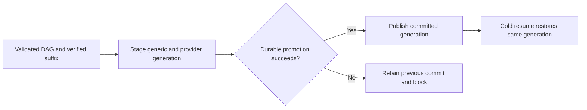

<!-- card: {"id":"CMPCT-059","type":"bug","priority":"P1","findings":"CB-08","dependsOn":["CMPCT-055","CMPCT-064","CMPCT-070","CMPCT-071","CMPCT-072","CMPCT-078","CMPCT-080"],"related":["PROV-046"]} -->
# CMPCT-059: Durably commit generic DAG boundaries with compatible provider state

## Confirmation

**Confirmed scoped wiring gap; restart impact depends on the resume route.**
Deferred pin at `rust/agent-loop/src/inject_summary_handler.rs:245` and direct
pin at `rust/agent-loop/src/generate_compaction_handler.rs:773` replace memory
without an explicit generic compaction-state commit. The setter exists at
`rust/core/src/persistence/manifest.rs:1166`; compaction-aware loading at `:969`
depends on that state. Ordinary message/provider persistence is not that commit.

## Acceptance criteria

- Commit exact DAG, durable coverage/suffix boundary, generation, token provenance
  and compatible provider checkpoint through one documented durable protocol.
- Publish successful application only after its durable boundary is authoritative;
  cold resume restores that generation plus verified suffix, not unreduced history.
- Before durable promotion, failure preserves the old commit. After promotion,
  notification failure retains/reports the new commit identity and blocks until
  reconciled; no rollback, duplicate commit, silent rebuild or false acknowledgement.

## Regression scenarios

- Given a committed DAG and post-snapshot tool work, when a fresh process resumes
  and sends, then captured provider input contains the intended DAG and suffix.
- Given failure at each persistence promotion boundary, when the process restarts,
  then it restores the authoritative old-before/new-after generation and never
  duplicates promotion or reports a failed acknowledgement as delivered completion.

## Coding notes

Own unified commit integration: CMPCT-055 owns freshness/suffix decisions, 064
storage transactions, 070/071/072 candidate admission/preservation, 078 provider
lineage and 080 checkpoint failure semantics. Do not just add a setter call after
destructive mutation. Integrate all those prerequisites at one commit boundary.
Keep immutable original envelopes; PROV-046's archival goal is related, not
equivalent to installing a replacement generation. Test disk in a fresh process,
not only a cache-backed reload. Upstream memory-before-append is not atomic proof.

Mandatory companion: `00-shared-contract.md`. Research: CB-08 in
`compaction-research/compaction-bugs/02-persistence-and-retrieval.md`.
