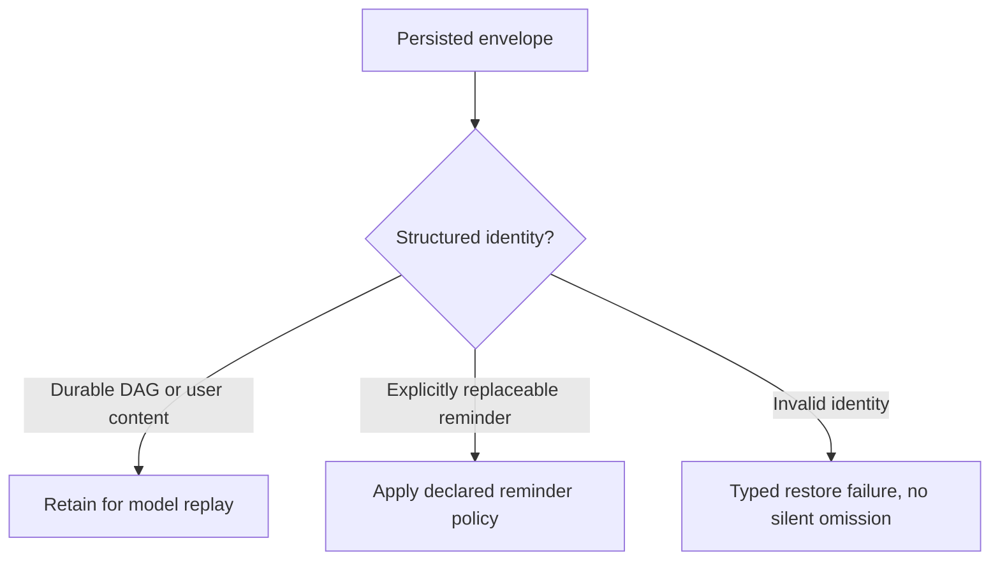

<!-- card: {"id":"CMPCT-060","type":"bug","priority":"P1","findings":"CB-09","dependsOn":[]} -->
# CMPCT-060: Preserve durable summaries using typed reminder identity on resume

## Confirmation

**Confirmed conditional filtering defect.**
`rust/sessions/src/handle_impl.rs:701` skips a non-assistant envelope containing
both reminder substrings. A wrapped DAG matches, even with the synthetic prefix
created at `rust/core/src/persistence/manifest.rs:970`. Envelope summary identity
exists at `:1042`, but replay ignores it. Array-envelope skipping can also discard
buffered tool results. Ordinary quoted/split marker text can trigger the same test.

## Acceptance criteria

- Identify replaceable runtime reminders and durable DAG summaries structurally;
  user quotes and marker-bearing content are not classified by broad substrings.
- Preserve the committed DAG and supported tool results through cold restore;
  remove only reminders explicitly designated replaceable by the contract.
- Ambiguous/incompatible persisted identity produces an explicit outcome, not
  silent summary omission or a fabricated replacement reminder.

## Regression scenarios

- Given a marker-wrapped saved DAG, when cold resume runs, then the next provider
  request retains that summary exactly once.
- Given quoted markers, split text blocks and a mixed tool-result envelope, when
  replay filters reminders, then legitimate user/tool content remains available.

## Coding notes

Use `_compactionSummary`/typed envelope identity or a versioned equivalent.
Separate UI presentation filtering from model replay. Test assistant and user
envelopes, string and array content, and actual next-wire input. Fixing the missing
commit setter alone does not fix this filter. Coordinate structured replay in
CMPCT-061 without retaining every arbitrary reminder forever.

Mandatory companion: `00-shared-contract.md`. Research: CB-09 in
`compaction-research/compaction-bugs/02-persistence-and-retrieval.md`.
