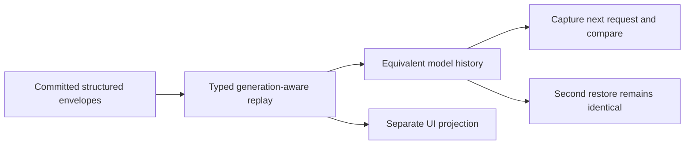

<!-- card: {"id":"CMPCT-061","type":"bug","priority":"P1","findings":"CB-10","dependsOn":["CMPCT-060","CMPCT-080"],"related":["PROV-050"]} -->
# CMPCT-061: Restore structured model history idempotently instead of UI text replay

## Confirmation

**Confirmed representational loss; duplicate append requires repeated restore.**
`rust/sessions/src/handle_impl.rs:597` creates UI thinking/tool chunks, but `:638`
rebuilds generic assistant history from text only. Pure tool-result envelopes
likewise need not create model messages at `:671`. Assistant string content is
skipped at `:583`; converted messages append at `:744` without replacement.
Provider-specific restoration is separate and may preserve more than generic replay.

## Acceptance criteria

- Restore supported structured assistant, tool call/result and content forms into
  equivalent model history, separately from UI scrollback projection.
- Repeated restore into cached/populated sessions is idempotent and generation-aware;
  no duplicate append or stale-provider-history resurrection.
- Missing/unsupported replay structure fails explicitly; never flatten, invent
  cancellation results or silently fall back to an archive transcript.

## Regression scenarios

- Given tool-only, thinking, assistant-string and mixed envelopes, when resume sends
  its next request, then supported structure and tool pairing survive on the wire.
- Given an already populated session, when restore is performed twice, then the
  final history equals one restore and includes no duplicated DAG or suffix.

## Coding notes

Define a shared typed model replay representation and explicit provider conversion.
Do not mistake an attractive scrollback for model equivalence. Reconcile generation
installation and provider checkpoints before mutation. PROV-050 is related pairing
work; this card owns restored request equivalence. Use real persisted envelopes and
scripted provider capture, with explicit unsupported outcomes for impossible forms.

Mandatory companion: `00-shared-contract.md`. Research: CB-10 in
`compaction-research/compaction-bugs/02-persistence-and-retrieval.md`.
