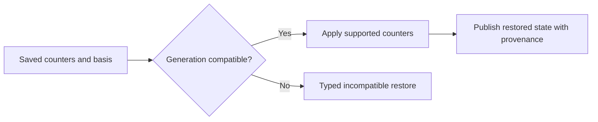

<!-- card: {"id":"CMPCT-062","type":"bug","priority":"P2","findings":"CB-11","dependsOn":["CMPCT-065"]} -->
# CMPCT-062: Restore saved token state instead of accepting an ignored argument

## Confirmation

**Confirmed static no-op.** `rust/sessions/src/handle_impl.rs:239` builds saved
token state and invokes restoration. At `:763`, the live method names it `_state`,
checks session existence and returns success without applying counters.
Other events may initialize values, so this does not prove every resumed UI value
is zero. The restoration operation itself ignores its advertised input.

## Acceptance criteria

- Restore supported context, cache, spend and reasoning fields with explicit
  measurement basis and committed generation; do not accept ignored saved values.
- Where recomputation is intentionally selected, report its provenance/estimated
  status explicitly rather than masquerading as authoritative restoration.
- Incompatible state fails explicitly; no zero-default success, guessed counters
  or inference on a generation whose admission state cannot be validated.

## Regression scenarios

- Given distinct saved context/spend/reasoning counters, when a fresh session resumes,
  then live state and emitted fields follow the declared restore contract.
- Given an incompatible token-state generation, when restore is requested, then
  it reports incompatibility without publishing restored success or usable fit.

## Coding notes

Separate current-context occupancy from cumulative billing before assigning fields.
Trace the state DTO so omitted reasoning/cache detail is not silently zeroed.
Use real manifests and observable live state/events, not just an Ok assertion.
Coordinate UI refresh in CMPCT-068 and settlement in CMPCT-069.

Mandatory companion: `00-shared-contract.md`. Research: CB-11 in
`compaction-research/compaction-bugs/02-persistence-and-retrieval.md`.
