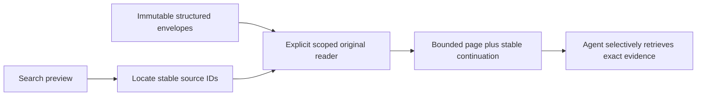

<!-- card: {"id":"CMPCT-063","type":"story","priority":"P1","findings":"CB-12","dependsOn":[],"related":["PROV-046"]} -->
# CMPCT-063: Expose bounded lossless envelope retrieval for DAG reconstruction

## Confirmation

**Confirmed capability gap, not a raw-retention defect.**
`rust/agent-loop/src/persist.rs:159` keeps full tool output in metadata while
`:177` stores a short searchable preview. SessionSearch resolves content/blobs at
`rust/agent-loop/src/session_search_handler.rs:479`, not that nested full result.
Core envelope loading at `rust/core/src/persistence/manifest.rs:1071` can access
structured originals. Existing tail-window show/project search semantics are valid.

## Acceptance criteria

- Provide explicit session-scoped full-envelope retrieval with stable persisted
  identities and bounded forward pagination; preserve original structure/content.
- Distinguish preview, trimmed view and original retrieval; report truncation and
  continuation honestly so builders can recover beyond preview thresholds.
- Missing original/source data fails explicitly; no reconstruction from previews,
  fabricated payloads or silent fresh-DAG substitute.

## Regression scenarios

- Given a tool result with a sentinel beyond its preview, when explicit original
  retrieval is used, then the exact sentinel and structured payload are returned.
- Given multiple sessions and bounded pages, when retrieval names one session/range,
  then pages traverse it without mixing sessions, skipping or duplicating records.

## Coding notes

Reuse core envelope readers instead of duplicating filesystem decoding. Preserve
existing search/show semantics unless a separately specified change is required;
add an explicit mode/API rather than silently redefining max_turns. Use proptest
for pagination boundaries and integration tests for large UTF-8/tool payloads.
Update builder instructions to select originals deliberately. This is a story
because accessible lossless expansion is missing functionality, not deleted data.

Mandatory companion: `00-shared-contract.md`. Research: CB-12 in
`compaction-research/compaction-bugs/02-persistence-and-retrieval.md`.
