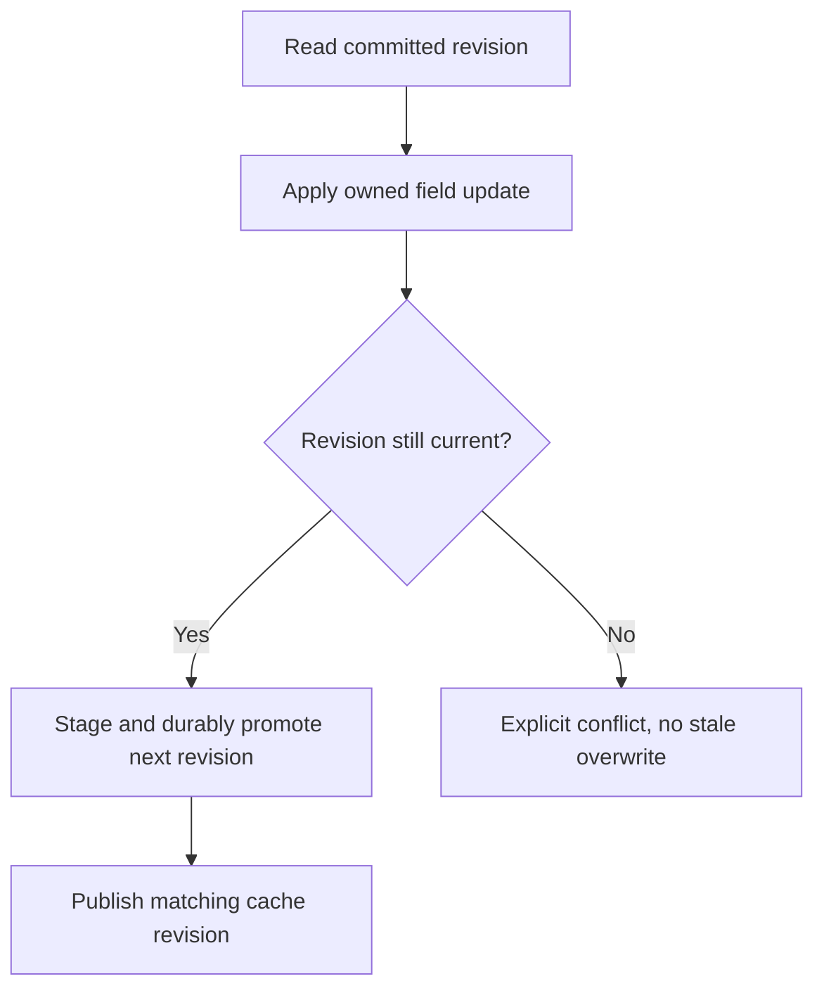

<!-- card: {"id":"CMPCT-064","type":"bug","priority":"P1","findings":"CB-13","dependsOn":[]} -->
# CMPCT-064: Prevent stale manifest overwrites and interrupted durable promotion

## Confirmation

**Confirmed unsafe transaction boundary; lost update/corruption not reproduced.**
`rust/core/src/persistence/manifest.rs:329` directly writes a whole JSON snapshot;
`:357` can return a cached clone. Individual operations lock, but load–modify–save
is not one transaction. Message append at `:891`, token writers and
`rust/cli/src/session/provider.rs:27` can save independent stale snapshots.
A later save can overwrite unrelated newer fields; direct writes risk interruption.

## Acceptance criteria

- Serialize or revision-check whole load–modify–save operations across message,
  provider, token and compaction writers; preserve unrelated committed fields.
- Define crash-safe durable promotion and cache coherence for the supported
  platforms; fresh-process readers recognize only committed generations.
- Conflict/write/interruption failure is explicit. Before promotion retain the old
  commit; after promotion retain/recover the new revision despite lost notification.
  No rollback, silent cache success, archive rebuild or checkpoint omission.

## Regression scenarios

- Given barrier-synchronized token/provider/message writers, when all updates commit,
  then none overwrites another's fields or durable message references.
- Given interruption at staged-write/promotion boundaries, when a fresh process
  opens the session, then it observes the valid old-before/new-after revision or
  explicit unresolvable failure, never a notification-driven rollback or duplicate commit.

## Coding notes

HITL decision: one process owns a session; reject competing process writers.
Concurrent cross-process mutation is outside supported scope. Crash-safe commits
and lossless replay are mandatory in the first implementation milestone.

An atomic rename alone does not solve stale snapshots; an in-process mutex alone
does not define cross-process or crash behavior. Choose and document supported
writer ownership/revision rules and platform-specific promotion semantics. Use
real stores and deterministic failure injection; do not claim fsync durability
from upstream's memory-before-append model. Ask before major persistence refactors.

Mandatory companion: `00-shared-contract.md`. Research: CB-13 in
`compaction-research/compaction-bugs/02-persistence-and-retrieval.md`.
