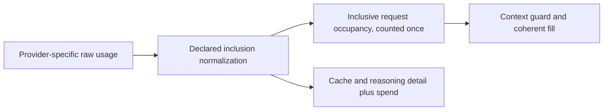

<!-- card: {"id":"CMPCT-065","type":"bug","priority":"P1","findings":"CB-14","dependsOn":[],"related":["RIG-011"]} -->
# CMPCT-065: Normalize inclusive usage before additive context accounting

## Confirmation

**Confirmed contract mismatch; impact requires overlapping provider fields.**
`rust/core/src/token_usage.rs:64` adds input/cache and output/reasoning as disjoint.
OpenAI conversion at
`rust/patches/rig-core/src/providers/openai/completion/streaming.rs:83` retains
inclusive prompt plus cached subset. Responses final conversion at
`rust/patches/rig-core/src/providers/openai/responses_api/streaming.rs:81` similarly
retains inclusive input/output and detail subsets; Codex uses that final type.
`rust/core/src/compaction_hook.rs:260` copies these into an additive hook state.

## Acceptance criteria

- Normalize once at declared provider boundaries into coherent inclusive context
  occupancy and separate categorized spend/detail; cached/reasoning subsets count once.
- Preserve provider-specific semantics, including Anthropic's distinct input/cache
  categories. Cost discounts never reduce context occupancy.
- Unknown/inconsistent usage semantics remain explicit; no invented disjointness,
  dropped detail or broad rescue estimate presented as authoritative usage.

## Regression scenarios

- Given inclusive input 1000 with cached subset 400 and output 100 with reasoning
  subset 30, when normalized, then context counts 1100, not 1530.
- Given Anthropic disjoint input/cache fields, when the same normalized API is used,
  then all actual input occupancy is retained without subtracting cache twice.

## Coding notes

Cover OpenAI-compatible, Codex, Claude, Gemini, Copilot and custom-provider contracts
with representative raw fixtures; do not assume all raw Usage shapes mean the same
thing. Define generation/request basis as well as inclusion. Use property tests
for subset constraints and round-trip detail preservation. Relate RIG-011 without
adopting its old unconditional input+output+reasoning expectation for inclusive output.

Mandatory companion: `00-shared-contract.md`. Research: CB-14 in
`compaction-research/compaction-bugs/03-accounting-and-presentation.md`.
