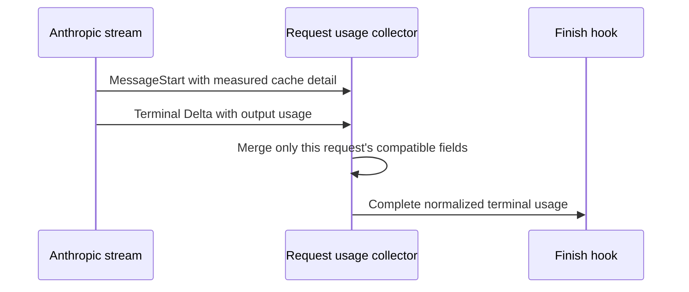

<!-- card: {"id":"CMPCT-066","type":"bug","priority":"P1","findings":"CB-15","dependsOn":["CMPCT-065"]} -->
# CMPCT-066: Preserve Anthropic cache usage through terminal streaming reconstruction

## Confirmation

**Confirmed adapter loss on a cache-bearing terminal stream.**
`rust/patches/rig-core/src/providers/anthropic/streaming.rs:338` emits MessageStart
cache details. Terminal MessageDelta rebuilds PartialUsage with cache fields None
at `:372`, then emits that final at `:454`. Its converter copies the absent fields.
`rust/core/src/compaction_hook.rs:266` converts absence to zero, losing earlier
terminal context detail. Non-streaming behavior is not claimed defective here.

## Acceptance criteria

- Merge compatible MessageStart/Delta usage within the same physical request;
  terminal Usage retains measured cache-read/creation detail and correct output.
- Preserve absent versus measured-zero semantics and normalized inclusive occupancy
  at live, final, hook, spend and persisted boundaries.
- A malformed/incomplete terminal usage outcome is explicit; do not fabricate zeros
  or borrow detail from another request to make compaction appear safe.

## Regression scenarios

- Given nonzero MessageStart cache values and terminal Delta without cache fields,
  when the finish hook runs, then measured cache occupancy is still present.
- Given adjacent cached and uncached requests, when terminal usage is reconstructed,
  then the second request cannot inherit the first request's cache details.

## Coding notes

Keep collector state request-scoped and use the provider's actual merge semantics.
Test a real scripted SSE sequence through the patched adapter and finish hook,
not merely a hand-built final converter. CMPCT-065 owns common normalization.
A payload estimator may limit impact today but does not repair terminal information
loss; no claim that every such stream necessarily overflows.

Mandatory companion: `00-shared-contract.md`. Research: CB-15 in
`compaction-research/compaction-bugs/03-accounting-and-presentation.md`.
