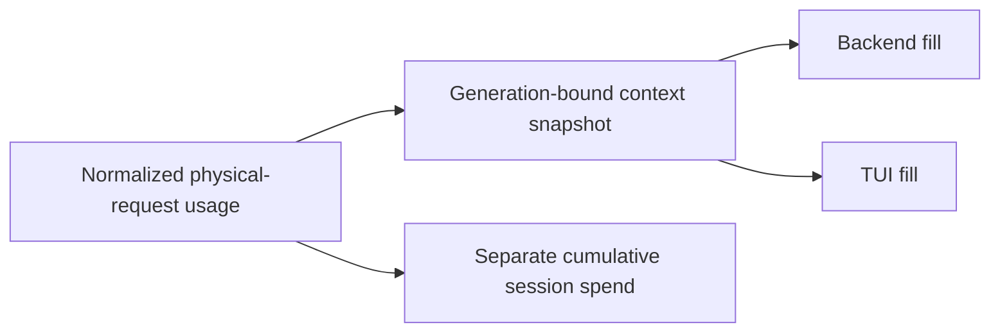

<!-- card: {"id":"CMPCT-067","type":"bug","priority":"P2","findings":"CB-16","dependsOn":["CMPCT-065","CMPCT-074"]} -->
# CMPCT-067: Compute every context-fill view from one request-generation basis

## Confirmation

**Confirmed mixed accounting bases; visible error depends on multisegment usage.**
`rust/cli/src/interactive/stream_loop.rs:1097` computes live fill from display
input and segment output. At `:1140`, final fill combines display input with
final output/reasoning, which may be aggregate. TUI recomputes from display counters
at `rust/fspec-tui/src/store/agent_view/token_state.rs:97`.
`rust/core/src/compaction/model.rs:163` also retains latest input plus cumulative
output/reasoning; those are not necessarily one request's occupancy.

## Acceptance criteria

- Define request, loop, session-spend and current-generation context snapshots;
  all context-fill producers/consumers use the same declared occupancy basis.
- Keep cumulative generated/billed tokens visible as separate metrics, never add
  prior-session generation to latest input as though it occupies one request.
- Unknown or post-commit estimated context is labeled with provenance; no stale
  aggregate or guessed percentage can authorize inference or claim successful fit.

## Regression scenarios

- Given multiple tool/internal continuation segments, when live and final fill
  update, then each uses the declared request/generation context rather than spend.
- Given Gemini continuation and Codex aggregate finals, when TUI and backend process
  the same snapshot, then their threshold-relative fill agrees within formatting.

## Coding notes

Use one context snapshot DTO with source/request/generation identity. Separate
absolute capacity from compaction-trigger percentage. Test raw fixture math,
stream events and reducer behavior, including event reordering and post-pin state.
CMPCT-074 repairs Codex's hook aggregate; this card owns cross-surface fill bases.

Mandatory companion: `00-shared-contract.md`. Research: CB-16 in
`compaction-research/compaction-bugs/03-accounting-and-presentation.md`.
