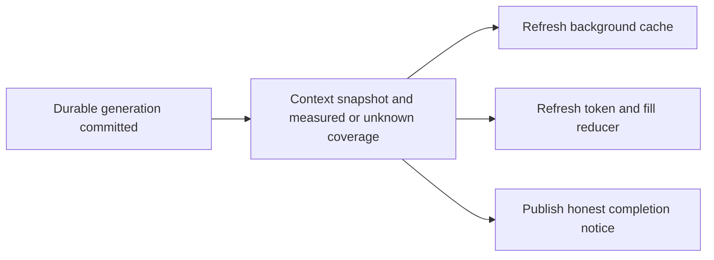

<!-- card: {"id":"CMPCT-068","type":"bug","priority":"P2","findings":"CB-17","dependsOn":["CMPCT-052","CMPCT-062","CMPCT-067"]} -->
# CMPCT-068: Refresh context state and honest coverage with committed compaction events

## Confirmation

**Confirmed producer/consumer event gap.**
`rust/agent-loop/src/inject_summary_handler.rs:292` recalculates inner tracker
state, but `:116` emits Running and CompactionComplete without ordinary token/fill
refresh, and `:123` hard-codes coverage to zero. The TUI completion handler at
`rust/fspec-tui/src/app/dispatch_compaction_complete.rs:46` updates progress/badge/
notice, not occupancy. A reduction notice can coexist with old full-looking counters.

## Acceptance criteria

- Publish committed generation, context/token/fill snapshot and compaction lifecycle
  coherently; update background caches and TUI without awaiting another provider call.
- Report durable coverage accurately or explicitly unknown, never hard-coded measured
  zero. Distinguish estimated counts and trigger fill from absolute model capacity.
- Rejected/uncommitted operations produce no success badge/completion; stale events
  cannot overwrite current counters. Post-commit notification failure reports the
  new commit identity for reconciliation, never rolls back or fabricates delivery.

## Regression scenarios

- Given a full-looking header, when a valid DAG commits, then header counters/fill
  refresh immediately with the same generation as the completion notice.
- Given unknown coverage or a failed commit, when events reach the reducer, then
  no fabricated zero coverage or successful compaction badge is shown.
- Given durable promotion followed by notification failure, when cold restore or
  explicit reconciliation runs, then the new generation survives without duplicate
  commit, stale header overwrite or a claim that completion was already delivered.

## Coding notes

Use one event contract/ordered projection rather than a TUI-only cosmetic reset.
Test background-output caches, reducers and notices. The historical 105% display
was trigger-relative, not proof of exceeding backend capacity; do not hide it by
clamping counters or taking absolute reduction values. Count preserved reminders
and whole-request overhead under the admission contract.

Mandatory companion: `00-shared-contract.md`. Research: CB-17 in
`compaction-research/compaction-bugs/03-accounting-and-presentation.md`.
