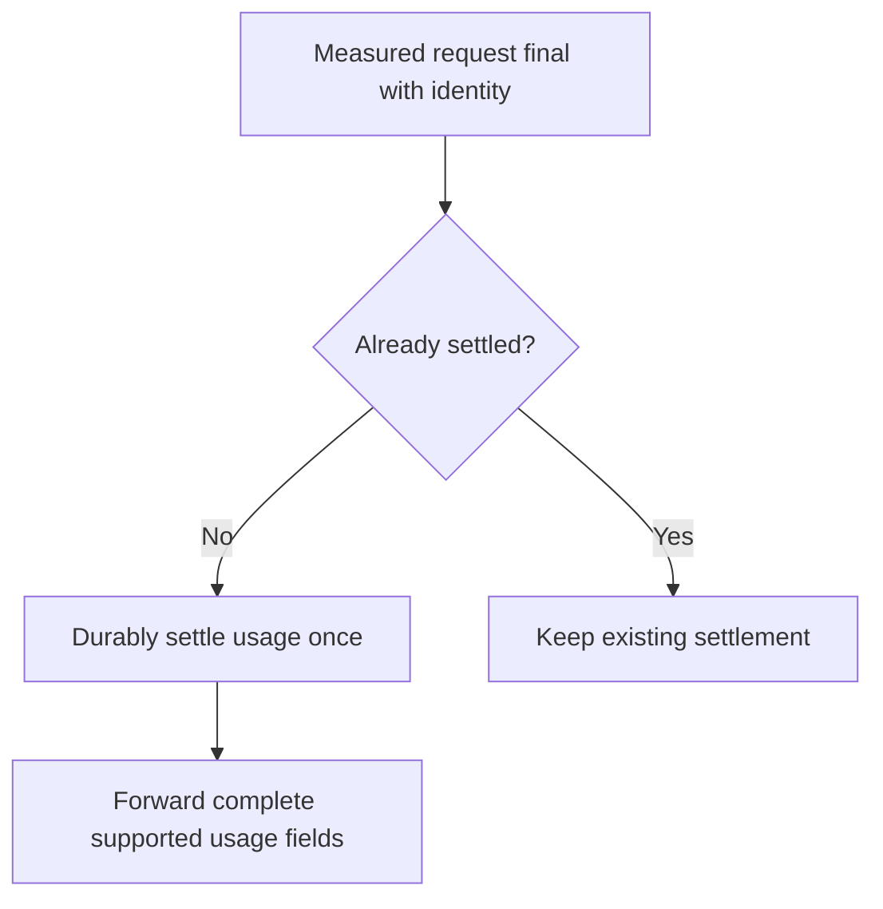

<!-- card: {"id":"CMPCT-069","type":"bug","priority":"P2","findings":"CB-18","dependsOn":["CMPCT-064","CMPCT-065"],"related":["RIG-011"]} -->
# CMPCT-069: Settle physical-request usage idempotently and preserve forwarded fields

## Confirmation

**Confirmed forwarding loss; settlement damage remains conditional.**
`rust/agent-loop/src/background_output.rs:475` persists cached counts on Done.
`rust/agent-loop/src/persist.rs:202` supplies zero cache details and no request ID.
`rust/core/src/persistence/manifest.rs:177` adds input/output to billed totals.
JSON TokenUpdate at `rust/agent-loop/src/stream_chunk_json.rs:96` omits reasoning
and cumulative billing fields supported by the typed event. Duplicate/missed billing
was not runtime-reproduced; a request ledger is the required stronger invariant.

## Acceptance criteria

- Settle measured usage by stable physical-request identity exactly once, separately
  from current context replacement; define retry, cancellation and failed-final policy.
- Preserve supported reasoning/cache/cumulative fields in bridge/subordinate JSON
  projection with explicit absent/unknown semantics.
- Duplicate Done, replayed events and compaction do not duplicate spend or invent
  missing usage; persistence failure is explicit rather than silent ledger success.

## Regression scenarios

- Given intermediate requests, retry and duplicate Done, when settlement runs,
  then each measured physical request is counted once and current context stays separate.
- Given a typed token event with reasoning/cache/billing values, when forwarded
  through JSON and restored, then every supported field survives unchanged.

## Coding notes

Use real store revisions and scripted request identities; do not derive spend
from an accumulated display counter. Snapshot JSON shape with insta and test
actual forwarding paths. CMPCT-064 owns manifest write isolation; coordinate its
transaction API rather than adding another independent whole-snapshot writer.

Mandatory companion: `00-shared-contract.md`. Research: CB-18 in
`compaction-research/compaction-bugs/03-accounting-and-presentation.md`.
