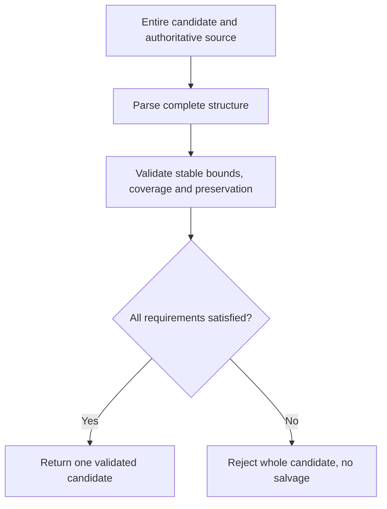

<!-- card: {"id":"CMPCT-070","type":"bug","priority":"P1","findings":"CB-19","dependsOn":[]} -->
# CMPCT-070: Validate whole DAG candidates in stable persisted coordinates

## Confirmation

**Confirmed coordinate and acceptance defects; historical bounds warnings observed.**
SessionSearch enumerates persisted records at
`rust/agent-loop/src/session_search_handler.rs:343`; deferred apply bounds metadata
by active message count at `rust/agent-loop/src/inject_summary_handler.rs:292`.
`rust/core/src/compaction/model.rs:459` recognizes opening tags, filters/clamps
metadata at `:508` and `:535`; apply still installs original text. Clean acceptance
at `rust/cli/src/compactor_sub_agent.rs:211` requires only some parsed metadata.

## Acceptance criteria

- Validate candidate syntax, closed bodies, supported attributes, stable source
  identities, declared coverage and required durable nodes before any replacement.
- Keep metadata and candidate text consistent; reject the whole malformed candidate,
  never clamp/drop bad nodes or accept a surviving subset. Preserve valid cross-depth overlap.
- All pending/direct/self/cross routes use one validator; invalid existing marked
  DAG is typed invalid-source, not invented zero coverage or fresh reconstruction.

## Regression scenarios

- Given persisted turns above active history length after prior compaction, when a
  valid persisted-range DAG is submitted, then its bounds are interpreted correctly.
- Given opening-only tags, mixed valid/bad nodes, invalid ranges or missing required
  coverage, when submitted through each route, then no replacement/completion occurs.

## Coding notes

Separate structural validation from semantic claims: a parser cannot prove every
fact is summarized. Enforce declared provenance and exact preservation obligations,
with scenario fixtures for known durable facts. Use proptest for range/hierarchy
rules and integration tests for installation veto. Remove `Some(..., 0)` recovery
in `rust/cli/src/compaction_dag.rs:156`; do not ban intentional hierarchical overlap.

Mandatory companion: `00-shared-contract.md`. Research: CB-19 in
`compaction-research/compaction-bugs/04-builders-and-convergence.md`.
